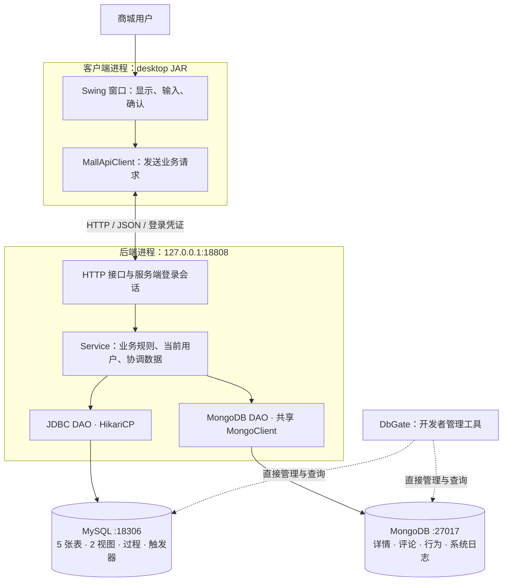

# 项目011 · 运动装备商城

以老师下发的《项目011_运动装备商城.docx》为验收依据；原件在工程上一级目录。本工程是正式大作业，沿用既有数据库，不重新初始化或导入覆盖用户数据。

当前版本：**0.2.0，2026-11-06**。窗口和后端分别运行，通过本机 HTTP 接口通信。普通商城用户只输入商城账号密码；MySQL 连接密码由启动后端的人提供。

仓库：[Gitee](https://gitee.com/Nisegitee/sports-mall) · [GitHub](https://github.com/Nisecata1/sports-mall)。每次提交后同步两个仓库，保留真实日期。

## 架构与职责



前后端分离体现为**不同进程、不同发行包、通过接口通信**。客户端包不含 JDBC/MongoDB 驱动、DAO、Service、后端类或 application.properties。SwingWorker 只负责避免网络请求卡住界面；业务规则仍由后端执行。两端共用 api/model 中的数据契约，不共享运行中的服务对象。

例如点击“资料与订单概览”：窗口发送 GET /api/me/overview → 后端从登录凭证查出本人身份 → AccountOverviewService 调用 DAO 查询两个视图 → 返回 JSON → 窗口显示。窗口不发送“我要查询哪个用户”的编号，也不直接执行 SQL。

这是本机课程版本：仅监听 127.0.0.1，使用 HTTP。后端当前沿用开发用 MySQL root 配置；公网部署前还需要 HTTPS、专用最小权限数据库账号等部署工作。本次不注册 Windows 服务，不配置开机启动。

## 第一次使用新版：操作、原理与架构位置

### 1. 保持已有数据库按需运行

MySQL：127.0.0.1:18306 / sports_mall；MongoDB：127.0.0.1:27017 / sports_mall。

**原理与位置：**这两个进程是存储层。DbGate、商城后端都连接它们；打开客户端不会自动启动数据库。沿用当前数据目录，已有表、订单、评论不重新初始化。

### 2. 构建两个程序

在含 pom.xml 的 sports-mall 工程目录执行：

```powershell
.\mvnw.cmd package
```

生成：

| 文件 | 用途 |
| --- | --- |
| target/sports-mall-0.2.0.jar | 独立后端，包含业务层、DAO 和数据库依赖 |
| target/sports-mall-0.2.0-desktop.jar | 独立商城窗口，只通过 HTTP 访问后端 |

**原理与位置：**Maven 编译同一源码工程并产生两种运行包。它们可以在同一台电脑分别启动；前后端分离不要求两个 Git 仓库。构建不导入 SQL、不改数据库。以后重新构建前退出运行中的新版窗口并停止新版后端，避免 JAR 占用。

### 3. 启动后端

双击工程根目录 **Start-Backend.cmd**，或在 PowerShell 7 执行：

```powershell
.\Start-Backend.ps1
```

按提示输入 MySQL 连接密码。看到“商城后端已启动：http://127.0.0.1:18808”后保持此窗口运行。

**原理与位置：**这一步启动独立业务后端，并建立数据库连接池及共享 MongoClient。连接密码只提供给这个进程，不保存到源码、脚本或永久环境变量。普通商城登录不会再次要求此密码。脚本不会自动安装数据库或系统服务。

如果本次终端已经设置 MALL_DB_PASSWORD，启动脚本会直接使用它。端口可通过 MALL_API_PORT 临时指定；不改变时使用18808。

### 4. 打开商城窗口

先关闭原来运行的旧版商城窗口，再双击 **Start-Mall.vbs**。终端等效命令：

```powershell
java -jar .\target\sports-mall-0.2.0-desktop.jar
```

只输入已注册的商城用户名、商城密码。窗口包含商品浏览、我的订单、商品评论、数据统计、我的账号。

**原理与位置：**这是表现层。MallApiClient 向后端发送 JSON；后端验证账号后签发随机登录凭证。凭证仅保存在客户端内存，用户编号和角色从后端会话确定。双击启动脚本还会清除子进程继承的 MALL_DB_PASSWORD 和 MALL_MONGO_URI。

后端地址默认 http://127.0.0.1:18808。更改后端端口时，在启动客户端的同一终端临时设置 MALL_API_URL。客户端地址仅允许 localhost 或127.0.0.1。

### 5. 首次手操验收

进入“我的账号”→“资料与订单概览”，查看当前已有账号、订单状态与金额；这个操作只读数据。现有历史示例为订单总数1、已取消1、已完成金额0.00，后续实际操作会使结果变化。

**原理与位置：**这个操作串起窗口、HTTP、会话、Service、DAO 和 MySQL 视图。2026-11-06 用户已经确认旧窗口的主库概览及两个 INVOKER 视图正常；新版分离结构已通过隔离实库检查，新版主库窗口仍需用户手操确认。

### 6. 结束使用

右上角“退出登录”让后端注销本次凭证；关闭窗口不会关闭后端。后端窗口按 Ctrl+C 才停止后端并释放连接池。数据库仍按原有方式自行关闭。

**原理与位置：**客户端、业务后端、数据库是不同进程，生命周期相互独立。后端重启后原有登录凭证失效，重新登录即可；数据库记录保留。

## 业务接口

需要身份的接口使用 Authorization: Bearer 加随机凭证。凭证8小时到期，退出登录即失效。服务端不接受用户传入 user_id/role 决定本人身份。

| 方法与路径 | 目的 |
| --- | --- |
| GET /api/health | 后端存活与版本 |
| POST /api/auth/register、/api/auth/login、/api/auth/logout | 注册、登录、退出 |
| GET /api/me；PATCH /api/me/phone | 本人资料、修改电话 |
| GET /api/me/overview | 读取资料与订单汇总视图 |
| GET /api/items | 在售商品 |
| POST /api/orders；GET /api/orders | 按当前报价下单、本人状态/日期筛选 |
| POST /api/orders/{id}/cancel | 取消本人待处理订单 |
| GET /api/items/{id}/comments；POST 同路径 | 最新20条评论、发表评论 |
| GET /api/items/{id}/comment-statistics | 全部评论聚合 |
| POST /api/browses；POST /api/browses/{id}/finish | 打开、结束一次浏览 |
| GET /api/statistics/hot-items；GET /api/me/activity | 近7天排行、本人报告 |

业务价格、账号状态、订单归属等仍在后端校验。报价变化会拒绝下单，订单保存历史金额；取消仍经 JDBC 调用 sp_cancel_order。浏览凭证由后端关联本人和商品，时长在后端计量，同一凭证只能结束一次。MongoDB 文档来源继续记录 DESKTOP。

请求大小上限32KiB；请求采用 JSON；不支持的字段、非法编号、错误日期会被拒绝。接口返回中文错误与代码，不把连接密码、密码哈希或原始数据库异常返回窗口。401表示需要重新登录；503或网络中断时，写入结果可能未确认，应先查询实际数据，不连续重试。

## 已完成与待完成

已完成：MySQL五表及商品单价、MongoDB四集合、注册登录、本人电话、事务下单/筛选/取消、评论读写、浏览行为、三条业务聚合、两个视图、两个触发器脚本、一个取消过程、桌面窗口、独立HTTP后端。

用户此前已经手操确认注册、登录日志、下单取消与日期筛选、评论、三类统计。2026-11-06又确认主库两个视图的 INVOKER 设置与窗口概览。窗口改造继续使用同一批数据。

**尚未完成整份作业：**第二存储过程及月报、管理员权限与完整CRUD、用户档案维护、分类树/商品维护、多条件分页、MongoDB完整修改删除、统一审计、规定的数据配额、性能/并发/故障实测、最终测试报告与答辩材料等仍需按老师要求推进。要求书中的 JDBC 批处理与 MongoDB 日志导入表述需要结合正式场景落实，不虚构 MongoDB JDBC。

## 当前验证证据

2026-11-06：

- Maven package成功；178项JUnit，0失败、0错误。
- 38项真实HTTP/临时MySQL8.4.13/MongoDB8.0.34检查通过：正常流程、跨用户隔离、报价校验、取消过程、评论与三类统计、视图、登录注销、错误请求、重复浏览等。
- 独立客户端子进程在没有数据库密码和驱动时，通过真实HTTP读取商品与本人概览。
- 前端JAR扫描确认没有数据库驱动、后端Service/DAO或数据库配置。
- 隔离探针源码见 src/test/java/com/sportsmall/integration；运行前验证临时数据目录，拒绝课程主端口18306/27017，运行后临时实例已停止并清理。
- 隔离验证与用户主库验收分别记录，不把自动检查等同于新版主库窗口已由用户操作。

## 工程与课程交付

| 位置 | 作用 |
| --- | --- |
| src/main/java/com/sportsmall/desktop、client | 窗口与HTTP客户端 |
| src/main/java/com/sportsmall/api、model | 两端共用的数据契约 |
| src/main/java/com/sportsmall/server | 后端启动、HTTP路由、会话与资源组装 |
| src/main/java/com/sportsmall/service、dao | 复用的业务层与数据访问层 |
| src/main/resources/application.properties | 后端地址配置，无数据库密码 |
| src/main/resources/sql | 建表、视图、触发器、过程与Mongo初始化脚本 |
| src/test/java | JUnit与显式隔离集成探针 |
| docs/*.pdf | 按要求逐步完善的正式文档 |
| target | 本机构建产物，不提交Git |
| Start-Backend.cmd / .ps1、Start-Mall.vbs | 按需启动后端、窗口 |

[技术设计文档](docs/技术设计文档.pdf) · [用户手册](docs/用户手册.pdf) · [需求规格说明书](docs/需求规格说明书.pdf)

现有 Main/cli 代码保留早期学习过程的入口，但新版产品启动以本页的两个程序为准。历史实现和操作记录可通过Git查看，不再按旧版本命令启动。

本地 docs/需求对照与进度.md、需求规格说明书.md、历史素材为过程材料，不计入本次提交。依照课程交付清单选择成品，不添加提交说明或额外压缩包。

## 提交到两个仓库

```powershell
git push origin main
git push github main
```

使用当前真实日期和明确的功能提交说明，不补造过去的每日提交。

技术参考：[JDK HttpServer](https://docs.oracle.com/en/java/javase/17/docs/api/jdk.httpserver/com/sun/net/httpserver/HttpServer.html)、[JDK HttpClient](https://docs.oracle.com/en/java/javase/17/docs/api/java.net.http/java/net/http/HttpClient.html)、[Gson](https://github.com/google/gson)。HTTP服务与客户端使用JDK17内置API，未改为ORM，保留课程要求的JDBC、DAO和手动事务。
