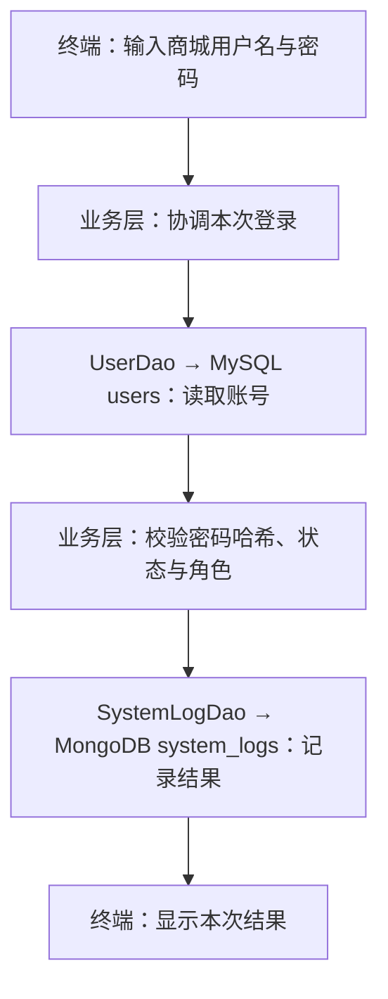
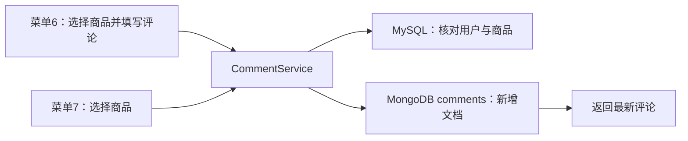
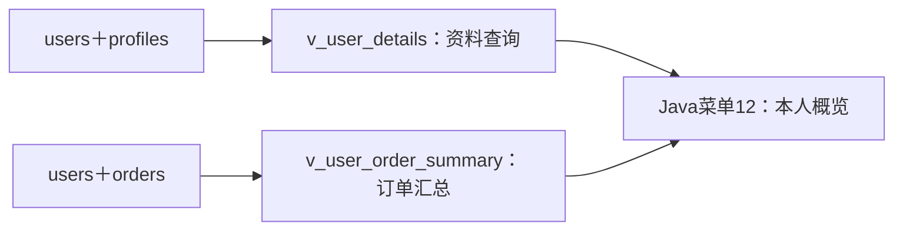

# 项目011 · 运动装备商城

这是老师指定的运动装备商城正式工程。后续仅在此 sports-mall 目录持续开发，已有数据库和源码继续使用。

本工程以《项目011_运动装备商城.docx》为课程验收依据，用户明确确认的业务补充另行标明。原始要求书在本地工程的上一级目录，不随源码仓库上传；项目要求书列出的需求、设计、性能、测试、用户手册、总结和答辩材料均按本项目清单推进。

Gitee 仓库：[Nisegitee/sports-mall](https://gitee.com/Nisegitee/sports-mall)。2026-10-27 已上传首个版本 `1eed789`，默认开发分支为 `main`。

需求基线：[需求规格说明书 PDF](docs/需求规格说明书.pdf)。本地同名 Markdown 为编辑源稿；PDF 是老师规定的交付格式。需求文档描述目标功能，不表示这些功能均已实现。

## 本轮目标

已完成 MySQL 五张基础表及商品单价迁移，训练篮球单价为100.00。2026-10-30用户已手操创建MongoDB的item_details集合和item_id唯一索引，并新增、读回训练篮球的Long类型编号1详情。同日16:54:39，用户运行本工程JAR，已实际确认MySQL商品、单价、分类与MongoDB说明、语言和空图片列表组合显示正确。默认商品查询入口只读取已有记录；建库与初始化脚本须按部署步骤另行执行。

用户随后已确认MongoDB四集合齐全，文档数为item_details=1，其余三集合=0。2026-10-31，用户通过register命令成功创建mall_user01，Java返回编号1；MySQL回读确认user_id=1、role=USER、status=1、password_hash以pbkdf2_sha256开头。这确认了注册正常流程，重复账号等真实数据库分支仍待后续验收。注册固定USER/status=1，不自动生成管理员、不填写档案，也不执行初始化脚本；默认无参数入口仍查询商品。

2026-10-31用户已通过login命令成功登录mall_user01，并在MongoDB读回登录文档：user_id=Long('1')、LOGIN/INFO、LOGIN_SUCCESS、来源127.0.0.1、timestamp=2026-10-31T08:31:23.637Z。该时间与终端北京时间16:31:23一致。这确认了MySQL账号校验和MongoDB登录日志写入的正常流程，异常分支仍需后续集成验证。登录里程碑416155f已推送Gitee。

2026-10-31用户已在登录后菜单查看本人账号，并于16:45:01把编号1的电话从未填写改为演示号码010-12345678；程序从MySQL读回新电话，USER角色及正常状态一致，随后正常退出。本人资料查询与电话修改的正常流程已确认，并以b0e6376推送Gitee；清空及异常分支仍待后续集成验证。

2026-10-31用户于17:19:42登录，17:19:51经菜单3创建订单1：用户1、商品1训练篮球、金额100.00、待处理、数据库时间2026-10-31 17:19:51；随后菜单4从MySQL重新查询到同一订单，再正常退出。由此确认事务下单和本人订单查询的正常流程；真实回滚、价格变化和并发等分支继续补齐。55项单元测试已通过。这是正式工程的阶段版本，其他用户字段、完整权限、档案、商品维护、订单筛选/状态转换、评论和统计等继续推进；本地核对笔记docs/需求对照与进度.md不随源码仓库上传。

已接入菜单5取消本人待处理订单，新增两个订单触发器与sp_cancel_order存储过程的安装脚本。62项JUnit及21项隔离MySQL集成断言通过。用户于2026-11-01实操，23:47:56成功取消订单1，菜单4重新查询也显示已取消；金额仍100.00、创建时间仍2026-10-31 17:19:51。这确认主库取消过程及JDBC调用正常；尚未提供主库两个触发器的元数据输出，不将取消成功等同于两者定义均已核验。课程存储过程至少2个，目前第1个取消过程已使用，月报过程后续补齐。

订单查询筛选已按要求书4.1接入菜单4，支持状态及创建日期组合，各项可留空。73项JUnit与28项隔离SQL/JDBC断言通过。用户于2026-11-03登录后查询“已取消2、2026-10-31至2026-10-31”，实际读回订单1及历史金额100.00；改查同日期的“待处理0”得到无匹配记录，再正常退出。由此确认新版筛选的正常匹配与空结果流程。

评分与文字评论已接入菜单6，菜单7按商品查看最新20条。用户于2026-11-03 11:58:23为商品1保存评论6ae95bdfba7016eb80e6f916：用户1、5分、文字“这是一条课程项目演示评论。”、标签训练/篮球；随后菜单7读回相同评论编号及内容，确认正常写入与查询。评论版本c2e6bb2已推送。

菜单8评论聚合已由用户于2026-11-03 13:47:23实操确认：商品1评论数1、平均5.00/5、5分1条，其余评分0条；商品编号留空返回菜单的流程也正常。该功能是课程至少3条业务聚合管道中的第1条。

菜单9浏览及菜单10排行已于2026-11-03由用户实操确认：14:05:40为用户1/商品1保存行为6ae979b446c0e4bd00264a05，停留5秒；随后近7天排行显示训练篮球1次、累计5秒。浏览及排行版本c901314已推送。

菜单11本人活动报告已于2026-11-03 14:55:40实操确认：用户1近7天浏览1次、不同商品1、活跃日期1、停留5秒，最近浏览时间14:05:40。评论、热门排行、用户活动报告三条业务管道均已有主库正常执行证据。完整CRUD、视图/月报、数据量、性能及正式文档继续补齐。

本轮准备两个MySQL视图及菜单12“我的资料与订单概览”：资料视图关联users/profiles，订单汇总视图按用户统计各状态数量和已完成金额。169项JUnit和14项隔离MySQL视图检查通过，新版JAR已构建；用户主库须先安装mysql_views.sql，再手操菜单12。五张业务表继续作为原始数据来源。

## 1. 当前正式工程目录

当前工程已统一放在课程目录的“9-期末大作业_运动装备商城/sports-mall”中。终端与IDE均使用这一份工程。PowerShell可执行：

```powershell
cd "C:\Users\ndir\OneDrive\Laplas_OneDrive\GradResearchHub\浙大城院文件\_上课-课程作业\高级数据库技术\9-期末大作业_运动装备商城\sports-mall"
```

当前目录结构为：

```text
sports-mall
  pom.xml
  mvnw.cmd
  .mvn\wrapper\maven-wrapper.properties
  src\main\java\com\sportsmall\...
```

此 README 与 `pom.xml` 所在位置就是工程根目录。后续构建、运行和 Git 命令均在本 sports-mall 内执行；上级目录整理后沿用现有工程，不重新解压或初始化。老师的项目要求书与本工程并列存放，文档使用相对链接。

历史商品页面草稿保存在 `docs/历史素材/商品页面草稿.html`。草稿尚未接入后端，不计作已完成的业务界面，不影响当前程序；最终提交时只按要求选取成品。

老师的环境表列出 IntelliJ IDEA / Eclipse。现在先通过 PowerShell 确认工程能运行，随后在 IDE 中打开同一个 `pom.xml`、使用相同 JDK 与 Wrapper，不另建一份重复项目。

## 2. 检查工程自己的 Maven

保留 MySQL 服务窗口，在新的 PowerShell 7 窗口执行：

```powershell
# 在当前 sports-mall 工程根目录执行
.\mvnw.cmd -v
```

首次运行会获取工程固定的 Maven 3.9.16，以后复用缓存，不需要另行安装全局 `mvn`。

**原理：**Wrapper 固定构建工具版本；`pom.xml` 声明工程依赖；JDK 执行编译和运行。这一步不连接数据库。

**预期：**输出 Maven 3.9.16、Java 21 和 JDK 路径。

## 3. 编译、打包正式工程

若当前Java程序仍在登录后菜单，先输入0退出，再构建及启动新版。JAR是编译后的程序包，运行中的旧进程不会自动加载源码改动；Windows可能因文件占用而拒绝替换JAR。数据库服务窗口继续保留。

```powershell
.\mvnw.cmd package
```

第一次会获取数据库驱动、HikariCP、日志组件等依赖。成功时显示 `BUILD SUCCESS`，并生成：

```text
target\sports-mall-0.1.0.jar
```

**原理：**将 Java 源码编译，并将运行所需的库打进可执行 JAR。构建成功说明程序已准备好，实际数据库连接在下一步验证。

## 4. 输入你自己的 MySQL 密码，读取两库中的真实商品

保留MySQL与MongoDB服务端窗口：MySQL监听本机18306，MongoDB监听本机27017。MySQL默认账号是你已验证过的root，密码不放入源码；MongoDB沿用你当前本机连接配置。

在刚才同一 PowerShell 中执行：

```powershell
$env:MALL_DB_PASSWORD = Read-Host "输入你自己设置的 MySQL 密码" -MaskInput
java -jar .\target\sports-mall-0.1.0.jar
```

输入时显示星号。密码只传给这个终端运行的程序，不写入项目文件或永久环境变量。关闭终端后，下次需重新输入。

**原理：**MySQL的ItemDao读取商品、十进制单价和分类，MongoDB的ItemDetailDao读取同一item_id的说明、图片和语言，CatalogService组合两份结果，Main负责显示。MongoClient在本次程序运行内复用，并在程序结束时关闭。

若数据库仍保留你前面录入的数据，预期类似：

```text
连接成功：MySQL 8.4.13 / sports_mall
连接成功：MongoDB / sports_mall
商品编号 | 商品名称 | 单价（元） | 分类编号 | 分类名称
1 | 训练篮球 | 100.00 | 1 | 球类
  商品说明：训练用篮球，适合日常运球与投篮练习。
  内容语言：zh-CN
  商品图片：暂无图片
共读取 1 条商品。
```

用户已于2026-10-30实际运行并确认上述组合输出，商品编号1、单价100.00、说明、zh-CN语言与“暂无图片”均匹配两库记录；以后输出以实际数据库为准。某商品没有详情时显示“尚未填写”；MongoDB连接或字段类型错误时提示错误，不冒充详情不存在。缺失和连接失败等分支仍需后续集成验证。

如果中文显示成“杩炴帴鎴愬姛”或“�̳��û�”等乱码，先按Ctrl+C退出正在等待输入的Java程序，回到PS提示符，再在同一个PowerShell中对齐终端编码并重新运行：

```powershell
chcp 65001
[Console]::InputEncoding = [System.Text.UTF8Encoding]::new($false)
[Console]::OutputEncoding = [System.Text.UTF8Encoding]::new($false)
$OutputEncoding = [Console]::OutputEncoding
java -jar .\target\sports-mall-0.1.0.jar
```

注册时把最后一行改为java -jar .\target\sports-mall-0.1.0.jar register。65001是UTF-8代码页；InputEncoding/OutputEncoding对齐控制台读写，$OutputEncoding对齐PowerShell向外部程序传递文本的编码。Java的Console与System.out使用各自的输出路径，Main中固定System.out为UTF-8并不自动改变Console的编码；因此应在启动Java之前完成设置，不能只设置普通输出。此操作属于终端交互层，让用户名、邮箱和提示文字在键盘、Java和屏幕之间正确传递，不改变注册规则或数据库结构，也不需要重新编译。新终端应重新设置编码及MALL_DB_PASSWORD。

官方说明：[Java Console.charset()](https://docs.oracle.com/en/java/javase/21/docs/api/java.base/java/io/Console.html#charset())、[Windows chcp](https://learn.microsoft.com/en-us/windows-server/administration/windows-commands/chcp)。


## 当前关键文件

| 文件 | 项目作用 |
|---|---|
| `pom.xml` | 固定依赖和构建设置 |
| `.mvn/wrapper/maven-wrapper.properties` | 固定 Maven 版本 |
| `src/main/resources/application.properties` | 数据库地址、账号和连接池配置 |
| `src/main/java/com/sportsmall/Main.java` | 当前入口 |
| `src/main/java/com/sportsmall/dao/ItemDao.java` | 从 MySQL 读取商品、单价与分类，用 getBigDecimal 取价 |
| `src/main/java/com/sportsmall/model/ItemView.java` | 用 BigDecimal 携带单价等一条查询结果，不是数据库表 |
| `src/main/java/com/sportsmall/config/MongoConfig.java` | 读取MongoDB配置，创建可复用的MongoClient并限制连接等待时间 |
| `src/main/java/com/sportsmall/dao/mongo/ItemDetailDao.java` | 按item_id读取MongoDB详情，检查BSON编号、数组及嵌套字段的类型 |
| `src/main/java/com/sportsmall/model/ItemDetail.java` | Java中的商品扩展详情，不重复保存MySQL价格或分类 |
| `src/main/java/com/sportsmall/service/CatalogService.java` | 按同一个商品编号组合两库结果；详情缺失与读取失败分别处理 |
| `src/main/java/com/sportsmall/cli/RegisterCommand.java` | 终端注册入口，收集输入并隐藏密码，显示账号摘要 |
| `src/main/java/com/sportsmall/service/UserRegistrationService.java` | 注册业务层：输入与确认密码校验、生成密码哈希，再调用DAO |
| `src/main/java/com/sportsmall/dao/mysql/UserDao.java` | 用PreparedStatement保存普通账号、按用户名读取登录凭据，处理唯一键冲突 |
| `src/main/java/com/sportsmall/util/PasswordHasher.java` | JDK的PBKDF2加盐密码哈希与校验，供注册及后续登录复用 |
| `src/main/java/com/sportsmall/cli/LoginCommand.java` | 本机登录入口，隐藏密码，管理两库连接及显示登录结果 |
| `src/main/java/com/sportsmall/cli/AccountMenu.java` | 登录后菜单，账号、订单及商品评论入口 |
| `src/main/java/com/sportsmall/cli/CommentMenu.java` | 评论交互入口，选商品、填写评分文字标签、确认保存及查看最新评论 |
| `src/main/java/com/sportsmall/service/CommentService.java` | 从当前身份取用户编号，校验评分/文字/标签并核对MySQL商品，再协调MongoDB读写 |
| `src/main/java/com/sportsmall/dao/mongo/CommentDao.java` | comments写入确认、BSON类型映射，按商品及时间/_id倒序读最新记录 |
| `src/main/java/com/sportsmall/model/CommentView.java` | 一条评论的显示对象，含评论编号、两库引用、评分、标签及时间 |
| `src/main/java/com/sportsmall/service/StatisticsService.java` | 协调评论汇总、近7天浏览排行及本人活动报告，限定身份与时间窗口 |
| `src/main/java/com/sportsmall/model/CommentStatistics.java` | 一份商品评论汇总结果；无评论时平均分为空，评分分布按1至5分排列 |
| `src/main/java/com/sportsmall/cli/BrowsingMenu.java` | 浏览详情、测量本次页面停留及显示热门排行 |
| `src/main/java/com/sportsmall/service/BrowsingService.java` | 核对身份/商品、组合两库详情，结束时保存同一用户的VIEW行为 |
| `src/main/java/com/sportsmall/dao/mongo/ActionLogDao.java` | 写action_logs；聚合浏览排行及按用户去重的活动报告 |
| `src/main/java/com/sportsmall/model/ActionLogView.java` | 一次已确认保存的浏览行为摘要 |
| `src/main/java/com/sportsmall/model/HotItemStatistics.java` | 时间窗口内每件商品的浏览次数和累计停留秒数 |
| `src/main/java/com/sportsmall/model/UserActivityStatistics.java` | 一名用户的浏览总量、商品/日期去重数量及最近浏览时间 |
| `src/main/java/com/sportsmall/service/UserAccountService.java` | 用已登录身份限定本人记录，校验电话、检查账号状态并协调保存与回读 |
| `src/main/java/com/sportsmall/model/UserAccount.java` | 用户可显示资料，不查询或携带密码哈希 |
| `src/main/java/com/sportsmall/dao/mysql/AccountOverviewDao.java` | 用PreparedStatement按本人编号读取两个MySQL视图 |
| `src/main/java/com/sportsmall/service/AccountOverviewService.java` | 校验当前身份、概览归属、订单数量及已完成金额口径 |
| `src/main/java/com/sportsmall/model/AccountOverview.java` | 本人资料与订单汇总的Java显示对象 |
| `src/main/java/com/sportsmall/service/OrderService.java` | 用登录身份协调商品选择、创建订单及本人订单查询 |
| `src/main/java/com/sportsmall/dao/mysql/OrderDao.java` | 同事务检查用户/商品及价格、保存订单金额，按本人编号查询订单 |
| `src/main/java/com/sportsmall/util/JdbcTransactions.java` | 显式setAutoCommit(false)、成功commit、异常时尝试rollback并关闭连接 |
| `src/main/java/com/sportsmall/model/OrderableItem.java` | 下单前展示的商品报价 |
| `src/main/java/com/sportsmall/model/OrderView.java` | 订单显示对象，金额来自orders.amount历史记录 |
| `src/main/java/com/sportsmall/model/OrderFilter.java` | Java中的订单状态和创建日期条件，结束日期转为次日零点之前；不是新数据库表 |
| `src/main/java/com/sportsmall/service/UserLoginService.java` | 协调账号核验、状态检查与登录日志，不把连接故障当成密码错误 |
| `src/main/java/com/sportsmall/model/LoginAccount.java` | 业务层内部凭据，覆盖默认toString以免输出哈希 |
| `src/main/java/com/sportsmall/model/AuthenticatedUser.java` | 本次核验通过的用户身份，不携带密码或哈希 |
| `src/main/java/com/sportsmall/dao/mongo/SystemLogDao.java` | 将登录结果写入system_logs，Long编号、BSON日期及嵌套操作信息 |
| `src/test/java/com/sportsmall/dao/mongo/ItemDetailDaoTest.java` | 检查真实BSON类型映射的边界，不连接或修改数据库 |
| `src/main/resources/sql/mysql_schema.sql` | 五表目标结构，供新数据库使用；现有表不会被 IF NOT EXISTS 自动改成新结构 |
| `src/main/resources/sql/mysql_views.sql` | 安装/更新v_user_details及v_user_order_summary两个视图，保持原始记录 |
| `src/main/resources/sql/mysql_triggers.sql` | 两个订单触发器：校验新增订单，保护后续状态及历史字段；须在商城库安装 |
| `src/main/resources/sql/mysql_procedures.sql` | 当前含首个sp_cancel_order过程，由Java主动调用，事务由JDBC管理；月报过程待补 |
| `src/main/resources/sql/mysql_migrate_001_item_price.sql` | 现有商品表补单价的分步迁移，检查后执行一次；不是初始化数据脚本 |
| `src/main/resources/sql/mongodb_init.js` | mongosh阶段性脚本：四集合、首批查询索引及一条商品详情；完整测试数据、聚合和业务写入仍待补齐 |
| `docs/需求规格说明书.pdf` | 老师要求的需求规格交付物，V0.1需求基线 |
| `docs/MySQL_E-R图.png` | 五张表的关系设计，已与用户提供的实际建表结果核对一致 |
| `docs/MongoDB集合设计.pdf` | Day2要求的四集合目标设计，含字段类型、嵌套与引用、索引与三项聚合口径；设计文档不代表全部已部署 |
| `docs/需求对照与进度.md` | 本地内部核对笔记，不替代正式需求文档 |

## 哪些属于课程工程，哪些只是辅助文件

“老师没有逐个指定文件名”不等于“文件多余”。课程要求的功能、配置、日志、异常处理和构建，需要由具体源码与配置文件实现。

| 当前文件／目录 | 与要求的关系 | 保留与提交方式 |
|---|---|---|
| `src/`、`pom.xml`、`README.md` | 要求书第六节工程结构中的源码、构建配置和说明；当前只有首版内容 | 保留，随最终源码提交；继续补齐功能和脚本 |
| `.gitignore` | 要求书第五节要求正确配置忽略规则 | 保留，随 Git 仓库提交 |
| `mvnw`、`mvnw.cmd`、`.mvn/wrapper/` | 本工程选用的 Maven Wrapper；老师要求 Maven，没有强制 Wrapper | 保留，随源码提供，便于别人用同一版本构建 |
| `docs/需求对照与进度.md` | 本会话添加的核对笔记，不是老师要求的“需求规格说明书” | 开发时保留，最终提交默认不含此笔记 |
| `docs/需求规格说明书.pdf` | 老师明确要求的需求规格说明书 | 随源码提交至 Gitee，最终按课程要求交付 |
| `docs/MySQL_E-R图.png` | 老师明确要求的 MySQL E-R 图片 | 五表结构已落实并核对，随本轮源码提交；后续结构变更时同步维护 |
| `docs/MongoDB集合设计.pdf` | 老师明确要求的四集合设计文档 | V0.1五页PDF已生成并逐页核对；随后续正式源码提交，实施证据另行记录 |
| `docs/需求规格说明书.md` | PDF 的本地可编辑源稿 | 本轮提交只选 PDF；源稿在本地保留，不自动进入最终提交包 |
| `docs/历史素材/商品页面草稿.html` | 旧页面草稿，不是已完成界面，也不是规定交付物 | 当前仅归档，最终提交排除未采用草稿 |
| `target/` | Maven 自动生成的编译文件及 JAR | 可重新构建，已由 `.gitignore` 排除，不随源码提交；当前运行仍使用其中的可执行 JAR |

最终从本 sports-mall 工程整理规定交付物。老师的选题原始资料、本地核对笔记和未采用草稿不自动进入提交压缩包。

## 接下来按要求推进

1. 对应 Day1：Git/Gitee 首版及需求 PDF 均已提交并成功上传，需求 PDF 对应提交为 `8ae73f5`。教师交付与检查按课程安排。
2. 对应 Day2：五张 MySQL 表及 E-R 图已核对并上传；继续四个 MongoDB 集合的设计与实际落实，已有数据库继续使用。
3. 对应 Day3：补齐 MySQL DDL 与 MongoDB 初始化脚本，在设计明确后按步骤执行。
4. 继续真实业务功能：完善商品的录入、修改、删除和查询，再接入 MongoDB 详情、多条件查询与分页。此后按要求补其他模块、视图、存储过程、触发器、测试与项目文档。

要求书的 Day 是阶段标记，不在此推断实际截止日期；开发期间持续保留真实 Git 提交。IDE 使用 IntelliJ IDEA / Eclipse 打开当前工程，不另建项目。

## 五表设计与本轮手操

[MySQL E-R 图](docs/MySQL_E-R图.png) 展示目标结构：分类与商品、用户与订单、商品与订单均为一对多；用户与档案为一对零或一，分类有可空的上级分类。users 的外键引用将写在 orders、profiles 表中，users 本身无需为此增加外键。

用户已确认 categories、items、users、profiles、orders 五张基础表。训练篮球 price=100.00，price 必填且大于零；orders 的两个外键、金额正数与状态范围约束已通过实际 SHOW CREATE TABLE 核对。注册、下单等业务仍待后续实现，建表不等同于完整业务完成。

users 记录商城用户，与 MySQL 的 root 账号不同。本工程约定用户名、邮箱、密码哈希必填，用户名和邮箱分别唯一；电话可不填；注册默认 USER；status 取 1 正常、0 停用。NOT NULL 不负责判断空字符串，相关输入校验在后续 Java 注册流程实现。现在先建空表，密码哈希以后由 Java 生成。

profiles.user_id 同时使用 NOT NULL、UNIQUE 和外键，分别保证档案必须有归属、同一用户至多一份、归属用户真实存在。用户可尚未填写档案，此时 profiles 中没有该用户的行。姓名等资料暂允许 NULL，后续按档案编辑流程逐项填写。已有档案引用时，数据库拒绝直接删除用户；账号停用按需求约定处理。可通过 SHOW CREATE TABLE profiles 查看完整外键定义，而不是仅凭 DESCRIBE 的 Key 列判断有无外键。

orders.user_id、item_id 都是必填外键，分别引用用户和商品；同一用户或商品可以出现在多笔订单里，所以这里不加唯一约束。外键不会自动复制商品价格；将来由 Java 下单流程把成交金额写入 amount，检查用户、商品状态并控制订单状态转换。

用户已完成旧库补单价：先增加可空 price，再给训练篮球（编号1）填入 100.00 演示价，invalid_prices=0 后设为必填且大于零。该迁移已完成，不重复执行；今后新增商品必须提供单价，旧的“不含 price 的商品 INSERT”不再适合作为录入步骤。

新库执行 mysql_schema.sql 建完整结构；有旧版商品表的库才使用 mysql_migrate_001_item_price.sql 迁移。两者用途不同，CREATE TABLE IF NOT EXISTS 不会给现有表自动补列。本机已完成相关结构修改，本轮补 Java 查询与显示单价；注册、下单等仍待后续实现。

## 本轮 Java 单价链路

items.price → ItemDao 查询及 getBigDecimal 映射 → ItemView.price → Main 打印。数据库新增列后，需要显式补齐查询字段、Java结果对象和显示位置。SQL DECIMAL 对应 Java BigDecimal，全程不转换为 double；输出保持两位小数。

单价查询与两库组合代码已通过构建，用户已于2026-10-30实连并确认组合展示。工具端未使用用户密码访问数据库，实连证据来自用户终端输出；单元测试和编译结果分别记录。

课程要求使用 IntelliJ IDEA / Eclipse。可以从 [IntelliJ IDEA 官网](https://www.jetbrains.com/idea/download/?section=windows) 安装，核心 Java 功能免费；安装位置与项目源码目录各自独立。通过 Open 选择当前工程的 pom.xml，按 Open as Project 打开，沿用已有工程。项目 SDK 选择已安装的 Temurin JDK21；Maven 使用工程 Wrapper。查看 ItemDao、ItemView、Main 三处改动，再在现有 PowerShell7 构建运行，密码环境变量属于该终端的进程环境。

## MongoDB 商品详情：本轮手操

2026-10-29用户已通过mongosh连接MongoDB8.0.34；2026-10-30用户完成以下创建、索引、插入与读回操作，首条详情_id为6ae36d3bc7e97e0b414a5658、item_id为Long('1')。本节保留操作记录，已完成的本机步骤不重复执行；新环境再按顺序初始化。MongoDB中的同名数据库与MySQL分别存储，由Java按商品编号关联。

[MongoDB集合设计PDF](docs/MongoDB集合设计.pdf)记录四集合的目标结构、索引及聚合口径。这是Day2设计交付物；本轮手操先落实其中一条商品详情，尚不等于四集合部署及完整业务完成。

### 1. 创建商品详情集合

```javascript
use sports_mall
db.createCollection("item_details")
```

集合组织同类文档，一条文档表示一件商品的一整份详情。createCollection执行成功后，库和空集合实际存在；只执行use只是选定数据库名称。这里没有为每个字段建表，字段随下一步文档保存。

### 2. 限定每个商品至多一份详情

```javascript
db.item_details.createIndex(
  { item_id: 1 },
  { name: "uq_item_details_item_id", unique: true }
)
```

unique限制item_id不重复，实现本工程的一商品一详情规则。索引定义中的1表示升序，不是商品编号。该索引不检查MySQL中商品是否存在；训练篮球编号1来自已经确认的MySQL记录，后续Java录入时还需检查跨库关联。

### 3. 保存训练篮球的详情

```javascript
db.item_details.updateOne(
  { item_id: Long("1") },
  {
    $setOnInsert: {
      description: "训练用篮球，适合日常运球与投篮练习。",
      images: [],
      metadata: { language: "zh-CN" }
    }
  },
  { upsert: true }
)
```

这段指令按item_id找详情；没有时插入，有时保留，重复粘贴不会新增另一份或覆盖之后编辑的内容。Long明确保存64位整数，与MySQL的BIGINT对应；不是把编号保存为字符串。description为说明文字，images为图片列表（目前没有真实图片，先为空），metadata为嵌套对象，language为其中的语言标记。此处说明文字与语言值是商品示例内容，不是老师规定的固定值。

### 4. 读出刚保存的数据

```javascript
db.item_details.findOne({ item_id: Long("1") })
db.getCollectionNames()
```

用户已成功读到训练篮球详情。MongoDB自动生成的_id标识本条文档；item_id用于关联MySQL商品，两者作用不同。item_id唯一索引相当于额外的唯一规则，不会把它改成文档主键。MySQL商品表保留编号、名称、分类、单价等基础信息，MongoDB保存说明、图片和扩展信息，Java组合展示已由用户实际运行确认。

同样的创建、索引、插入与读取操作已保存到resources/sql/mongodb_init.js，便于后续重放；脚本遇到已有集合或已有商品详情会保留它们。脚本现已继续补齐以下三个集合和首批索引，但用户实际执行状态另行记录；不代表每集合至少20条、日志100+、三项聚合或完整初始化已经完成。

## 评论与两类日志集合：首次准备记录

以下是首次准备时的步骤，用户现已创建四集合和首批索引，继续沿用。准备时MySQL用户表尚无已确认的业务账号，因此先建空集合及索引；后续已注册mall_user01并实际写入登录日志。字段类型按集合设计PDF及Java校验落实，创建空集合或索引本身不自动设置所有字段的类型和必填规则。

### 1. 创建三个集合

```javascript
db.createCollection("comments")
db.createCollection("action_logs")
db.createCollection("system_logs")
```

comments保存用户对商品的评论；action_logs保存用户浏览等行为，用于热门排行和用户活动报告；system_logs保存登录及业务操作结果。三类记录会独立增长、分页与统计，因此分别存储。

### 2. 按后续真实查询建立索引

```javascript
db.comments.createIndex(
  { item_id: 1, created_at: -1, _id: -1 },
  { name: "idx_comments_item_time" }
)
db.action_logs.createIndex(
  { created_at: 1, item_id: 1 },
  { name: "idx_actions_time_item" }
)
db.action_logs.createIndex(
  { user_id: 1, created_at: 1 },
  { name: "idx_actions_user_time" }
)
db.system_logs.createIndex(
  { timestamp: -1, _id: -1 },
  { name: "idx_system_time" }
)
db.system_logs.createIndex(
  { user_id: 1, timestamp: -1 },
  { name: "idx_system_user_time" }
)
```

这些均为普通索引：同一商品可有多条评论、同一用户可多次浏览或登录，不对业务编号加unique。评论索引服务“某商品的最新评论”，其查询排序将同时使用created_at和_id倒序；行为日志分别支持时间窗口与某用户活动；系统日志支持时间分页及某用户记录。1表示升序，-1表示降序。空集合上先建立访问路径，性能收益待实际查询与数据量测量，不预先声称提速。

### 3. 查看当前集合与记录数

```javascript
db.getCollectionNames()
printjson({
  item_details: db.item_details.countDocuments({}),
  comments: db.comments.countDocuments({}),
  action_logs: db.action_logs.countDocuments({}),
  system_logs: db.system_logs.countDocuments({})
})
```

用户已按上述步骤创建并核对四个集合，文档数分别为1、0、0、0。返回0只表示没有文档，须结合集合列表确认集合已创建。完整初始化脚本重放尚未验收，工具端没有执行这些MongoDB写操作。注册正常流程已由用户确认，下一步实现登录及对应系统日志。

## 注册一个真实商城用户：架构与手操

这条业务的数据路径为：终端RegisterCommand收集输入 → UserRegistrationService校验并生成密码哈希 → UserDao绑定SQL参数 → MySQL users保存账号。入口层不负责SQL，DAO不接收明文密码；数据库唯一约束保证用户名、邮箱分别不重复。

### 1. 从终端进入注册入口

在已设置MALL_DB_PASSWORD、且位于工程根目录的PowerShell7执行。先对齐本终端编码，再启动Java；这些设置只作用于当前终端：

```powershell
chcp 65001
[Console]::InputEncoding = [System.Text.UTF8Encoding]::new($false)
[Console]::OutputEncoding = [System.Text.UTF8Encoding]::new($false)
$OutputEncoding = [Console]::OutputEncoding
java -jar .\target\sports-mall-0.1.0.jar register
```

操作原理：Main识别register参数，转到交互入口。架构目的：入口层选择要执行的业务；MySQL连接密码仍来自当前终端环境，与接下来新设的商城密码各有用途。默认不加参数仍查询商品。注册只需要MySQL服务，不访问MongoDB；登录写MongoDB系统日志将在下一步实现。

### 2. 输入自己的账号信息

依次填写商城用户名、邮箱、可空电话、商城密码及确认密码。用户名最多50字符、邮箱最多100、电话最多20；邮箱做基础格式校验。密码输入不回显，不会显示星号；输入后按回车。注册没有额外的复杂强度评分门槛，密码不做trim。

操作原理：Service检查必填、长度和两次密码一致，再调用JDK自带PBKDF2WithHmacSHA256，使用随机16字节盐、600000次迭代、256位摘要生成存储串，字段仍是既有password_hash VARCHAR(255)。随机盐、迭代次数和摘要一起保存供后续登录验证，不存明文，登录也不需要解密。此为要求书允许的同类密码哈希实现，参数参考OWASP密码存储指南，不是新增作业评分要求。

架构目的：业务层统一注册规则；DAO使用PreparedStatement保存USER角色、status=1及可空电话，由MySQL生成账号编号及时间。角色不接受注册者输入，重复用户名或邮箱由数据库唯一约束拒绝并返回可理解提示。

成功时应显示“注册成功：用户编号=实际编号，用户名=实际输入，邮箱=实际输入，角色=USER”。实际编号以数据库生成为准，不保证从1开始；输出与日志不包含密码或完整哈希。

### 3. 从数据层读回账号

在MySQL客户端中执行：

```sql
USE sports_mall;
SELECT user_id, username, role, status,
       LEFT(password_hash, 13) AS password_scheme
FROM users
ORDER BY user_id DESC
LIMIT 5;
```

操作原理：直接读取最新用户记录，password_scheme只显示算法标记pbkdf2_sha256，不展示完整哈希。架构目的：确认终端上的注册结果已经落到MySQL存储层；用户账号与数据库root账号分别管理。新增账号此时尚无profile，尚未登录，三个MongoDB评论/日志集合不因注册自动增加记录。

### 本轮验证范围

clean package已在JDK21及Maven Wrapper下完成，18项JUnit5测试全部通过：旧商品映射4项、注册业务11项、密码哈希3项。测试覆盖成功输入、空值/长度/邮箱格式、两次密码不一致、重复/保存失败的结果传递、随机盐、正确密码与错误密码的校验；不连接或修改真实数据库。2026-10-31用户实际完成CLI隐藏输入、MySQL插入和回读，账号mall_user01编号1、USER/status=1与哈希算法标记一致，中文提示正常。真实重复键处理、登录和其他业务仍需后续验证。

## 使用刚注册的账号登录：架构与手操

对应课程要求：MySQL验证用户登录，MongoDB记录登录日志。



### 1. 启动登录入口

保持已使用的MySQL和MongoDB服务窗口运行，在项目根目录的PowerShell执行，沿用当前UTF-8设置及MALL_DB_PASSWORD：

```powershell
java -jar .\target\sports-mall-0.1.0.jar login
```

操作原理：Main选择LoginCommand，载入已有连接配置。架构目的：入口层收集操作意图，随后交给业务层协调。本轮JAR已经重新打包，不必再次构建；新开PowerShell时按前文重新设置编码和数据库密码环境变量。

### 2. 输入现有商城账号

用户名输入mall_user01，商城密码输入注册时设置的密码，仍然不回显。程序按用户名查询users，PasswordHasher利用保存的盐、迭代次数及摘要校验输入；不会还原原密码，也不会再创建用户。只有正常状态的USER/ADMIN账号可以通过。

架构目的：UserDao负责读取账号，UserLoginService负责判断身份是否有效。随后SystemLogDao写入登录结果，成功时终端显示：

```text
登录成功：用户编号=1，用户名=mall_user01，角色=USER
本次登录结果已保存到MongoDB的sports_mall.system_logs。
```

当前新版login成功后进入下文账号菜单，本进程保留AuthenticatedUser身份，输入0退出后返回PowerShell。用户此前验证的416155f版本尚无菜单；本轮源码在其基础上继续扩展，不持久保存跨进程登录状态。

### 3. 在MongoDB读回本次登录事件

若mongosh已打开，在其sports_mall提示符执行下方JavaScript。否则另开PowerShell，先连接：

```powershell
& "C:\develop\MongoDB\shell\bin\mongosh.exe" "mongodb://127.0.0.1:27017"
```

```javascript
use sports_mall
db.system_logs.find(
  { user_id: Long("1"), log_type: "LOGIN" }
).sort({ timestamp: -1, _id: -1 }).limit(3)
```

操作原理：用真实用户编号筛选登录事件，按时间及_id倒序读取最近三条。架构目的：system_logs存储操作发生的记录，与MySQL中的账号资料各有用途；重复登录会新增事件，不会重复创建用户。

正常登录文档应含user_id=Long('1')、log_type='LOGIN'、log_level='INFO'、action_detail.operation='LOGIN_SUCCESS'、action_detail.ip='127.0.0.1'及真实BSON日期timestamp。IP是当前本机命令行入口的回环来源；未来网络入口应记录实际请求来源。文档不保存用户名、邮箱、密码或哈希。

基础输入检查通过后的密码错误、账号不存在和停用账号会生成WARN/LOGIN_FAILED日志；账号不存在时user_id为null，不虚构编号。MySQL查询故障不记作密码错误。MongoDB日志未确认写入时返回LOGIN_LOG_SAVE_FAILED，不显示完整登录流程成功；网络错误下日志可能已写入，因此提示为“未确认保存”。本流程只读MySQL，再写MongoDB，不把它称为两库共同提交的事务。

### 本轮验证范围

2026-10-31已使用JDK21和Wrapper执行离线clean package，32项测试全部通过：原18项、登录业务12项、日志BSON映射2项。新增测试覆盖正常/错误/不存在/停用账号、基础输入、数据库读取故障、日志写入故障及Long/Date/null/嵌套字段类型。单元测试使用内存替代读写和BSON编码，不连接数据库。用户随后实际登录成功并读回MongoDB文档6ae5a75bd907b36d8083710d，用户编号1、LOGIN/INFO、LOGIN_SUCCESS与真实日期字段符合设计；失败登录等实连分支仍待后续验证。

## 登录后查看和修改本人的联系方式

对应课程要求：4.1用户管理中的信息修改（MySQL），本阶段先实现phone字段。

| 架构位置 | 本轮作用 |
|---|---|
| Java进程内存 | 保存刚才通过登录校验的用户编号与身份，菜单期间复用 |
| AccountMenu → UserAccountService | 收集业务操作，限定为本人记录，校验电话长度与账号状态 |
| UserDao → MySQL users | SELECT显示本人资料，UPDATE修改原记录的phone，再读回保存结果 |
| MongoDB system_logs | 再次登录时继续生成登录事件；本轮电话修改只写MySQL及终端运行日志，业务审计后续统一接入 |

### 1. 进入菜单

在已配置好UTF-8及数据库密码的项目根目录PowerShell执行：

```powershell
java -jar .\target\sports-mall-0.1.0.jar login
```

使用已有mall_user01和商城密码。成功后显示：

```text
当前用户：mall_user01（编号1）
1. 查看我的账号资料
2. 修改我的联系电话
0. 退出登录
请选择：
```

原理与架构目的：UserLoginService返回的身份交给AccountMenu，在本次Java进程内存中保留。进入菜单前立即清空已读入的密码字符数组；之后的操作复用已确认的用户编号，不要求用户再次指定目标账号。

### 2. 输入1，查看账号资料

菜单会显示编号、用户名、邮箱、电话、角色和状态。注册时电话留空的用户会看到“未填写”。

原理与架构目的：业务层用当前登录编号查询MySQL users，确认该账号仍正常，再返回UserAccount显示对象；显示查询不包含password_hash。此处是实际账号查询功能，不创建新记录。

### 3. 输入2，保存新的联系电话

填写希望保存的联系电话，最多20个字符。演示可使用010-12345678；输入两端空白会被去除，直接回车表示清空电话为NULL。程序保存后自动显示读回的资料，相同值则提示无需修改。

原理与架构目的：UserAccountService确定本人编号及状态，UserDao用PreparedStatement执行UPDATE users SET phone = ? WHERE user_id = ? AND status = 1。只更新该条记录的电话，目标编号来自登录结果；主键、角色与密码不作为这次修改的输入。业务层读回结果再交给界面显示；语句未确认更新或读回值不一致时不报告成功。profiles详细档案和其他用户字段不在本轮实现范围。

### 4. 输入0，退出

原理与架构目的：结束本次菜单与Java进程中的身份，关闭连接池及MongoClient。已保存的联系电话留在MySQL，之后重新登录可以读取。

### 本轮验证范围

2026-10-31T16:39:10+08:00离线clean package成功，23个生产Java源文件编译，42项JUnit5通过（原32项+账号服务10项），0失败0错误。新增测试检查登录编号的使用、更新与回读、空值/同值/超长电话、账号停用/删除、未登录访问、读回其他用户以及写入失败。测试采用内存替代读写，不连接数据库。用户随后于16:43:57登录，16:45:01修改演示电话并收到MySQL回读结果，再输入0正常退出；正常读写及菜单交互已确认，异常分支仍待后续集成验证。

## 创建订单与查看我的订单

对应课程要求：4.1订单管理、4.2及第十节的JDBC显式事务。每单一件商品，沿用已确认的商品单价及订单金额规则。

| 数据位置 | 本次下单的作用 |
|---|---|
| Java登录身份 | 提供当前用户编号，界面不指定订单所属用户 |
| MySQL users | 检查账号仍存在且正常 |
| MySQL items | 读取商品状态及单价，核对刚展示的报价 |
| MySQL orders | 新增引用用户与商品的一行，保存金额、待处理状态及生成时间 |

### 1. 登录并选择创建订单

在已设置UTF-8及MALL_DB_PASSWORD的项目根目录PowerShell运行：

```powershell
java -jar .\target\sports-mall-0.1.0.jar login
```

使用已有mall_user01及商城密码，菜单选择3。程序会从MySQL列出在售商品；按当前已确认数据，训练篮球编号1、单价100.00，以实际展示为准。此步由入口收集操作意图，业务层复用登录身份，DAO读取可下单商品。

### 2. 选择商品并确认下单

商品编号输入1，看到本次商品和金额后输入y确认。空商品编号或其他确认内容会返回菜单，不执行订单创建。

原理与架构目的：确认后才开始短事务，OrderDao在一个JDBC连接里依次关闭自动提交、FOR SHARE读取账号与商品、检查状态及价格、INSERT orders、按生成编号回读，再commit。所有SQL是静态常量，值使用PreparedStatement参数。业务/SQL异常会尝试rollback并关闭连接；提交结果不确定时提示先查看订单，不自动重试创建。连接归还HikariCP，不在等待用户输入时持有行锁。

入库amount取自事务内重新读取的items.price，展示报价仅用于核对价格是否变化；变化时要求重新选择。共享锁使相关状态和价格修改等到事务结束，具体锁竞争仍待后续集成验收。成功后显示“订单创建成功”和实际订单编号；按现有数据预期user_id=1、item_id=1、amount=100.00、status=0（待处理），订单编号不保证从1开始。

### 3. 查看我的订单并退出

菜单选择4查询本人订单，选择0退出。查询用当前登录用户编号限定WHERE条件，连接items读取商品名称，金额明确读取o.amount。商品后续改价不会重算旧订单金额。当前显示本人的全部订单，状态/时间筛选和分页后续补齐。退出结束Java身份并释放连接，已提交订单留在MySQL。

本轮下单写MySQL及终端运行日志，MongoDB业务审计后续统一接入；没有新增库存、支付或多商品明细表。

### 本轮验证范围

28个生产Java源文件编译及打包成功，55项JUnit5通过（原42+订单服务8+事务控制5），0失败0错误。事务测试用JDBC接口替身检查执行后提交、SQL/业务异常回滚、提交异常、回滚失败保留原错误及连接关闭；服务测试检查订单归属、本人查询、选择校验及失败传递。测试不连接真实数据库。用户随后于17:19:51实际创建订单1，并经菜单4读回用户1、商品1、100.00、待处理及创建时间，确认正常流程。InnoDB锁竞争、真实回滚、价格变化及其他故障分支仍待后续集成验证。

官方实现依据：[JDBC Connection事务方法](https://docs.oracle.com/en/java/javase/21/docs/api/java.sql/java/sql/Connection.html)、[MySQL InnoDB锁定读取](https://dev.mysql.com/doc/refman/8.4/en/innodb-locking-reads.html)。

## 用存储过程和触发器取消本人订单

对应课程要求：存储过程至少2个、触发器至少2个及JDBC事务调用。本轮安装2个触发器及第1个过程；具体取消操作和状态值为本工程实现约定，月报过程尚待补齐。

| 架构位置 | 本次职责 |
|---|---|
| AccountMenu → OrderService | 用户选择自己的待处理订单并确认，复用当前登录编号 |
| OrderDao / JDBC事务 | 检查当前账号，使用CallableStatement调用过程，回读后提交 |
| MySQL sp_cancel_order | 用用户编号、订单编号、status=0限定UPDATE，改为2；不内部提交 |
| MySQL BEFORE UPDATE触发器 | 自动检查状态流转及历史字段；不允许修改金额/归属或把终态退回待处理 |

### 1. 从项目根目录PowerShell打开MySQL客户端

```powershell
& "C:\develop\MySQL\mysql-8.4.13-winx64\bin\mysql.exe" --no-defaults --host=127.0.0.1 --port=18306 --user=root --password --default-character-set=utf8mb4 --database=sports_mall
```

这里输入MySQL连接密码。原理与架构目的：从应用进程进入数据库管理客户端，准备把SQL文件中的对象定义安装到服务器。客户端继承工程根目录，下一步才能直接读取相对路径。

### 2. 在mysql提示符安装SQL对象，然后退出客户端

```sql
SOURCE src/main/resources/sql/mysql_triggers.sql;
SOURCE src/main/resources/sql/mysql_procedures.sql;
exit
```

原理与架构目的：SOURCE由mysql客户端读取文件并执行定义语句，脚本末尾分别列出2个触发器、1个存储过程。文件本身是源码，安装后对象保存在sports_mall数据库中；安装只创建定义，不执行取消，也不重建五表。IF NOT EXISTS保留同名对象，重放不会升级已有定义。

trg_orders_validate_insert要求新订单为待处理、账号正常、商品在售且金额等于当前单价；trg_orders_validate_update保护订单编号、归属、商品、金额和创建时间，只允许保留原状态或从0变为1/2。这些是数据库内自动执行的规则，不需要Java逐个调用触发器。

### 3. 返回PowerShell登录，菜单5取消订单1

```powershell
java -jar .\target\sports-mall-0.1.0.jar login
```

使用mall_user01及商城密码，菜单选择5，再从列表选择订单编号1，输入y确认。原理与架构目的：Java取得本次用户编号，开启JDBC事务并调用sp_cancel_order(用户编号,订单编号)；过程发起UPDATE，BEFORE UPDATE触发器先检查规则，允许后修改状态，再由Java回读并commit。CallableStatement继承PreparedStatement，参数仍绑定，不拼接用户输入。过程内部没有START TRANSACTION/COMMIT，可参加调用者的整体回滚。

用户已于2026-11-01实际执行菜单5，23:47:56收到“订单已取消”，订单1由待处理0变为已取消2，金额仍100.00，用户/商品编号及创建时间保持原值。随后菜单4重新查询相同结果，查看本人资料后正常退出。订单1现在已取消，保留其真实状态。

### 本轮验证范围

2026-10-31T17:32:23+08:00离线clean package成功，62项JUnit全部通过（原55+取消业务7），0失败0错误。另使用已安装MySQL程序在工程外新建隔离测试实例，先核对实际datadir，再安装五表、两个触发器及首个过程，调用本工程JAR中的OrderDao/JdbcTransactions，通过21项SQL/JDBC集成断言：新建/取消、重复与他人取消拒绝、历史字段与终态保护、插入规则、真实插入回滚、过程参与调用者回滚、改价后旧金额及新报价等。定义重放保留测试订单，随后停止实例并清理其目录。测试辅助源码和结果在工程外，不随提交源码上传；没有连接或修改用户的18306商城实例。业务主库的对象安装及菜单5操作待用户执行，锁竞争及真实断连仍待补。

官方依据：[MySQL触发器](https://dev.mysql.com/doc/refman/8.4/en/trigger-syntax.html)、[JDBC调用存储过程](https://dev.mysql.com/doc/connector-j/en/connector-j-usagenotes-statements-callable.html)。

2026-11-01补充主库证据：用户已完成上述取消和重新查询正常流程，sp_cancel_order调用成功。前述“待手操”为10-31构建时的状态；主库两个触发器定义的元数据尚未提供，锁竞争及真实断连仍待补。

## 按状态与创建日期筛选本人订单

对应要求书4.1“订单查询：按状态/时间筛选”。使用现有users、orders、items，不新增或迁移数据库表。


### 1. 在项目根目录PowerShell启动新版JAR并登录

```powershell
java -jar .\target\sports-mall-0.1.0.jar login
```

新JAR已在本机构建。沿用当前UTF-8终端及MALL_DB_PASSWORD，使用mall_user01与商城密码。原理与架构目的：进入已有Java应用，获得本次登录身份；订单所属用户由该身份确定，筛选输入不包含用户编号。登录仍写入MongoDB登录日志。

### 2. 选择菜单4，查找10月31日创建的已取消订单

| 提示 | 输入 |
|---|---|
| 请选择 | 4 |
| 订单状态 | 2 |
| 开始创建日期 | 2026-10-31 |
| 结束创建日期 | 2026-10-31 |

原理与架构目的：入口将输入组织为OrderFilter，业务层核对当前账号，DAO用固定SQL及PreparedStatement参数把条件交给MySQL。状态、日期与本人编号同时满足才返回，金额仍读取orders.amount。OrderFilter仅是Java里的条件对象，不是第六张表；查询不改变已有订单。

按目前已确认的一笔订单，预期返回订单1、训练篮球、100.00、已取消、创建时间2026-10-31 17:19:51。日期筛选用订单创建时间，取消发生日期不改变created_at。

### 3. 理解结束日及空结果

界面输入结束日期2026-10-31，程序将上界转换为“小于2026-11-01 00:00:00”，覆盖10月31日整日；开始日期则是“大于等于2026-10-31 00:00:00”。SQL比较created_at本身，不把用户输入拼接为SQL。

再次选择菜单4，把状态改为0、日期仍为2026-10-31至2026-10-31。按目前这笔已取消订单，应提示“没有符合这些条件的订单”。这是正常查询结果，不会重新激活或删除订单；订单仍存在，只是不满足这组条件。各项直接回车表示该条件不限，可组合只按状态、只按日期或全部本人订单。输入0退出登录。

### 本轮验证范围

离线clean package成功，29个生产Java源文件及9个测试源文件编译，73项JUnit5通过（原62+筛选条件7+查询业务4），0失败0错误。隔离MySQL实测扩充到28项断言（原21+筛选7），核对闰日零点与23:59:59、次日零点排除、状态/日期组合、用户归属、单边日期、空结果及全部条件留空；测试实例已停止并清理，仅使用工程外合成数据。未连接用户18306主库；用户菜单4的新版筛选交互尚待确认。查询性能及多条件商品分页继续后续测量，不以正确性断言代替性能结论。

2026-11-03补充主库证据：用户实际查询已取消2及2026-10-31当天，返回订单1、100.00、已取消及原创建时间；同日范围改查待处理0得到“没有符合这些条件的订单”，随后正常退出。筛选正常匹配与空结果已由用户确认。

## 发表评论与查看商品最新评论

对应要求书4.1“互动管理：发表评论，MongoDB，评分+文字”及comments规定字段。使用现有MySQL账号/商品和MongoDB comments集合。工程选择：登录且状态正常的用户可对在售商品评论；评分为1至5整数，文字1至2000字符，标签最多5个、各20字符，可留空，同一用户可有多条评论。这些具体输入范围属于实现约定。



### 1. 启动现有工程并登录

```powershell
java -jar .\target\sports-mall-0.1.0.jar login
```

在已设置UTF-8和MALL_DB_PASSWORD的项目根目录运行，使用mall_user01和商城密码。新版JAR已构建。原理与架构目的：复用当前登录身份和连接池/MongoClient；发表评论时的user_id由身份提供，界面只选择商品。

### 2. 菜单6保存一条演示评论

| 提示 | 演示输入 |
|---|---|
| 请选择 | 6 |
| 商品编号 | 1 |
| 评分 | 5 |
| 评论文字 | 这是一条课程项目演示评论。 |
| 标签 | 训练,篮球 |
| 输入y保存评论 | y |

原理与架构目的：入口收集输入，CommentService校验并整理标签、从登录结果取得user_id、查询MySQL账号状态及商品；CommentDao向comments新增一条文档，写入收到确认才报告成功。文档中的user_id/item_id是BSON Long、rating是整数、tags是真实数组、created_at是BSON日期，_id为该条评论的ObjectId。多个评论可以引用同一个商品。

MySQL在此流程中只负责引用核对，写入目标是MongoDB。该核对不构成跨库外键或跨库原子事务；账号/商品在核对后被并发修改的完整一致性处理后续统一验收。写入结果不确定时显示此次评论编号并要求先查看，不自动重复新增。取消保存返回菜单。

### 3. 菜单7查看商品1的最新评论

选择7，再输入商品编号1。原理与架构目的：重新向MongoDB查询item_id=Long(1)，按created_at及_id倒序返回最多20条，并显示文字、评分、标签及本机时间。正常保存后应能在列表看到同一评论编号；空集合提示“该商品还没有评论”，连接/数据错误使用单独提示。这里展示该商品所有用户的最新评论，不限于本人。

完成后0退出。此轮菜单操作即为主要实连证据；如需直接观察BSON，可在已连接的mongosh中执行：

```javascript
use sports_mall
db.comments.find({item_id: Long("1")}).sort({created_at: -1, _id: -1}).limit(3)
```

### 本轮验证范围

2026-11-03T11:44:55+08:00离线clean package成功，33个生产Java源文件、11个测试源文件编译，99项JUnit通过（原73+评论业务16+BSON映射10），0失败0错误。另在工程外同时启动独立MySQL8.4.13及MongoDB8.0.34实例，先在Python和Java中核对两者datadir/dbPath，再用合成数据通过16项评论集成检查：在售商品读取、实际评论写入与读回、中文和补充平面字符、Long/整数/Date/数组类型、他人公开评论、空标签、停用账号/无效商品拒绝、无多余写入、最新20条上限及同时间排序、评论索引存在。mongodb_init.js也在隔离MongoDB执行成功。实例已停止、测试目录已清理，辅助源码/结果均留在工程外；未连接用户18306/27017商城实例。主库菜单6/7结果待用户执行，数量配额、三项聚合、完整MongoDB CRUD及真实断连仍待补齐。

2026-11-03补充主库证据：用户11:58:23保存评论6ae95bdfba7016eb80e6f916，随后菜单7重新查到同一编号、用户1/商品1、5分、演示文字和训练/篮球标签，再正常退出。前述构建时“待用户执行”的评论正常流程现已确认。

## 商品评论聚合统计：菜单8

对应要求书4.1“评论聚合”及4.2 MongoDB Aggregation Pipeline。本节是第1条业务管道；另外两条见后文浏览排行及用户活动报告，分别由Java DAO发给MongoDB执行。


### 1. 在现有工程目录启动并登录

```powershell
java -jar .\target\sports-mall-0.1.0.jar login
```

沿用当前UTF-8终端、MALL_DB_PASSWORD及mall_user01的商城密码，新版JAR已经构建。原理与架构目的：登录入口建立身份并复用两库连接，菜单将统计意图交给业务层。

### 2. 输入8，再选择商品编号1

原理与架构目的：StatisticsService检查账号及在售商品；CommentDao向MongoDB发起一条包含$match和$group两阶段的聚合管道。$match选取商品1，$group计算评论总数、平均评分和各评分条数，Java接收并显示汇总。菜单7最多展示20条，菜单8统计该商品全部评论；统计结果由查询时计算，不写回comments。

按目前用户已确认的1条5分评论，预期如下；如另有新增评论，以实时结果为准。

```text
商品：训练篮球（编号1）
统计范围：该商品的全部评论。
评论条数：1
平均评分：5.00/5
评分 | 评论条数
1分 | 0
2分 | 0
3分 | 0
4分 | 0
5分 | 1
```

条数代表评论文档数量，同一用户可有多条评论，因此不把它叫作评价人数。无评论时条数及分布均为0，平均分显示“暂无评分”；连接失败或评分字段不合设计时单独报错。MongoDB的$avg可忽略非数值，本工程额外统计无效评分并拒绝不完整结果，避免误报均分。完成后输入0退出。

官方实现依据：[MongoDB Java聚合管道](https://www.mongodb.com/docs/drivers/java/sync/current/aggregation/)、[$avg行为](https://www.mongodb.com/docs/v8.3/reference/operator/aggregation/avg/)。

### 本轮验证范围

2026-11-03T12:09:32+08:00离线clean package成功，35个生产Java源文件、13个测试源文件编译，116项JUnit通过（原99+统计业务8+统计结果映射9），0失败0错误。工程外隔离双库检查扩充至24项（原评论16+聚合8），核对空评论无均分、单条5分、两条4.5均分、23条全部计入且与分布吻合、统计不写入、不同商品隔离、无效字符串评分明确拒绝以及移除隔离异常样本后的恢复。实际计算由MongoDB8.0.34执行，本轮测试实例/目录已清理；未连接用户18306/27017实例。主库评论新增/读取已有用户证据，主库菜单8仍待用户执行。此前订单28项隔离检查保留，未因本轮无关改动重复运行。

2026-11-03主库补充：用户菜单8选择商品1，13:47:23实际输出评论数1、平均5.00、1至4分各0、5分1；首次商品编号留空返回菜单。评论聚合正常流程已确认。

## 浏览商品与近7天商品浏览排行

对应要求书的浏览查询、action_logs全部规定字段、4.1热门排行及4.2 Aggregation Pipeline。热度口径是工程选择：查询时刻向前7×24小时，以行为保存的created_at筛选VIEW；起止时刻均包含，按浏览次数降序、累计停留秒数降序、商品编号升序取前10。评论数不作为本版浏览榜的热度指标。


### 1. 退出旧程序并启动新版

若还在旧菜单，输入0回到项目根目录PowerShell；本轮用户已确认退出。新版JAR已构建，继续使用已有终端编码、MALL_DB_PASSWORD和商城账号：

```powershell
java -jar .\target\sports-mall-0.1.0.jar login
```

原理与架构目的：新Java进程加载新版JAR，登录后菜单出现9、10；复用既有MySQL连接池及MongoClient。

### 2. 菜单9选择商品1，看完后按回车

列表来自MySQL在售商品；选择1后显示训练篮球、100.00元、球类，以及MongoDB说明、语言和图片。原理与架构目的：BrowsingService检查当前身份与在售商品，按同一item_id读取详情；详情尚未填写与读取失败分别处理。详情显示开始后以System.nanoTime测量经过时间，按回车结束时取整秒，不包括登录或选商品等待。

结束后ActionLogDao把当前用户编号、已打开的商品编号、VIEW、duration_seconds、client_info{client_type:CLI,ip:127.0.0.1}和created_at写入既有action_logs，收到写入确认后显示行为编号及秒数。编号和时长为BSON Long，时间为Date，来源为嵌套文档。少于1秒可为0秒。这个时长表示页面停留，不推断用户是否专注阅读。

浏览结束以当时保存时间归入统计窗口，整段停留时长计入该条行为。开始时核对商品，结束时再核对账号身份；商品此时下架也保留已发生的浏览。强制结束进程前未按回车的浏览尚未保存，写入结果不确定时不自动重试；跨库并发一致性仍按整体方案后续验收。

### 3. 菜单10查看近7天商品浏览排行

原理与架构目的：StatisticsService确定滚动时间窗口；ActionLogDao在MongoDB依次$match时间与VIEW、$group商品计数/时长、$sort规则、$limit10，然后业务层关联MySQL商品名。历史商品当前不可浏览时仍保留编号及统计，名称栏注明当前不可浏览。

如果此前没有浏览行为，完成一次菜单9后，预期榜单出现商品1训练篮球，浏览次数1；累计秒数与本次实际停留一致。已有其他浏览则显示实时累计值。排行查询不新增VIEW、不写回原始行为。完成后0退出；下节菜单11的用户报告复用这些真实行为。

### 本轮验证范围

首次clean因旧JAR被占用失败；用户确认0退出后，2026-11-03T13:56:37+08:00离线clean package成功。40个生产Java源文件、16个测试源文件编译，144项JUnit通过（原116+浏览业务12+行为BSON/排行映射12+排行业务4），0失败0错误。隔离双库检查扩充至36项（原24+浏览/排行12），覆盖两库详情、实际VIEW写入及Long/Date/嵌套CLI来源、0秒浏览、写入后排行关联商品名、停用及身份错配拒绝、时间起止边界、排除旧/未来/非VIEW行为、次数优先/时长次序/编号稳定排序、服务端数量限制、只读与无效时长拒绝、索引存在。独立测试实例已关闭、目录已清理，未访问用户18306/27017主库。菜单9计时交互和主库榜单仍待用户执行，性能与完整数据量继续后续验收。

2026-11-03主库补充：用户14:05:40经菜单9保存行为6ae979b446c0e4bd00264a05，商品1、用户1、停留5秒；菜单10在2026-10-27 14:05:50至2026-11-03 14:05:50范围返回训练篮球1次/5秒，再0退出。浏览正常计时/保存及主库排行已确认。

## 我的近7天活动报告：菜单11

对应要求书4.1用户报告及第3条业务聚合管道。工程口径：统计当前用户最近7×24小时的VIEW行为，起止时刻包含；浏览次数逐条累计，不同商品按item_id去重，活跃日期按Asia/Shanghai日历日期去重，时长累加，最近浏览时间取最大created_at。报告复用既有行为，不新增一份原始浏览数据。


### 1. 在当前工程目录启动新版并登录

```powershell
java -jar .\target\sports-mall-0.1.0.jar login
```

新版JAR已构建，沿用终端编码、MALL_DB_PASSWORD及mall_user01。原理与架构目的：新进程加载菜单11，业务层从已经核验的账号取得user_id，界面不提供查询其他用户编号的输入。

### 2. 输入11查看报告

原理与架构目的：StatisticsService核对账号并确定滚动时间窗口；ActionLogDao的第3条业务管道依次$match本人/VIEW/时间、$group计数/时长/最近时间并以$addToSet去重、$project计算不同商品数与活跃日期数。MongoDB完成计算，Java负责显示；报告不依赖商品当前是否在售，也不把浏览次数当成不同商品数。

如果期间没有新增浏览，按用户刚提供的记录，预期为：

| 指标 | 预期 |
|---|---|
| 浏览次数 | 1 |
| 不同商品数 | 1 |
| 累计停留 | 5秒 |
| 活跃日期数（北京时间） | 1 |
| 最近浏览时间 | 2026-11-03 14:05:40 |

同一商品看两次计两次浏览，商品去重数仍为1；同一北京时间日期内有多次浏览，活跃日期数仍为1。滚动7×24小时可能横跨8个日历日期，故不硬性限制活跃日期数为7。无浏览时所有数量为0，最近时间显示“暂无浏览”；失败查询单独报错。完成后0退出。

日期由$dateToString显式指定Asia/Shanghai，以免默认UTC日期与北京时间跨零点时产生不同分组。[MongoDB官方日期与时区说明](https://www.mongodb.com/docs/manual/reference/operator/aggregation/datetostring/)。

### 本轮验证范围

首次clean遇到JAR占用，定位到14:08:54启动的Java进程；用户确认对应窗口退出后，独占打开检查通过。2026-11-03T14:16:58+08:00离线clean package成功，41个生产Java源文件和18个测试源文件编译，159项JUnit通过（原144+本人报告业务5+结果映射10），0失败0错误。隔离双库检查扩充至44项（原36+报告8）：本人/他人隔离、重复浏览和不同商品去重、日期去重、总时长/最近时间、空集、时间及VIEW筛选、北京时间午夜边界、7天窗口跨8日历日期、只读及无效时长拒绝。临时两实例及目录已清理，未访问18306/27017主库；主库菜单11结果待用户执行。三条业务聚合代码已齐，完整作业仍需CRUD、视图/第2过程、数据量、性能与正式材料。

2026-11-03主库补充：用户14:55:40从菜单11实际读回本人浏览1次、不同商品1、停留5秒、活跃日期1、最近浏览14:05:40，再0退出。三条聚合的主库正常流程均已确认。

## 两个MySQL视图与本人概览：菜单12

对应项目要求书3.1.2“视图至少2个，如用户详情视图、业务汇总视图”。本轮采用v_user_details和v_user_order_summary。视图保存查询定义，读取时从原表取得关联/汇总结果；本项目仍是5张BASE TABLE，另有2个VIEW，不能把这两类都算作新增业务表。



### 1. 从项目根目录PowerShell进入MySQL客户端

```powershell
& "C:\develop\MySQL\mysql-8.4.13-winx64\bin\mysql.exe" --no-defaults --host=127.0.0.1 --port=18306 --user=root --password --default-character-set=utf8mb4 --database=sports_mall
```

输入MySQL连接密码。原理与架构目的：通过管理客户端安装数据库内的查询定义；客户端继承当前工程目录，下一步能读取ASCII相对路径SQL文件。

### 2. 在mysql提示符安装两个视图并退出客户端

```sql
SOURCE src/main/resources/sql/mysql_views.sql;
exit
```

原理与架构目的：SOURCE读取脚本并执行CREATE OR REPLACE VIEW，数据库保存两份查询定义；末尾应列出v_user_details和v_user_order_summary，SECURITY_TYPE为INVOKER。重放更新同名定义，业务记录保留。资料视图用LEFT JOIN保留尚无profiles记录的用户；订单汇总也保留无订单用户，数量及金额为0。

SQL文件是可提交源码，数据库中的视图是执行后创建的对象。查询结果随原表数据变化；脚本只创建/替换定义，不替用户注册账号、填写档案或修改订单状态。官方依据：[MySQL CREATE VIEW](https://dev.mysql.com/doc/refman/8.4/en/create-view.html)。

### 3. 回到PowerShell启动新版，登录并选择12

```powershell
java -jar .\target\sports-mall-0.1.0.jar login
```

沿用商城账号mall_user01及商城密码。原理与架构目的：AccountOverviewService从已验证身份取得user_id；AccountOverviewDao以固定SQL、PreparedStatement参数关联两个视图并仅返回本人结果。现有注册、登录、订单和聚合菜单继续使用原入口，视图安装状态只影响本轮概览功能。

按目前已确认的订单1，预期如下；若已有其他业务变更，以实时数据库为准。

| 指标 | 预期 |
|---|---|
| 真实姓名、地址 | 未填写（尚无档案） |
| 总订单数 | 1 |
| 待处理 | 0 |
| 已完成 | 0 |
| 已取消 | 1 |
| 已完成订单金额 | 0.00元 |

已取消订单仍计入总数和已取消数；已完成金额只累计状态1订单的orders.amount历史值，因此这笔100.00元已取消订单对已完成金额贡献0。资料视图不含password_hash；概览入口只显示姓名/地址及汇总，详细档案编辑后续补齐。完成后0退出。

### 本轮验证范围

JAR预检发现15:01:46启动的Java进程占用文件；用户确认对应窗口退出后，2026-11-03T15:09:57+08:00离线clean package成功。44个生产Java源文件及19个测试源文件编译，169项JUnit通过（原159+概览业务10），0失败0错误。工程外隔离MySQL检查14项通过：两个INVOKER视图、原始业务表仍5张、资料视图不含密码哈希、无档案/无订单、未知用户、下单后即时汇总、档案补充后结果更新、取消/完成分开统计、改价与待处理不改历史完成额、本人隔离、停用拒绝、只读及缺少视图的明确提示。重放SQL定义保留测试订单；测试实例及目录已清理，未连接用户18306主库。此前28项订单及44项双库检查保留，本轮未因无关功能重复运行；主库两个视图安装及菜单12结果待用户手操。

## 实现约定与后续事项

- 商品必须有分类，分类可以没有上级；因此两处关联字段的可空性不同。
- 编号采用自增，状态暂约定 1 为在售；这些是本工程的实现选择。
- 首次只读连接沿用你已验证的本机账号；进入完整写入功能时完善应用专用账号与权限。
- 当前连接参数仅面向本机开发：关闭 TLS 并允许认证公钥获取。部署时需按部署环境另行配置。
- price迁移已完成，用户实际下单、取消并读回订单1，金额均为100.00。改价历史金额、插入回滚及过程回滚已在隔离MySQL验证；并发/断连继续补齐。本机不重复执行建表或单价迁移。
- 现有169项JUnit5测试通过，另有28项订单、44项双库聚合及14项视图隔离检查；这些与用户主库实际运行证据分别记录。完整权限、并发、其他业务与正式测试报告继续补齐。
- 下单及本人订单查询936be50已推送Gitee；取消、两个触发器及首个存储过程随本次版本保存，后续按真实开发日期持续提交。10-29没有提交，不回填日期。
- 代码使用 AI 辅助编写；用户亲手配置和运行。最终按老师要求标注大模型使用，保存真实开发、测试证据。

## 连接错误的处理

- `PASSWORD_NOT_SET`：在当前 PowerShell 输入密码。
- `CONNECTION_FAILED`：确认 MySQL 服务窗口仍运行、端口为 18306。
- `LOGIN_FAILED`：输入你后来设置的新密码，不是初始化时的旧临时密码。
- `DATABASE_NOT_FOUND` / `TABLE_NOT_FOUND`：核对是否连接到已有商城数据的实例，先检查，不重复初始化数据目录。
- `MONGO_CONNECTION_FAILED`：保留MongoDB服务端窗口，核对mongo.uri中的地址与端口。
- `MONGO_DATA_INVALID`：读取到了详情，但编号、说明、图片数组或语言类型不符合设计；与“尚未填写”不同。
- `INVALID_CREDENTIALS`：商城用户名或密码不正确；使用注册时设置的商城密码。
- `ACCOUNT_DISABLED`：商城账号当前不可用。
- `USER_QUERY_FAILED`：MySQL账号读取未完成，检查MySQL连接与users表。
- `LOGIN_LOG_SAVE_FAILED`：MongoDB登录日志未确认保存，检查服务窗口、连接配置与system_logs写权限。
- `ITEM_PRICE_CHANGED`：展示后价格已变化，重新选择商品并确认新报价。
- `ORDER_SAVE_UNCONFIRMED`：下单结果未确认，先查看我的订单，再决定是否重试创建，并检查MySQL连接。
- `ORDER_ROUTINE_NOT_FOUND`：先在商城库安装mysql_procedures.sql中的sp_cancel_order。
- `ORDER_NOT_CANCELLABLE`：订单不属于本人、不存在或已不是待处理；重新查看订单。
- `ORDER_CANCEL_UNCONFIRMED`：取消结果未确认，先查看订单状态并检查MySQL连接。
- `INVALID_ORDER_FILTER`：检查订单状态、有效日期及开始日期不晚于结束日期，再重新查询。
- `INVALID_COMMENT_CONTENT` / `INVALID_COMMENT_RATING` / `INVALID_COMMENT_TAGS`：按提示修改评论输入。
- `COMMENT_ITEM_NOT_AVAILABLE`：重新从在售商品列表选择。
- `COMMENT_SAVE_UNCONFIRMED`：先按评论编号查看最新评论，再决定是否重试新增。
- `COMMENT_QUERY_FAILED` / `COMMENT_DATA_INVALID`：分别检查MongoDB连接和comments字段类型。
- `COMMENT_STATISTICS_FAILED`：检查MongoDB连接及聚合查询权限。
- `COMMENT_STATISTICS_DATA_INVALID`：检查所选商品评论的评分类型/范围及统计结果是否一致。
- `BROWSE_ITEM_NOT_AVAILABLE`：从在售商品列表重新选择。
- `ACTION_LOG_UNCONFIRMED`：此次浏览写入未确认，保留行为编号查询，不自动重复写入。
- `HOT_RANKING_FAILED` / `HOT_RANKING_DATA_INVALID`：分别检查MongoDB连接、行为编号及Long类型的非负时长。
- `USER_ACTIVITY_QUERY_FAILED` / `USER_ACTIVITY_DATA_INVALID`：分别检查MongoDB连接及本人行为字段/汇总结果的一致性。
- `OVERVIEW_VIEWS_NOT_INSTALLED`：先在MySQL的sports_mall执行mysql_views.sql。
- `OVERVIEW_QUERY_FAILED` / `OVERVIEW_DATA_INVALID`：检查视图依赖、本人编号及状态/金额汇总口径。

## 两库组合检查记录（2026-10-30）

- 用户已真实新增并读回MongoDB商品1详情，_id为6ae36d3bc7e97e0b414a5658。
- 已加入官方MongoDB同步驱动5.13.0、配置、DAO、业务结果对象及CatalogService；Java仅查询，不执行初始化或写入。
- 使用已有JDK21与Maven Wrapper运行clean package成功，4项JUnit5测试全部通过，覆盖Long编号与空图片数组、拒绝字符串编号、拒绝非字符串图片项、拒绝缺失语言；这些是内存中的BSON映射测试，不连接数据库。
- 首次驱动下载直连超时，构建时仅在该进程使用本机已有代理127.0.0.1:10808重试成功，未改全局Maven设置、系统网络或工程配置。依赖现已缓存。
- 用户于2026-10-30 16:54:39运行JAR，成功连接MySQL8.4.13 / sports_mall与MongoDB / sports_mall，显示训练篮球100.00元、分类球类、商品说明、语言zh-CN及暂无图片，读取总数1。这确认了本轮只读组合正常流程；四集合、完整CRUD、分页、日志、订单与统计功能仍待推进。

## 官方参考

- [Maven Wrapper](https://maven.apache.org/wrapper/)
- [MySQL Connector/J 的 Maven 配置](https://dev.mysql.com/doc/connector-j/en/connector-j-installing-maven.html)
- [HikariCP](https://github.com/brettwooldridge/HikariCP)
- [OWASP密码存储指南](https://cheatsheetseries.owasp.org/cheatsheets/Password_Storage_Cheat_Sheet.html)
- [MongoDB Java文档与BSON类型映射](https://www.mongodb.com/docs/drivers/java/sync/current/data-formats/documents/)

## 首版检查记录（2026-10-27）

- 在可访问的工具环境中，Wrapper 成功运行 Maven 3.9.16，使用 Temurin JDK 21.0.12.1。
- `mvnw.cmd package` 已成功，5 个 Java 源文件编译通过；可执行 JAR 的入口、JDBC 驱动、连接池、服务发现文件及配置已检查。
- 未设置数据库密码时，程序输出可读中文提示并以非零状态结束，没有尝试访问数据库。
- 工具环境未使用用户密码连接数据库。用户已在自己的终端完成构建、设置密码环境变量并运行，实际连接 MySQL 8.4.13 / sports_mall，读取 1 条商品；2026-10-27 14:32 的运行结果确认中文显示正常。
- 当前没有测试源文件，构建显示 `No tests to run`；不把构建成功表述为正式单元测试通过。
- 用户已完成首次提交并成功推送 Gitee 的 main 分支，仓库地址与上文一致；尚未进行从远程重新检出后的完整部署验收。
