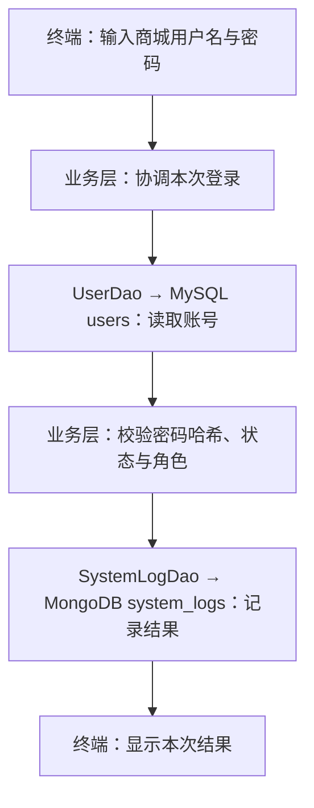

# 项目011 · 运动装备商城

这是老师指定的运动装备商城正式工程。后续仅在此 sports-mall 目录持续开发，已有数据库和源码继续使用。

本工程以《项目011_运动装备商城.docx》为课程验收依据，用户明确确认的业务补充另行标明。原始要求书在本地工程的上一级目录，不随源码仓库上传；项目要求书列出的需求、设计、性能、测试、用户手册、总结和答辩材料均按本项目清单推进。

Gitee 仓库：[Nisegitee/sports-mall](https://gitee.com/Nisegitee/sports-mall)。2026-10-27 已上传首个版本 `1eed789`，默认开发分支为 `main`。

需求基线：[需求规格说明书 PDF](docs/需求规格说明书.pdf)。本地同名 Markdown 为编辑源稿；PDF 是老师规定的交付格式。需求文档描述目标功能，不表示这些功能均已实现。

## 本轮目标

已完成 MySQL 五张基础表及商品单价迁移，训练篮球单价为100.00。2026-10-30用户已手操创建MongoDB的item_details集合和item_id唯一索引，并新增、读回训练篮球的Long类型编号1详情。同日16:54:39，用户运行本工程JAR，已实际确认MySQL商品、单价、分类与MongoDB说明、语言和空图片列表组合显示正确。默认商品查询入口只读取已有记录；建库与初始化脚本须按部署步骤另行执行。

用户随后已确认MongoDB四集合齐全，文档数为item_details=1，其余三集合=0。2026-10-31，用户通过register命令成功创建mall_user01，Java返回编号1；MySQL回读确认user_id=1、role=USER、status=1、password_hash以pbkdf2_sha256开头。这确认了注册正常流程，重复账号等真实数据库分支仍待后续验收。注册固定USER/status=1，不自动生成管理员、不填写档案，也不执行初始化脚本；默认无参数入口仍查询商品。

2026-10-31用户已通过login命令成功登录mall_user01，并在MongoDB读回登录文档：user_id=Long('1')、LOGIN/INFO、LOGIN_SUCCESS、来源127.0.0.1、timestamp=2026-10-31T08:31:23.637Z。该时间与终端北京时间16:31:23一致。这确认了MySQL账号校验和MongoDB登录日志写入的正常流程，异常分支仍需后续集成验证。现有32项JUnit5测试通过。这是正式工程的阶段版本，登录后业务菜单、权限、商品维护、订单、评论和统计等继续推进；本地核对笔记docs/需求对照与进度.md不随源码仓库上传。

## 1. 当前正式工程目录

当前工程已统一放在课程目录的“9-期末大作业_运动装备商城/sports-mall”中。终端与IDE均使用这一份工程。PowerShell可执行：

```powershell
cd "C:\Users\ndir\OneDrive\Laplas_OneDrive\GradResearchHub\浙大城院文件\_上课-课程作业\高级数据库技术\9-期末大作业_运动装备商城\sports-mall"
```

当前目录结构为：

```text
sports-mall
  pom.xml
  mvnw.cmd
  .mvn\wrapper\maven-wrapper.properties
  src\main\java\com\sportsmall\...
```

此 README 与 `pom.xml` 所在位置就是工程根目录。后续构建、运行和 Git 命令均在本 sports-mall 内执行；上级目录整理后沿用现有工程，不重新解压或初始化。老师的项目要求书与本工程并列存放，文档使用相对链接。

历史商品页面草稿保存在 `docs/历史素材/商品页面草稿.html`。草稿尚未接入后端，不计作已完成的业务界面，不影响当前程序；最终提交时只按要求选取成品。

老师的环境表列出 IntelliJ IDEA / Eclipse。现在先通过 PowerShell 确认工程能运行，随后在 IDE 中打开同一个 `pom.xml`、使用相同 JDK 与 Wrapper，不另建一份重复项目。

## 2. 检查工程自己的 Maven

保留 MySQL 服务窗口，在新的 PowerShell 7 窗口执行：

```powershell
# 在当前 sports-mall 工程根目录执行
.\mvnw.cmd -v
```

首次运行会获取工程固定的 Maven 3.9.16，以后复用缓存，不需要另行安装全局 `mvn`。

**原理：**Wrapper 固定构建工具版本；`pom.xml` 声明工程依赖；JDK 执行编译和运行。这一步不连接数据库。

**预期：**输出 Maven 3.9.16、Java 21 和 JDK 路径。

## 3. 编译、打包正式工程

```powershell
.\mvnw.cmd package
```

第一次会获取数据库驱动、HikariCP、日志组件等依赖。成功时显示 `BUILD SUCCESS`，并生成：

```text
target\sports-mall-0.1.0.jar
```

**原理：**将 Java 源码编译，并将运行所需的库打进可执行 JAR。构建成功说明程序已准备好，实际数据库连接在下一步验证。

## 4. 输入你自己的 MySQL 密码，读取两库中的真实商品

保留MySQL与MongoDB服务端窗口：MySQL监听本机18306，MongoDB监听本机27017。MySQL默认账号是你已验证过的root，密码不放入源码；MongoDB沿用你当前本机连接配置。

在刚才同一 PowerShell 中执行：

```powershell
$env:MALL_DB_PASSWORD = Read-Host "输入你自己设置的 MySQL 密码" -MaskInput
java -jar .\target\sports-mall-0.1.0.jar
```

输入时显示星号。密码只传给这个终端运行的程序，不写入项目文件或永久环境变量。关闭终端后，下次需重新输入。

**原理：**MySQL的ItemDao读取商品、十进制单价和分类，MongoDB的ItemDetailDao读取同一item_id的说明、图片和语言，CatalogService组合两份结果，Main负责显示。MongoClient在本次程序运行内复用，并在程序结束时关闭。

若数据库仍保留你前面录入的数据，预期类似：

```text
连接成功：MySQL 8.4.13 / sports_mall
连接成功：MongoDB / sports_mall
商品编号 | 商品名称 | 单价（元） | 分类编号 | 分类名称
1 | 训练篮球 | 100.00 | 1 | 球类
  商品说明：训练用篮球，适合日常运球与投篮练习。
  内容语言：zh-CN
  商品图片：暂无图片
共读取 1 条商品。
```

用户已于2026-10-30实际运行并确认上述组合输出，商品编号1、单价100.00、说明、zh-CN语言与“暂无图片”均匹配两库记录；以后输出以实际数据库为准。某商品没有详情时显示“尚未填写”；MongoDB连接或字段类型错误时提示错误，不冒充详情不存在。缺失和连接失败等分支仍需后续集成验证。

如果中文显示成“杩炴帴鎴愬姛”或“�̳��û�”等乱码，先按Ctrl+C退出正在等待输入的Java程序，回到PS提示符，再在同一个PowerShell中对齐终端编码并重新运行：

```powershell
chcp 65001
[Console]::InputEncoding = [System.Text.UTF8Encoding]::new($false)
[Console]::OutputEncoding = [System.Text.UTF8Encoding]::new($false)
$OutputEncoding = [Console]::OutputEncoding
java -jar .\target\sports-mall-0.1.0.jar
```

注册时把最后一行改为java -jar .\target\sports-mall-0.1.0.jar register。65001是UTF-8代码页；InputEncoding/OutputEncoding对齐控制台读写，$OutputEncoding对齐PowerShell向外部程序传递文本的编码。Java的Console与System.out使用各自的输出路径，Main中固定System.out为UTF-8并不自动改变Console的编码；因此应在启动Java之前完成设置，不能只设置普通输出。此操作属于终端交互层，让用户名、邮箱和提示文字在键盘、Java和屏幕之间正确传递，不改变注册规则或数据库结构，也不需要重新编译。新终端应重新设置编码及MALL_DB_PASSWORD。

官方说明：[Java Console.charset()](https://docs.oracle.com/en/java/javase/21/docs/api/java.base/java/io/Console.html#charset())、[Windows chcp](https://learn.microsoft.com/en-us/windows-server/administration/windows-commands/chcp)。


## 当前关键文件

| 文件 | 项目作用 |
|---|---|
| `pom.xml` | 固定依赖和构建设置 |
| `.mvn/wrapper/maven-wrapper.properties` | 固定 Maven 版本 |
| `src/main/resources/application.properties` | 数据库地址、账号和连接池配置 |
| `src/main/java/com/sportsmall/Main.java` | 当前入口 |
| `src/main/java/com/sportsmall/dao/ItemDao.java` | 从 MySQL 读取商品、单价与分类，用 getBigDecimal 取价 |
| `src/main/java/com/sportsmall/model/ItemView.java` | 用 BigDecimal 携带单价等一条查询结果，不是数据库表 |
| `src/main/java/com/sportsmall/config/MongoConfig.java` | 读取MongoDB配置，创建可复用的MongoClient并限制连接等待时间 |
| `src/main/java/com/sportsmall/dao/mongo/ItemDetailDao.java` | 按item_id读取MongoDB详情，检查BSON编号、数组及嵌套字段的类型 |
| `src/main/java/com/sportsmall/model/ItemDetail.java` | Java中的商品扩展详情，不重复保存MySQL价格或分类 |
| `src/main/java/com/sportsmall/service/CatalogService.java` | 按同一个商品编号组合两库结果；详情缺失与读取失败分别处理 |
| `src/main/java/com/sportsmall/cli/RegisterCommand.java` | 终端注册入口，收集输入并隐藏密码，显示账号摘要 |
| `src/main/java/com/sportsmall/service/UserRegistrationService.java` | 注册业务层：输入与确认密码校验、生成密码哈希，再调用DAO |
| `src/main/java/com/sportsmall/dao/mysql/UserDao.java` | 用PreparedStatement保存普通账号、按用户名读取登录凭据，处理唯一键冲突 |
| `src/main/java/com/sportsmall/util/PasswordHasher.java` | JDK的PBKDF2加盐密码哈希与校验，供注册及后续登录复用 |
| `src/main/java/com/sportsmall/cli/LoginCommand.java` | 本机登录入口，隐藏密码，管理两库连接及显示登录结果 |
| `src/main/java/com/sportsmall/service/UserLoginService.java` | 协调账号核验、状态检查与登录日志，不把连接故障当成密码错误 |
| `src/main/java/com/sportsmall/model/LoginAccount.java` | 业务层内部凭据，覆盖默认toString以免输出哈希 |
| `src/main/java/com/sportsmall/model/AuthenticatedUser.java` | 本次核验通过的用户身份，不携带密码或哈希 |
| `src/main/java/com/sportsmall/dao/mongo/SystemLogDao.java` | 将登录结果写入system_logs，Long编号、BSON日期及嵌套操作信息 |
| `src/test/java/com/sportsmall/dao/mongo/ItemDetailDaoTest.java` | 检查真实BSON类型映射的边界，不连接或修改数据库 |
| `src/main/resources/sql/mysql_schema.sql` | 五表目标结构，供新数据库使用；现有表不会被 IF NOT EXISTS 自动改成新结构 |
| `src/main/resources/sql/mysql_migrate_001_item_price.sql` | 现有商品表补单价的分步迁移，检查后执行一次；不是初始化数据脚本 |
| `src/main/resources/sql/mongodb_init.js` | mongosh阶段性脚本：四集合、首批查询索引及一条商品详情；完整测试数据、聚合和业务写入仍待补齐 |
| `docs/需求规格说明书.pdf` | 老师要求的需求规格交付物，V0.1需求基线 |
| `docs/MySQL_E-R图.png` | 五张表的关系设计，已与用户提供的实际建表结果核对一致 |
| `docs/MongoDB集合设计.pdf` | Day2要求的四集合目标设计，含字段类型、嵌套与引用、索引与三项聚合口径；设计文档不代表全部已部署 |
| `docs/需求对照与进度.md` | 本地内部核对笔记，不替代正式需求文档 |

## 哪些属于课程工程，哪些只是辅助文件

“老师没有逐个指定文件名”不等于“文件多余”。课程要求的功能、配置、日志、异常处理和构建，需要由具体源码与配置文件实现。

| 当前文件／目录 | 与要求的关系 | 保留与提交方式 |
|---|---|---|
| `src/`、`pom.xml`、`README.md` | 要求书第六节工程结构中的源码、构建配置和说明；当前只有首版内容 | 保留，随最终源码提交；继续补齐功能和脚本 |
| `.gitignore` | 要求书第五节要求正确配置忽略规则 | 保留，随 Git 仓库提交 |
| `mvnw`、`mvnw.cmd`、`.mvn/wrapper/` | 本工程选用的 Maven Wrapper；老师要求 Maven，没有强制 Wrapper | 保留，随源码提供，便于别人用同一版本构建 |
| `docs/需求对照与进度.md` | 本会话添加的核对笔记，不是老师要求的“需求规格说明书” | 开发时保留，最终提交默认不含此笔记 |
| `docs/需求规格说明书.pdf` | 老师明确要求的需求规格说明书 | 随源码提交至 Gitee，最终按课程要求交付 |
| `docs/MySQL_E-R图.png` | 老师明确要求的 MySQL E-R 图片 | 五表结构已落实并核对，随本轮源码提交；后续结构变更时同步维护 |
| `docs/MongoDB集合设计.pdf` | 老师明确要求的四集合设计文档 | V0.1五页PDF已生成并逐页核对；随后续正式源码提交，实施证据另行记录 |
| `docs/需求规格说明书.md` | PDF 的本地可编辑源稿 | 本轮提交只选 PDF；源稿在本地保留，不自动进入最终提交包 |
| `docs/历史素材/商品页面草稿.html` | 旧页面草稿，不是已完成界面，也不是规定交付物 | 当前仅归档，最终提交排除未采用草稿 |
| `target/` | Maven 自动生成的编译文件及 JAR | 可重新构建，已由 `.gitignore` 排除，不随源码提交；当前运行仍使用其中的可执行 JAR |

最终从本 sports-mall 工程整理规定交付物。老师的选题原始资料、本地核对笔记和未采用草稿不自动进入提交压缩包。

## 接下来按要求推进

1. 对应 Day1：Git/Gitee 首版及需求 PDF 均已提交并成功上传，需求 PDF 对应提交为 `8ae73f5`。教师交付与检查按课程安排。
2. 对应 Day2：五张 MySQL 表及 E-R 图已核对并上传；继续四个 MongoDB 集合的设计与实际落实，已有数据库继续使用。
3. 对应 Day3：补齐 MySQL DDL 与 MongoDB 初始化脚本，在设计明确后按步骤执行。
4. 继续真实业务功能：完善商品的录入、修改、删除和查询，再接入 MongoDB 详情、多条件查询与分页。此后按要求补其他模块、视图、存储过程、触发器、测试与项目文档。

要求书的 Day 是阶段标记，不在此推断实际截止日期；开发期间持续保留真实 Git 提交。IDE 使用 IntelliJ IDEA / Eclipse 打开当前工程，不另建项目。

## 五表设计与本轮手操

[MySQL E-R 图](docs/MySQL_E-R图.png) 展示目标结构：分类与商品、用户与订单、商品与订单均为一对多；用户与档案为一对零或一，分类有可空的上级分类。users 的外键引用将写在 orders、profiles 表中，users 本身无需为此增加外键。

用户已确认 categories、items、users、profiles、orders 五张基础表。训练篮球 price=100.00，price 必填且大于零；orders 的两个外键、金额正数与状态范围约束已通过实际 SHOW CREATE TABLE 核对。注册、下单等业务仍待后续实现，建表不等同于完整业务完成。

users 记录商城用户，与 MySQL 的 root 账号不同。本工程约定用户名、邮箱、密码哈希必填，用户名和邮箱分别唯一；电话可不填；注册默认 USER；status 取 1 正常、0 停用。NOT NULL 不负责判断空字符串，相关输入校验在后续 Java 注册流程实现。现在先建空表，密码哈希以后由 Java 生成。

profiles.user_id 同时使用 NOT NULL、UNIQUE 和外键，分别保证档案必须有归属、同一用户至多一份、归属用户真实存在。用户可尚未填写档案，此时 profiles 中没有该用户的行。姓名等资料暂允许 NULL，后续按档案编辑流程逐项填写。已有档案引用时，数据库拒绝直接删除用户；账号停用按需求约定处理。可通过 SHOW CREATE TABLE profiles 查看完整外键定义，而不是仅凭 DESCRIBE 的 Key 列判断有无外键。

orders.user_id、item_id 都是必填外键，分别引用用户和商品；同一用户或商品可以出现在多笔订单里，所以这里不加唯一约束。外键不会自动复制商品价格；将来由 Java 下单流程把成交金额写入 amount，检查用户、商品状态并控制订单状态转换。

用户已完成旧库补单价：先增加可空 price，再给训练篮球（编号1）填入 100.00 演示价，invalid_prices=0 后设为必填且大于零。该迁移已完成，不重复执行；今后新增商品必须提供单价，旧的“不含 price 的商品 INSERT”不再适合作为录入步骤。

新库执行 mysql_schema.sql 建完整结构；有旧版商品表的库才使用 mysql_migrate_001_item_price.sql 迁移。两者用途不同，CREATE TABLE IF NOT EXISTS 不会给现有表自动补列。本机已完成相关结构修改，本轮补 Java 查询与显示单价；注册、下单等仍待后续实现。

## 本轮 Java 单价链路

items.price → ItemDao 查询及 getBigDecimal 映射 → ItemView.price → Main 打印。数据库新增列后，需要显式补齐查询字段、Java结果对象和显示位置。SQL DECIMAL 对应 Java BigDecimal，全程不转换为 double；输出保持两位小数。

单价查询与两库组合代码已通过构建，用户已于2026-10-30实连并确认组合展示。工具端未使用用户密码访问数据库，实连证据来自用户终端输出；单元测试和编译结果分别记录。

课程要求使用 IntelliJ IDEA / Eclipse。可以从 [IntelliJ IDEA 官网](https://www.jetbrains.com/idea/download/?section=windows) 安装，核心 Java 功能免费；安装位置与项目源码目录各自独立。通过 Open 选择当前工程的 pom.xml，按 Open as Project 打开，沿用已有工程。项目 SDK 选择已安装的 Temurin JDK21；Maven 使用工程 Wrapper。查看 ItemDao、ItemView、Main 三处改动，再在现有 PowerShell7 构建运行，密码环境变量属于该终端的进程环境。

## MongoDB 商品详情：本轮手操

2026-10-29用户已通过mongosh连接MongoDB8.0.34；2026-10-30用户完成以下创建、索引、插入与读回操作，首条详情_id为6ae36d3bc7e97e0b414a5658、item_id为Long('1')。本节保留操作记录，已完成的本机步骤不重复执行；新环境再按顺序初始化。MongoDB中的同名数据库与MySQL分别存储，由Java按商品编号关联。

[MongoDB集合设计PDF](docs/MongoDB集合设计.pdf)记录四集合的目标结构、索引及聚合口径。这是Day2设计交付物；本轮手操先落实其中一条商品详情，尚不等于四集合部署及完整业务完成。

### 1. 创建商品详情集合

```javascript
use sports_mall
db.createCollection("item_details")
```

集合组织同类文档，一条文档表示一件商品的一整份详情。createCollection执行成功后，库和空集合实际存在；只执行use只是选定数据库名称。这里没有为每个字段建表，字段随下一步文档保存。

### 2. 限定每个商品至多一份详情

```javascript
db.item_details.createIndex(
  { item_id: 1 },
  { name: "uq_item_details_item_id", unique: true }
)
```

unique限制item_id不重复，实现本工程的一商品一详情规则。索引定义中的1表示升序，不是商品编号。该索引不检查MySQL中商品是否存在；训练篮球编号1来自已经确认的MySQL记录，后续Java录入时还需检查跨库关联。

### 3. 保存训练篮球的详情

```javascript
db.item_details.updateOne(
  { item_id: Long("1") },
  {
    $setOnInsert: {
      description: "训练用篮球，适合日常运球与投篮练习。",
      images: [],
      metadata: { language: "zh-CN" }
    }
  },
  { upsert: true }
)
```

这段指令按item_id找详情；没有时插入，有时保留，重复粘贴不会新增另一份或覆盖之后编辑的内容。Long明确保存64位整数，与MySQL的BIGINT对应；不是把编号保存为字符串。description为说明文字，images为图片列表（目前没有真实图片，先为空），metadata为嵌套对象，language为其中的语言标记。此处说明文字与语言值是商品示例内容，不是老师规定的固定值。

### 4. 读出刚保存的数据

```javascript
db.item_details.findOne({ item_id: Long("1") })
db.getCollectionNames()
```

用户已成功读到训练篮球详情。MongoDB自动生成的_id标识本条文档；item_id用于关联MySQL商品，两者作用不同。item_id唯一索引相当于额外的唯一规则，不会把它改成文档主键。MySQL商品表保留编号、名称、分类、单价等基础信息，MongoDB保存说明、图片和扩展信息，Java组合展示已由用户实际运行确认。

同样的创建、索引、插入与读取操作已保存到resources/sql/mongodb_init.js，便于后续重放；脚本遇到已有集合或已有商品详情会保留它们。脚本现已继续补齐以下三个集合和首批索引，但用户实际执行状态另行记录；不代表每集合至少20条、日志100+、三项聚合或完整初始化已经完成。

## 补齐评论与两类日志：本轮手操

本轮在mongosh的sports_mall库执行。MySQL用户表尚无已确认的业务账号，先创建空集合及索引；后续注册、登录、浏览和评论流程写入真正对应的记录。字段类型按集合设计PDF及Java写入校验落实，创建空集合或索引本身不自动设置所有字段的类型和必填规则。

### 1. 创建三个集合

```javascript
db.createCollection("comments")
db.createCollection("action_logs")
db.createCollection("system_logs")
```

comments保存用户对商品的评论；action_logs保存用户浏览等行为，用于热门排行和用户活动报告；system_logs保存登录及业务操作结果。三类记录会独立增长、分页与统计，因此分别存储。

### 2. 按后续真实查询建立索引

```javascript
db.comments.createIndex(
  { item_id: 1, created_at: -1, _id: -1 },
  { name: "idx_comments_item_time" }
)
db.action_logs.createIndex(
  { created_at: 1, item_id: 1 },
  { name: "idx_actions_time_item" }
)
db.action_logs.createIndex(
  { user_id: 1, created_at: 1 },
  { name: "idx_actions_user_time" }
)
db.system_logs.createIndex(
  { timestamp: -1, _id: -1 },
  { name: "idx_system_time" }
)
db.system_logs.createIndex(
  { user_id: 1, timestamp: -1 },
  { name: "idx_system_user_time" }
)
```

这些均为普通索引：同一商品可有多条评论、同一用户可多次浏览或登录，不对业务编号加unique。评论索引服务“某商品的最新评论”，其查询排序将同时使用created_at和_id倒序；行为日志分别支持时间窗口与某用户活动；系统日志支持时间分页及某用户记录。1表示升序，-1表示降序。空集合上先建立访问路径，性能收益待实际查询与数据量测量，不预先声称提速。

### 3. 查看当前集合与记录数

```javascript
db.getCollectionNames()
printjson({
  item_details: db.item_details.countDocuments({}),
  comments: db.comments.countDocuments({}),
  action_logs: db.action_logs.countDocuments({}),
  system_logs: db.system_logs.countDocuments({})
})
```

用户已按上述步骤创建并核对四个集合，文档数分别为1、0、0、0。返回0只表示没有文档，须结合集合列表确认集合已创建。完整初始化脚本重放尚未验收，工具端没有执行这些MongoDB写操作。注册正常流程已由用户确认，下一步实现登录及对应系统日志。

## 注册一个真实商城用户：架构与手操

这条业务的数据路径为：终端RegisterCommand收集输入 → UserRegistrationService校验并生成密码哈希 → UserDao绑定SQL参数 → MySQL users保存账号。入口层不负责SQL，DAO不接收明文密码；数据库唯一约束保证用户名、邮箱分别不重复。

### 1. 从终端进入注册入口

在已设置MALL_DB_PASSWORD、且位于工程根目录的PowerShell7执行。先对齐本终端编码，再启动Java；这些设置只作用于当前终端：

```powershell
chcp 65001
[Console]::InputEncoding = [System.Text.UTF8Encoding]::new($false)
[Console]::OutputEncoding = [System.Text.UTF8Encoding]::new($false)
$OutputEncoding = [Console]::OutputEncoding
java -jar .\target\sports-mall-0.1.0.jar register
```

操作原理：Main识别register参数，转到交互入口。架构目的：入口层选择要执行的业务；MySQL连接密码仍来自当前终端环境，与接下来新设的商城密码各有用途。默认不加参数仍查询商品。注册只需要MySQL服务，不访问MongoDB；登录写MongoDB系统日志将在下一步实现。

### 2. 输入自己的账号信息

依次填写商城用户名、邮箱、可空电话、商城密码及确认密码。用户名最多50字符、邮箱最多100、电话最多20；邮箱做基础格式校验。密码输入不回显，不会显示星号；输入后按回车。注册没有额外的复杂强度评分门槛，密码不做trim。

操作原理：Service检查必填、长度和两次密码一致，再调用JDK自带PBKDF2WithHmacSHA256，使用随机16字节盐、600000次迭代、256位摘要生成存储串，字段仍是既有password_hash VARCHAR(255)。随机盐、迭代次数和摘要一起保存供后续登录验证，不存明文，登录也不需要解密。此为要求书允许的同类密码哈希实现，参数参考OWASP密码存储指南，不是新增作业评分要求。

架构目的：业务层统一注册规则；DAO使用PreparedStatement保存USER角色、status=1及可空电话，由MySQL生成账号编号及时间。角色不接受注册者输入，重复用户名或邮箱由数据库唯一约束拒绝并返回可理解提示。

成功时应显示“注册成功：用户编号=实际编号，用户名=实际输入，邮箱=实际输入，角色=USER”。实际编号以数据库生成为准，不保证从1开始；输出与日志不包含密码或完整哈希。

### 3. 从数据层读回账号

在MySQL客户端中执行：

```sql
USE sports_mall;
SELECT user_id, username, role, status,
       LEFT(password_hash, 13) AS password_scheme
FROM users
ORDER BY user_id DESC
LIMIT 5;
```

操作原理：直接读取最新用户记录，password_scheme只显示算法标记pbkdf2_sha256，不展示完整哈希。架构目的：确认终端上的注册结果已经落到MySQL存储层；用户账号与数据库root账号分别管理。新增账号此时尚无profile，尚未登录，三个MongoDB评论/日志集合不因注册自动增加记录。

### 本轮验证范围

clean package已在JDK21及Maven Wrapper下完成，18项JUnit5测试全部通过：旧商品映射4项、注册业务11项、密码哈希3项。测试覆盖成功输入、空值/长度/邮箱格式、两次密码不一致、重复/保存失败的结果传递、随机盐、正确密码与错误密码的校验；不连接或修改真实数据库。2026-10-31用户实际完成CLI隐藏输入、MySQL插入和回读，账号mall_user01编号1、USER/status=1与哈希算法标记一致，中文提示正常。真实重复键处理、登录和其他业务仍需后续验证。

## 使用刚注册的账号登录：架构与手操

对应课程要求：MySQL验证用户登录，MongoDB记录登录日志。



### 1. 启动登录入口

保持已使用的MySQL和MongoDB服务窗口运行，在项目根目录的PowerShell执行，沿用当前UTF-8设置及MALL_DB_PASSWORD：

```powershell
java -jar .\target\sports-mall-0.1.0.jar login
```

操作原理：Main选择LoginCommand，载入已有连接配置。架构目的：入口层收集操作意图，随后交给业务层协调。本轮JAR已经重新打包，不必再次构建；新开PowerShell时按前文重新设置编码和数据库密码环境变量。

### 2. 输入现有商城账号

用户名输入mall_user01，商城密码输入注册时设置的密码，仍然不回显。程序按用户名查询users，PasswordHasher利用保存的盐、迭代次数及摘要校验输入；不会还原原密码，也不会再创建用户。只有正常状态的USER/ADMIN账号可以通过。

架构目的：UserDao负责读取账号，UserLoginService负责判断身份是否有效。随后SystemLogDao写入登录结果，成功时终端显示：

```text
登录成功：用户编号=1，用户名=mall_user01，角色=USER
本次登录结果已保存到MongoDB的sports_mall.system_logs。
```

本轮login执行完返回PowerShell，不保存跨进程登录状态；登录后业务菜单与操作权限后续在同一工程接入。

### 3. 在MongoDB读回本次登录事件

若mongosh已打开，在其sports_mall提示符执行下方JavaScript。否则另开PowerShell，先连接：

```powershell
& "C:\develop\MongoDB\shell\bin\mongosh.exe" "mongodb://127.0.0.1:27017"
```

```javascript
use sports_mall
db.system_logs.find(
  { user_id: Long("1"), log_type: "LOGIN" }
).sort({ timestamp: -1, _id: -1 }).limit(3)
```

操作原理：用真实用户编号筛选登录事件，按时间及_id倒序读取最近三条。架构目的：system_logs存储操作发生的记录，与MySQL中的账号资料各有用途；重复登录会新增事件，不会重复创建用户。

正常登录文档应含user_id=Long('1')、log_type='LOGIN'、log_level='INFO'、action_detail.operation='LOGIN_SUCCESS'、action_detail.ip='127.0.0.1'及真实BSON日期timestamp。IP是当前本机命令行入口的回环来源；未来网络入口应记录实际请求来源。文档不保存用户名、邮箱、密码或哈希。

基础输入检查通过后的密码错误、账号不存在和停用账号会生成WARN/LOGIN_FAILED日志；账号不存在时user_id为null，不虚构编号。MySQL查询故障不记作密码错误。MongoDB日志未确认写入时返回LOGIN_LOG_SAVE_FAILED，不显示完整登录流程成功；网络错误下日志可能已写入，因此提示为“未确认保存”。本流程只读MySQL，再写MongoDB，不把它称为两库共同提交的事务。

### 本轮验证范围

2026-10-31已使用JDK21和Wrapper执行离线clean package，32项测试全部通过：原18项、登录业务12项、日志BSON映射2项。新增测试覆盖正常/错误/不存在/停用账号、基础输入、数据库读取故障、日志写入故障及Long/Date/null/嵌套字段类型。单元测试使用内存替代读写和BSON编码，不连接数据库。用户随后实际登录成功并读回MongoDB文档6ae5a75bd907b36d8083710d，用户编号1、LOGIN/INFO、LOGIN_SUCCESS与真实日期字段符合设计；失败登录等实连分支仍待后续验证。

## 实现约定与后续事项

- 商品必须有分类，分类可以没有上级；因此两处关联字段的可空性不同。
- 编号采用自增，状态暂约定 1 为在售；这些是本工程的实现选择。
- 首次只读连接沿用你已验证的本机账号；进入完整写入功能时完善应用专用账号与权限。
- 当前连接参数仅面向本机开发：关闭 TLS 并允许认证公钥获取。部署时需按部署环境另行配置。
- 用户已完成 price 迁移，现有训练篮球单价 100.00。订单 amount 字段已创建；自动读取单价、保存下单金额及维持历史金额的行为仍待 Java 下单流程实现。
- 现有32项JUnit5测试通过；用户已确认真实注册、登录和MongoDB登录日志回读。权限、事务、完整集成测试和正式测试报告继续补齐。
- 截至2026-10-31，注册里程碑8b85b9c已推送Gitee；本轮继续保存已确认的登录里程碑。10-29没有提交，不回填日期。
- 代码使用 AI 辅助编写；用户亲手配置和运行。最终按老师要求标注大模型使用，保存真实开发、测试证据。

## 连接错误的处理

- `PASSWORD_NOT_SET`：在当前 PowerShell 输入密码。
- `CONNECTION_FAILED`：确认 MySQL 服务窗口仍运行、端口为 18306。
- `LOGIN_FAILED`：输入你后来设置的新密码，不是初始化时的旧临时密码。
- `DATABASE_NOT_FOUND` / `TABLE_NOT_FOUND`：核对是否连接到已有商城数据的实例，先检查，不重复初始化数据目录。
- `MONGO_CONNECTION_FAILED`：保留MongoDB服务端窗口，核对mongo.uri中的地址与端口。
- `MONGO_DATA_INVALID`：读取到了详情，但编号、说明、图片数组或语言类型不符合设计；与“尚未填写”不同。
- `INVALID_CREDENTIALS`：商城用户名或密码不正确；使用注册时设置的商城密码。
- `ACCOUNT_DISABLED`：商城账号当前不可用。
- `USER_QUERY_FAILED`：MySQL账号读取未完成，检查MySQL连接与users表。
- `LOGIN_LOG_SAVE_FAILED`：MongoDB登录日志未确认保存，检查服务窗口、连接配置与system_logs写权限。

## 两库组合检查记录（2026-10-30）

- 用户已真实新增并读回MongoDB商品1详情，_id为6ae36d3bc7e97e0b414a5658。
- 已加入官方MongoDB同步驱动5.13.0、配置、DAO、业务结果对象及CatalogService；Java仅查询，不执行初始化或写入。
- 使用已有JDK21与Maven Wrapper运行clean package成功，4项JUnit5测试全部通过，覆盖Long编号与空图片数组、拒绝字符串编号、拒绝非字符串图片项、拒绝缺失语言；这些是内存中的BSON映射测试，不连接数据库。
- 首次驱动下载直连超时，构建时仅在该进程使用本机已有代理127.0.0.1:10808重试成功，未改全局Maven设置、系统网络或工程配置。依赖现已缓存。
- 用户于2026-10-30 16:54:39运行JAR，成功连接MySQL8.4.13 / sports_mall与MongoDB / sports_mall，显示训练篮球100.00元、分类球类、商品说明、语言zh-CN及暂无图片，读取总数1。这确认了本轮只读组合正常流程；四集合、完整CRUD、分页、日志、订单与统计功能仍待推进。

## 官方参考

- [Maven Wrapper](https://maven.apache.org/wrapper/)
- [MySQL Connector/J 的 Maven 配置](https://dev.mysql.com/doc/connector-j/en/connector-j-installing-maven.html)
- [HikariCP](https://github.com/brettwooldridge/HikariCP)
- [OWASP密码存储指南](https://cheatsheetseries.owasp.org/cheatsheets/Password_Storage_Cheat_Sheet.html)
- [MongoDB Java文档与BSON类型映射](https://www.mongodb.com/docs/drivers/java/sync/current/data-formats/documents/)

## 首版检查记录（2026-10-27）

- 在可访问的工具环境中，Wrapper 成功运行 Maven 3.9.16，使用 Temurin JDK 21.0.12.1。
- `mvnw.cmd package` 已成功，5 个 Java 源文件编译通过；可执行 JAR 的入口、JDBC 驱动、连接池、服务发现文件及配置已检查。
- 未设置数据库密码时，程序输出可读中文提示并以非零状态结束，没有尝试访问数据库。
- 工具环境未使用用户密码连接数据库。用户已在自己的终端完成构建、设置密码环境变量并运行，实际连接 MySQL 8.4.13 / sports_mall，读取 1 条商品；2026-10-27 14:32 的运行结果确认中文显示正常。
- 当前没有测试源文件，构建显示 `No tests to run`；不把构建成功表述为正式单元测试通过。
- 用户已完成首次提交并成功推送 Gitee 的 main 分支，仓库地址与上文一致；尚未进行从远程重新检出后的完整部署验收。
