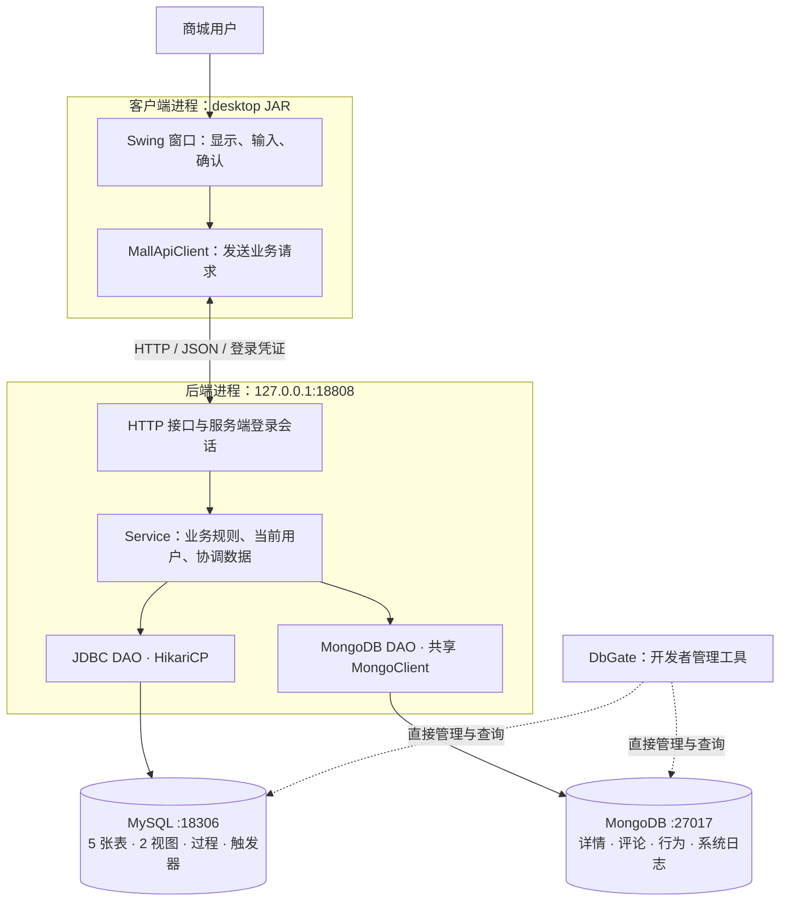

# 项目011 · 运动装备商城

以老师下发的《项目011_运动装备商城.docx》为验收依据；原件在工程上一级目录。本工程是正式大作业，沿用既有数据库，不重新初始化或导入覆盖用户数据。

当前版本为 **0.2.7，2026-11-08**。窗口和后端分别运行，通过本机HTTP通信。本版新增管理员商品基础信息维护：查看、新增、编辑分类与单价、上下架；使用既有items表，MongoDB详情编辑下一轮接入。先看[商品基础信息维护实操](docs/商品基础信息维护实操.md)中的代码链路，再操作窗口。分类编辑与删除已由用户主库手操确认，前期讲解见[分类编辑与删除实操](docs/分类编辑与删除实操.md)。普通商城用户输入商城密码，MySQL连接密码只在启动后端时提供。

仓库：[Gitee](https://gitee.com/Nisegitee/sports-mall) · [GitHub](https://github.com/Nisecata1/sports-mall)。每次提交后同步两个仓库，保留真实日期。

## 架构与职责



前后端分离体现为**不同进程、不同发行包、通过接口通信**。客户端包不含 JDBC/MongoDB 驱动、DAO、Service、后端类或 application.properties。SwingWorker 只负责避免网络请求卡住界面；业务规则仍由后端执行。两端共用 api/model 中的数据契约，不共享运行中的服务对象。

例如点击“资料与订单概览”：窗口发送 GET /api/me/overview → 后端从登录凭证查出本人身份 → AccountOverviewService 调用 DAO 查询两个视图 → 返回 JSON → 窗口显示。窗口不发送“我要查询哪个用户”的编号，也不直接执行 SQL。

这是本机课程版本：仅监听 127.0.0.1，使用 HTTP。后端当前沿用开发用 MySQL root 配置；公网部署前还需要 HTTPS、专用最小权限数据库账号等部署工作。本次不注册 Windows 服务，不配置开机启动。

## 第一次使用新版：操作、原理与架构位置

### 1. 保持已有数据库按需运行

MySQL：127.0.0.1:18306 / sports_mall；MongoDB：127.0.0.1:27017 / sports_mall。

**原理与位置：**这两个进程是存储层。DbGate、商城后端都连接它们；打开客户端不会自动启动数据库。沿用当前数据目录，已有表、订单、评论不重新初始化。

### 2. 构建两个程序

在含 pom.xml 的 sports-mall 工程目录执行：

```powershell
.\mvnw.cmd package
```

生成：

| 文件 | 用途 |
| --- | --- |
| target/sports-mall-0.2.7.jar | 独立后端，包含业务层、DAO 和数据库依赖 |
| target/sports-mall-0.2.7-desktop.jar | 独立商城窗口，只通过 HTTP 访问后端 |

**原理与位置：**Maven 编译同一源码工程并产生两种运行包。它们可以在同一台电脑分别启动；前后端分离不要求两个 Git 仓库。构建不导入 SQL、不改数据库。以后重新构建前退出运行中的新版窗口并停止新版后端，避免 JAR 占用。

### 3. 启动后端

双击工程根目录 **Start-Backend.cmd**，或在 PowerShell 7 执行：

```powershell
.\Start-Backend.ps1
```

按提示输入 MySQL 连接密码。看到“商城后端已启动，地址 http://127.0.0.1:18808”后保持此窗口运行。

**原理与位置：**这一步启动独立业务后端，并建立数据库连接池及共享 MongoClient。连接密码只提供给这个进程，不保存到源码、脚本或永久环境变量。普通商城登录不会再次要求此密码。脚本不会自动安装数据库或系统服务。

如果本次终端已经设置 MALL_DB_PASSWORD，启动脚本会直接使用它。端口可通过 MALL_API_PORT 临时指定；不改变时使用18808。

### 4. 打开商城窗口

先关闭原来运行的旧版商城窗口，再双击 **Start-Mall.vbs**。终端等效命令：

```powershell
java -jar .\target\sports-mall-0.2.7-desktop.jar
```

只输入已注册的商城用户名、商城密码。窗口包含商品浏览、我的订单、商品评论、数据统计、我的账号。

**原理与位置：**这是表现层。MallApiClient 向后端发送 JSON；后端验证账号后签发随机登录凭证。凭证仅保存在客户端内存，用户编号和角色从后端会话确定。双击启动脚本还会清除子进程继承的 MALL_DB_PASSWORD 和 MALL_MONGO_URI。

后端地址默认 http://127.0.0.1:18808。更改后端端口时，在启动客户端的同一终端临时设置 MALL_API_URL。客户端地址仅允许 localhost 或127.0.0.1。

### 5. 首次手操验收

进入“我的账号”→“资料与订单概览”，查看当前已有账号、订单状态与金额；这个操作只读数据。现有历史示例为订单总数1、已取消1、已完成金额0.00，后续实际操作会使结果变化。

这个操作串起窗口、HTTP、会话、Service、DAO和MySQL视图。2026-11-06用户已经完成主库概览及0.2.1月报查询，窗口显示10月订单总数1、已取消1、已完成金额0.00元。档案保存、数据库关联查询与窗口概览读回也已由用户确认，第8步用于理解实现链路。

### 6. 结束使用

右上角“退出登录”让后端注销本次凭证；关闭窗口不会关闭后端。后端窗口按 Ctrl+C 才停止后端并释放连接池。数据库仍按原有方式自行关闭。

**原理与位置：**客户端、业务后端、数据库是不同进程，生命周期相互独立。后端重启后原有登录凭证失效，重新登录即可；数据库记录保留。

### 7. 安装并使用本人月度订单报表

老师要求用 MySQL 存储过程实现月度报表，并要求至少两个过程。本版提供 sp_cancel_order 与 sp_monthly_order_report 两个过程的安装脚本。

1. 在 DbGate 的商城 MySQL 连接中打开 src/main/resources/sql/mysql_procedures.sql，执行整个文件。结果应列出两个过程。
2. 在同一连接执行下方 CALL，查询已确认的用户1在2026年10月创建的订单汇总。
3. 退出旧商城窗口，在旧后端窗口按 Ctrl+C。重新打开 Start-Backend.cmd 和 Start-Mall.vbs，使用当前版本。
4. 登录后进入“数据统计”，点击“我的月度订单”，填写2026-10，核对窗口和 DbGate 的结果。

```sql
CALL sports_mall.sp_monthly_order_report(1, '2026-10-01');
```

执行脚本后，MySQL保存过程定义。后端DAO通过JDBC CallableStatement调用这个过程，窗口负责提交月份和显示结果。窗口查询的用户编号由后端登录会话确定。

统计口径按订单创建月份筛选，按查询时的当前状态计数，已完成金额合计符合条件订单的orders.amount。采用月初包含、下月月初排除的时间范围。该口径由项目选定，目前接入本人范围。

以最近确认数据为例，2026-10应为总数1、待处理0、已完成0、已取消1、已完成金额0.00元。无订单月份返回零汇总。按创建月份统计的已完成金额与按完成日期统计的收入分别服务不同的业务口径，本版提供前者。

架构调用顺序为“数据统计页面 → HTTP本人月报接口 → MonthlyOrderService → OrderDao → MySQL存储过程 → 返回窗口”。用户已提供主库CALL与0.2.1商城月报截图，确认两个过程存在、数量和状态结果一致，商城已完成金额0.00元。

### 8. 边做边学维护本人档案

users保存账号信息，profiles保存姓名、证件号码、地址和备注。profiles.profile_id是档案自己的主键，profiles.user_id是引用users的外键，并有唯一约束。一位用户可以先注册账号，填写资料后再建立一份档案。

1. 启动当前版本后端与窗口，登录原有商城账号，进入“我的账号”。页面同时读取账号与本人档案。
2. 点击“编辑我的档案”，填写演示姓名和演示地址，确认保存。首次保存会在profiles新增记录，并显示生成的档案编号。
3. 再次编辑，把地址改为另一段文字并保存。已有档案会按唯一user_id更新。表单的四个字段一起提交，留空字段保存为SQL NULL。
4. 点击“资料与订单概览”，观察姓名和地址。概览读取v_user_details与订单汇总视图，姓名和地址来自profiles。
5. 用DbGate执行下面的关联查询，直接核对用户、档案编号及字段。该查询是数据库层的只读核对。

```sql
SELECT u.user_id, u.username, p.profile_id, p.real_name, p.address
FROM sports_mall.users AS u
LEFT JOIN sports_mall.profiles AS p ON p.user_id = u.user_id
WHERE u.username = 'mall_user01';
```

架构中，窗口收集输入，后端从登录会话确定用户编号，ProfileService检查字段长度与账号状态，ProfileDao执行参数化SQL。保存和读回使用同一JDBC事务，提交后再显示结果。数据库的外键维护所属关系，唯一约束控制每用户一份档案，SQL保存语句根据该唯一键新增或更新。

姓名最多50字符、证件号码20字符、地址500字符。备注最多2000字符是本功能的工程约定。可选字段的空白内容保存为NULL。保存会更新四个字段，并发保存按完成的先后顺序形成当前档案内容。

“删除我的档案”在确认后删除本人profiles记录。删除前可用上方查询观察user_id与profile_id，删除后再看关联查询与资料概览，理解账号与可选档案的关系。此功能已通过隔离接口检查，用户主库的创建、修改、删除与显示结果按实际手操分别记录。

## 业务接口

需要身份的接口使用 Authorization: Bearer 加随机凭证。凭证8小时到期，退出登录即失效。服务端不接受用户传入 user_id/role 决定本人身份。

| 方法与路径 | 目的 |
| --- | --- |
| GET /api/health | 后端存活与版本 |
| POST /api/auth/register、/api/auth/login、/api/auth/logout | 注册、登录、退出 |
| GET /api/me；PATCH /api/me/phone | 本人资料、修改电话 |
| GET /api/admin/users | 管理员读取前100个账号的编号、用户名、角色与状态 |
| GET、POST /api/admin/items；PUT /api/admin/items/{id} | 管理员查看含下架商品的前100项、新增、编辑与上下架 |
| GET、POST /api/admin/categories | 管理员读取分类关系、新增根分类或子分类 |
| PUT、DELETE /api/admin/categories/{id} | 管理员改名/更换上级，或删除无下级、无商品引用的分类 |
| GET /api/me/profile | 读取本人档案，profileId为空表示尚未建立 |
| PUT /api/me/profile | 保存整份本人档案，首次创建、以后更新 |
| DELETE /api/me/profile | 删除本人档案 |
| GET /api/me/overview | 读取资料与订单汇总视图 |
| GET /api/me/orders/monthly?month=YYYY-MM | 调用MySQL过程读取本人月度订单汇总 |
| GET /api/items | 在售商品 |
| POST /api/orders；GET /api/orders | 按当前报价下单、本人状态/日期筛选 |
| POST /api/orders/{id}/cancel | 取消本人待处理订单 |
| GET /api/items/{id}/comments；POST 同路径 | 最新20条评论、发表评论 |
| GET /api/items/{id}/comment-statistics | 全部评论聚合 |
| POST /api/browses；POST /api/browses/{id}/finish | 打开、结束一次浏览 |
| GET /api/statistics/hot-items；GET /api/me/activity | 近7天排行、本人报告 |

业务价格、账号状态、订单归属等仍在后端校验。报价变化会拒绝下单，订单保存历史金额；取消仍经 JDBC 调用 sp_cancel_order。浏览凭证由后端关联本人和商品，时长在后端计量，同一凭证只能结束一次。MongoDB 文档来源继续记录 DESKTOP。

请求大小上限32KiB；请求采用 JSON；不支持的字段、非法编号、错误日期会被拒绝。接口返回中文错误与代码，不把连接密码、密码哈希或原始数据库异常返回窗口。401表示需要重新登录；503或网络中断时，写入结果可能未确认，应先查询实际数据，不连续重试。

## 已完成与待完成

已实现MySQL五表及商品单价、MongoDB四集合、注册登录、本人电话与档案CRUD、事务下单/筛选/取消、评论读写、浏览行为、三条业务聚合、两个视图、两个触发器脚本、取消与月报两个过程脚本、桌面窗口和独立HTTP后端。

用户此前已经手操确认注册、登录日志、下单取消与日期筛选、评论、三类统计。2026-11-06又确认主库两个视图的 INVOKER 设置与窗口概览。窗口改造继续使用同一批数据。

管理员只读列表及分类CRUD已接入服务端权限校验，分类写事务检查防环和删除引用保护，公开注册仍固定为USER。本版已增加商品基础信息的管理员查看、新增、编辑和上下架。后续工作包括管理员账号完整CRUD、MongoDB商品详情维护、跨库写入边界、多条件分页、MongoDB完整修改删除、统一审计、规定的数据配额、性能/并发/故障实测、最终测试报告与答辩材料。要求书中的JDBC批处理与MongoDB日志导入表述需要结合正式场景落实。

## 当前验证证据

2026-11-08 当前源码重新构建与验证通过。

- 0.2.7通过269项JUnit，0失败、0错误；较0.2.6新增21项商品管理业务测试。0.2.6为248项，0.2.5为235项。
- 0.2.7通过227项真实HTTP/临时MySQL8.4.13/MongoDB8.0.34检查，在原172项基础上增加55项商品管理检查，覆盖SQL读回、销售状态、金额精度、权限、失败回滚及既有订单快照。临时实例已退出并清理，自动检查未修改课程主库。
- 已实际查看档案表单、首次保存后的显示与再次编辑的预填，另完成1项实际窗口修改、回读和视图核对检查。
- 已实际点击隔离窗口的月报入口、输入2026-10并查询，窗口显示1笔已取消订单、已完成金额0.00元，1项窗口操作检查通过。
- 独立客户端子进程在没有数据库密码和驱动时，通过真实HTTP读取商品与本人概览。
- 前端JAR扫描确认没有数据库驱动、后端Service/DAO或数据库配置。
- 隔离探针源码见 src/test/java/com/sportsmall/integration；先执行 .\mvnw.cmd package，再执行 python scripts/Run-IsolatedChecks.py。脚本使用本机C:\develop下的数据库程序和独立临时目录、动态端口；探针运行前验证真实数据目录，拒绝课程主端口18306/27017。脚本结束关闭自己启动的实例并清理其数据目录，保留检查日志。
- 用户已确认主库登录、概览、月报、档案保存及users/profiles关联读回。主库档案二次修改与删除的操作结果仍按用户实际反馈记录。
- 用户已提供主库管理员截图：mall_admin01为编号2、ADMIN、启用；窗口显示两个账号，后端GET /api/admin/users返回200。另已提供0.2.5分类截图：球类编号1、上级NULL，篮球编号2、上级1，主库记录与窗口树一致。2026-11-08用户确认0.2.6分类编辑、移动与删除均正常，提供编号3改名和parent_id=2的SQL及窗口截图，以及POST、两次PUT、DELETE、刷新均为200的日志。截图为删除前状态，删除后SQL未另行截图。0.2.7商品维护待本轮手操。

## 工程与课程交付

| 位置 | 作用 |
| --- | --- |
| src/main/java/com/sportsmall/desktop、client | 窗口与HTTP客户端 |
| src/main/java/com/sportsmall/api、model | 两端共用的数据契约 |
| src/main/java/com/sportsmall/server | 后端启动、HTTP路由、会话与资源组装 |
| src/main/java/com/sportsmall/service、dao | 复用的业务层与数据访问层 |
| src/main/resources/application.properties | 后端地址配置，无数据库密码 |
| src/main/resources/sql | 建表、视图、触发器、过程与Mongo初始化脚本 |
| src/test/java | JUnit与显式隔离集成探针 |
| docs/*.pdf | 按要求逐步完善的正式文档 |
| target | 本机构建产物，不提交Git |
| Start-Backend.cmd / .ps1、Start-Mall.vbs | 按需启动后端、窗口 |

[技术设计文档](docs/技术设计文档.pdf) · [用户手册](docs/用户手册.pdf) · [需求规格说明书](docs/需求规格说明书.pdf)

现有 Main/cli 代码保留早期学习过程的入口，但新版产品启动以本页的两个程序为准。历史实现和操作记录可通过Git查看，不再按旧版本命令启动。

docs中的需求对照、文档Markdown源稿和历史素材随本次更新纳入Git。PDF为课程交付格式，Markdown用于持续维护，历史素材保留早期记录。正式验收以当前进度表和PDF为准，提交清单见docs/需求对照与进度.md。

## 提交到两个仓库

```powershell
git push origin main
git push github main
```

使用当前真实日期和明确的功能提交说明，不补造过去的每日提交。

技术参考：[JDK HttpServer](https://docs.oracle.com/en/java/javase/17/docs/api/jdk.httpserver/com/sun/net/httpserver/HttpServer.html)、[JDK HttpClient](https://docs.oracle.com/en/java/javase/17/docs/api/java.net.http/java/net/http/HttpClient.html)、[Gson](https://github.com/google/gson)。HTTP服务与客户端使用JDK17内置API，未改为ORM，保留课程要求的JDBC、DAO和手动事务。


## 从源码追踪一次档案保存

本段用于边做正式项目边理解各层。先打开代码，再执行操作并核对结果。

| 顺序 | 打开的文件与入口 | 本层目的 |
| --- | --- | --- |
| 1 | desktop/MallDesktop.java，editProfile | 从表单读取姓名、证件、地址和备注 |
| 2 | client/MallApiClient.java，saveProfile | 将四个字段编码为JSON，发送PUT /api/me/profile |
| 3 | server/MallApiServer.java，/api/me/profile分支 | 校验会话，从服务端身份取得用户编号 |
| 4 | service/ProfileService.java，saveMine | 校验账号与长度，整理可选空字段 |
| 5 | dao/mysql/ProfileDao.java，save | 绑定SQL参数，在事务中新增或更新并读回 |
| 6 | util/JdbcTransactions.java，execute | 控制本次数据库操作的提交与回滚 |
| 7 | MySQL profiles及v_user_details | 保存档案，并为资料概览提供关联查询 |
| 8 | 桌面刷新账号页面 | 将后端返回和再次查询的数据呈现出来 |

Java目录均位于src/main/java/com/sportsmall下。保存请求含realName、idCard、address、notes，后端身份来自登录会话。ProfileDao使用INSERT ... ON DUPLICATE KEY UPDATE，已有user_id时更新同一份档案。表结构继续使用既有profiles定义。

启动新版后端和窗口，登录并打开“我的账号”，后端会显示GET /api/me/profile。点击“编辑我的档案”，可保留已有内容保存一次，后端会显示PUT请求及HTTP状态、耗时，再用第8步的SELECT核对记录。读取与保存可能同时伴随GET /api/me等账号刷新请求。

HTTP请求日志输出在后端终端，显示固定接口名称、请求编号、状态和耗时。它们由RequestLoggingFilter产生。MongoDB system_logs继续保存已有登录业务日志，两种记录各有用途。

## 后续开发顺序

当前按[商品基础信息维护实操](docs/商品基础信息维护实操.md)，先看表单、HTTP、业务校验、事务SQL和返回数据，再用一条新商品完成新增、改分类/价格、SQL读回与上下架。之后接MongoDB详情编辑和多条件分页。每轮先解释实际代码改动，再安排手操。

docs中的需求、技术设计和用户手册PDF目前保留0.2.3阶段快照；0.2.4至0.2.7增量以本页、需求对照与进度和对应实操讲义为准，最终交付前统一更新PDF。
