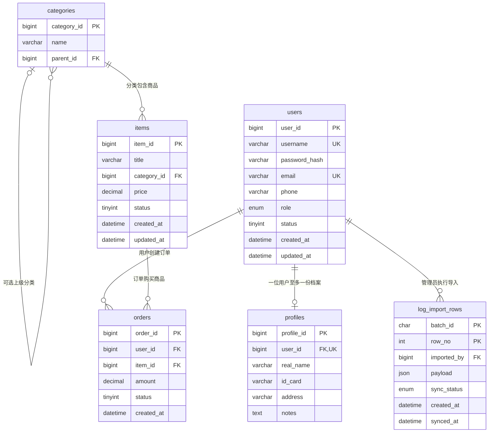

# MySQL当前结构（0.3.3）

当前五张核心业务表加log_import_rows导入暂存表。正式六表字段图位于本目录的MySQL_E-R图.png与MySQL_E-R图.pdf，查询索引定义见mysql_query_indexes.sql。

log_import_rows的主键是batch_id与row_no的组合，不能只用行号识别记录。imported_by引用的是导入操作者；payload.userId是文件里可选的日志主体引用，两者承担不同职责。当前角色为ADMIN由后端在事务中检查，外键本身只保证账号存在。

MySQL记录同步状态，MongoDB system_logs保存查询用的日志。两库通过批次编号、行号对照，没有跨库外键，也没有一个同时提交两库的JDBC事务。新实例执行mysql_log_import.sql建立第六张表，当前课程库已经安装。
