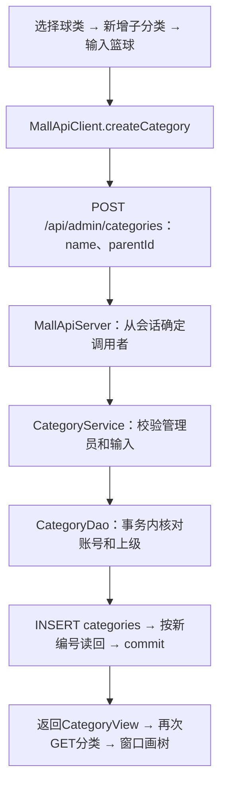

# 0.2.5：分类树查看与新增

本文记录0.2.5新增分类的实现与手操；0.2.6的编辑、移动和删除见[分类编辑与删除实操](分类编辑与删除实操.md)。

对应要求书“分类管理：树形分类”。管理员权限已在课程主库完成首次手操，本次在原工程继续新增分类功能。

## 这次改哪里，数据库会怎样变化

| 层 | 文件与方法 | 架构目的 |
| --- | --- | --- |
| 窗口 | MallDesktop.showCategories、createCategory | 画树、选择上级、输入名称 |
| HTTP客户端 | MallApiClient.categories、createCategory | 发送GET/POST /api/admin/categories |
| HTTP后端 | MallApiServer的分类路由 | 验证会话、请求方法与字段，把身份交给Service |
| 业务 | CategoryService.treeFor、createFor | 检查当前ADMIN权限、名称和上级编号；读取时检查分类关系 |
| DAO | CategoryDao.findAll、create | 执行参数化SELECT/INSERT，保存与读回共用事务 |
| 事务工具 | JdbcTransactions.execute | 管理本次保存的提交、异常回滚和连接归还 |
| 数据模型 | CategoryView | 在各层传递categoryId、name、parentId |
| MySQL | 已有categories表 | 新增分类记录，沿用原主键及自引用外键 |

Java文件均位于src/main/java/com/sportsmall下。根分类的parent_id为NULL；子分类的parent_id保存另一条分类记录的category_id。本次无需执行DDL或重新建库，MongoDB集合结构也保持原样。登录仍按原流程写system_logs。



## 1. 先观察现有分类记录

在DbGate的商城MySQL连接执行：

```sql
SELECT c.category_id, c.name, c.parent_id,
       p.name AS parent_name
FROM sports_mall.categories AS c
LEFT JOIN sports_mall.categories AS p
    ON c.parent_id = p.category_id
ORDER BY c.category_id;
```

**原理与架构目的：**这是开发者直接读取存储层。c表示当前分类记录，p表示它的上级分类记录，两者都来自同一张categories表。LEFT JOIN使没有上级的根分类也保留在查询结果中。查询结果只用于观察，不会合并或修改原表。

按之前已经确认的数据，应能找到“球类”这条分类。以这次实际查询的编号为准。

## 2. 打开0.2.5

保留MySQL、MongoDB窗口。关闭旧商城窗口，在旧商城后端窗口按Ctrl+C，然后依次双击工程根目录Start-Backend.cmd和Start-Mall.vbs。使用mall_admin01登录，进入“分类管理”。

**原理与架构目的：**新版本已经构建好。重启客户端和后端后，才会加载分类页面及新接口。打开分类管理会发送GET /api/admin/categories，后端读取数据库记录，窗口根据编号与上级编号连接成树。

窗口中的“全部分类”是用于展示整棵树的节点，数据库里没有这一行。

## 3. 在“球类”下面新增“篮球”

在分类树中选中“球类”，确认下方显示的是它的分类编号，然后点击“新增子分类”，输入“篮球”并确认。

**原理与架构目的：**窗口发送两个业务字段：name是“篮球”，parentId是刚选中“球类”的编号。当前管理员编号由后端会话确定。前端无需知道MySQL密码，也不直接发送SQL。

后端确认权限和名称后，DAO会：

1. 在本次事务里读取并锁定管理员账号与所选上级分类，确认它们仍有效。
2. 执行INSERT INTO categories(name,parent_id) VALUES(?,?)。
3. 取得MySQL生成的新主键，再按这个编号查询刚保存的记录。
4. 提交事务后返回结果，窗口重新读取并画出分类树。

这些步骤位于CategoryDao.create和JdbcTransactions.execute中。先看方法整体输入输出，再看里面的SQL；无需先记住JDBC语法。

这次事务把“核对账号和上级、插入、读回”组织到同一个连接上；发生异常时工具会尝试回滚。窗口只有在保存方法正常返回后才提示成功。如果提示结果未确认，先查询实际记录再决定是否重试，避免重复新增。

## 4. 对照树和表

重新执行第1步查询。应新增一条“篮球”，其parent_id等于“球类”的category_id；parent_name应显示“球类”。

假设查询到“球类”编号为1，本次新增主键为N，关系如下：

| category_id | name | parent_id |
| --- | --- | --- |
| 1 | 球类 | NULL |
| N | 篮球 | 1 |

N表示这次实际返回的编号，不预设为2。自增编号允许存在间隔。

窗口对应为：

```text
全部分类                    ← 仅在窗口中存在
└─ 球类（编号1）             ← parent_id为NULL
   └─ 篮球（编号N）          ← parent_id为1
```

**原理与架构目的：**表存的是记录和引用，树是窗口把这些关系画出来的结果。后端并没有新建名为“篮球”的数据表。

同时查看后端日志，应出现POST /api/admin/categories及后续GET，成功请求显示HTTP=200。至此同时观察了操作、请求和数据库记录。

## 5. 查看商品仍关联哪个分类

```sql
SELECT i.item_id, i.title, i.category_id, c.name AS category_name
FROM sports_mall.items AS i
JOIN sports_mall.categories AS c ON i.category_id = c.category_id
ORDER BY i.item_id;
```

**原理与架构目的：**新增“篮球”分类只扩展可选择的分类。已有“训练篮球”商品仍引用原来的分类编号，商品名称不会自动决定分类。商品维护阶段再实现通过后端修改商品归类。

## 可选：新增一个根分类

点击“新增根分类”，例如输入“户外装备”。新记录的parent_id应为NULL，窗口中与“球类”同级。此操作继续复用同一个POST接口，parentId为空。

## 当前范围

0.2.5实现分类树查看、根分类新增、子分类新增；0.2.6已增加改名、调整上级、防环和删除引用保护，见本页顶部的后续实操。只有ADMIN可使用分类管理接口，权限在后端校验；保存事务还会重新核对账号角色与状态。

读取树时，后端会检查孤立引用、循环等异常，避免将手工修改造成的异常记录显示成正常树。0.2.6的编辑防环与删除引用保护在同一写事务内完成。

本次自动检查使用独立临时双库。你的课程主库分类记录，以实际点击保存和DbGate读回为准。
