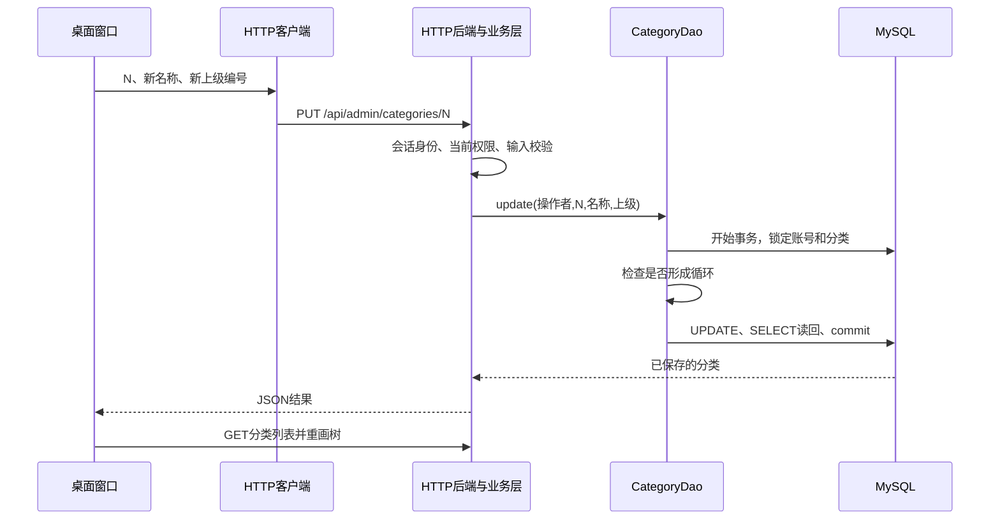

# 0.2.6：先看实现，再操作分类编辑与删除

本轮继续《项目011_运动装备商城.docx》的分类管理要求。0.2.5的主库截图已经确认：分类1是“球类”，上级为空；分类2是“篮球”，上级编号1，窗口显示的父子关系与表一致。

## 业务变化与数据库变化

新增两个操作：编辑已有分类的名称和上级；删除没有下级、没有商品引用的分类。没有新增数据表、列、外键或MongoDB集合，也没有自动修改课程主库。

改名修改name，更换上级修改parent_id，category_id始终保留。下级分类仍引用原来的category_id，商品的category_id也保持原值。将整个子树移动到另一处，只需修改子树顶部那一行的parent_id。

例如分类N是演示分类，原来在“球类”下面：

| 状态 | category_id | name | parent_id |
| --- | --- | --- | --- |
| 操作前 | N | 分类操作演示 | 1 |
| 改名并移动到“篮球”后 | N | 训练用品演示 | 2 |
| 改为根分类后 | N | 训练用品演示 | NULL |

N表示实际生成的编号，不预设为3。删除后这行消失，主键允许留有间隔。

## 改了哪些文件，为什么分开

Java文件均在src/main/java/com/sportsmall下面。

| 层 | 文件与方法 | 本轮职责 |
| --- | --- | --- |
| 桌面界面 | desktop/MallDesktop：showCategories、editCategory、deleteCategory | 选择分类、输入名称/上级、确认删除；显示结果 |
| HTTP客户端 | client/MallApiClient：updateCategory、deleteCategory | 将表单转换成PUT或DELETE请求，携带已有登录令牌 |
| HTTP入口 | server/MallApiServer：分类单条记录路由 | 从会话获取操作者，解析分类编号和允许的字段 |
| 业务层 | service/CategoryService：updateFor、deleteFor | 验证当前管理员权限、名称长度、编号 |
| 关系规则 | util/CategoryTrees：validate、validateMove | 校验树，沿拟选上级向上寻找是否会回到当前分类 |
| 数据访问 | dao/mysql/CategoryDao：update、delete、lockedTree | 同一事务中锁定、检查、更新/删除、读回 |
| 事务工具 | util/JdbcTransactions：execute | 复用已有工具，成功提交，异常尝试回滚 |
| 数据契约 | api/ApiDtos.CategoryDeletion | 将删除结果作为JSON返回，不携带数据库对象 |
| 请求日志 | server/RequestLoggingFilter | 为新路由增加固定名称、方法、状态、耗时记录 |

把原来的分类关系检查移到了CategoryTrees，读取分类树与写事务可以复用同一套规则。它只计算关系，不连接数据库。

## 一次编辑怎样真正保存

假设选中了演示分类N，名称改为“训练用品演示”，上级选择“篮球（编号2）”。

1. **窗口收集输入。** editCategory用当前名称预填文本框，用分类列表填充上级下拉框。“无上级”对应null。下拉框显示名称，但内部保存的是编号。
2. **客户端发请求。** updateCategory发送PUT /api/admin/categories/N，请求体为：

   ```json
   {"name":"训练用品演示","parentId":2}
   ```

   N位于请求路径中，用来确定修改哪一行；不是新建分类。当前管理员身份由登录令牌确定，不让前端自报role或userId。
3. **HTTP后端接收。** MallApiServer只接受name、parentId两个业务字段，再把会话用户、N及表单交给CategoryService.updateFor。前端没有发SQL，也没有使用MySQL密码。
4. **业务层检查。** 从MySQL读取账号的当前角色和状态，确认可以管理分类；去掉名称首尾空白，检查1至50个字符、编号合法。是否形成循环必须使用事务里锁定后的真实分类记录检查。
5. **DAO执行事务。** 重新核对并锁定操作者账号，再按主键顺序读取并锁定分类记录。validateMove从拟选上级沿parent_id向上查；遇到N就说明会形成循环，直接拒绝，尚未执行UPDATE。
6. **执行参数化修改。** SQL固定为：

   ```sql
   UPDATE categories SET name = ?, parent_id = ? WHERE category_id = ?;
   ```

   Java分别绑定名称、上级编号、当前编号。即使名称像SQL语句，也只是字段值。上级为空时使用setNull，最终存SQL NULL。
7. **读回并提交。** 按N查询实际保存的行，检查名称与上级符合请求。JdbcTransactions执行commit后方法才返回；发生异常则尝试rollback。原值保存也允许正常返回。
8. **界面刷新。** 后端返回CategoryView；窗口收到成功结果后重新GET分类，再按parent_id重画树。它不是在本地随意挪一个图标。



本项目分类较少，因此编辑/删除采用“锁定分类记录后检查”的直观方案，两个管理员同时改父子关系会等待彼此。分类规模扩大时再优化锁范围；这里优先把并发下的关系正确性落实。

## 为什么已有外键还要防环

外键只核对引用的编号存在。例如“球类”引用“篮球”，而“篮球”又引用“球类”，两个编号都存在，仍然可能形成循环。validateMove负责“不能把自己放进自己的下级”这条业务规则。

新增分类不会自带下级；编辑已有分类则可能移动整个子树，所以本轮新增了事务内的防环检查。

## 一次删除怎样发生

deleteCategory先显示名称、编号和确认框，再发DELETE /api/admin/categories/N，请求体为空对象。后端校验管理员，在事务中检查：

- 分类N仍存在；
- 没有分类的parent_id等于N；
- 没有商品的category_id等于N。

满足条件才执行DELETE FROM categories WHERE category_id = ?，成功删除一行并提交后返回deleted=true。没有级联删除。外键仍然保留，即使有其他写入或额外引用，MySQL也会阻止不合法删除。

删除失败不会顺便删除下级或商品。提示“结果未确认”时先查询真实记录，再考虑重试；连接中断时不能仅凭窗口提示推定是否保存。

## 手操：在现有工程做一轮，不动原有业务分类

先读完上面的实现，再做下面这轮正常编辑与删除。自动检查已经覆盖失败与并发分支，不需要逐项重演异常。

1. **加载新程序。** 保留两个数据库窗口，退出旧商城，在旧后端窗口按Ctrl+C，然后依次双击工程根目录的Start-Backend.cmd、Start-Mall.vbs。以mall_admin01登录。启动脚本已指向0.2.6，不需要重新初始化数据库。

   **目的与原理：**两个Java进程分别加载新接口与新窗口；只重开窗口不能让旧后端认识PUT/DELETE。

2. **新增一条演示分类。** 进入分类管理，选中“球类”，新增子分类“分类操作演示”，记下返回的编号N。

   **目的与原理：**准备一条没有商品和下级的真实记录，用来观察后面的UPDATE/DELETE。新增过程仍是上轮的POST与INSERT。

3. **编辑这条演示分类。** 选中它，点击“编辑分类”。名称改为“训练用品演示”，上级选择“篮球（编号2）”，保存。窗口应把它画到“篮球”下面。

   **目的与原理：**本次PUT更新同一行的name和parent_id；编号N不变。先打开源码中的editCategory、updateCategory、updateFor、update四个方法，对照上述链路看输入怎样往下传递。

4. **在DbGate读回。** 执行：

   ```sql
   SELECT c.category_id, c.name, c.parent_id, p.name AS parent_name
   FROM sports_mall.categories AS c
   LEFT JOIN sports_mall.categories AS p ON p.category_id = c.parent_id
   ORDER BY c.category_id;
   ```

   **目的与原理：**直接从存储层确认N那行的名称和上级编号，parent_name来自同表连接。后端日志应有PUT及随后GET；它们与SQL读回一起解释窗口变化。

5. **删除这条演示分类，再运行同一查询。** 选中“训练用品演示”，点击“删除分类”并确认。编号N那行应消失，原来的“球类”和“篮球”继续保留。

   **目的与原理：**DELETE真正移除数据库记录；窗口通过再次读取数据而更新。以后商品维护会复用已有分类编号，本轮没有自动重新归类商品。

本轮窗口效果等待用户手操反馈。隔离HTTP与数据库检查、主库手操和截图证据分别记录，不相互替代。
