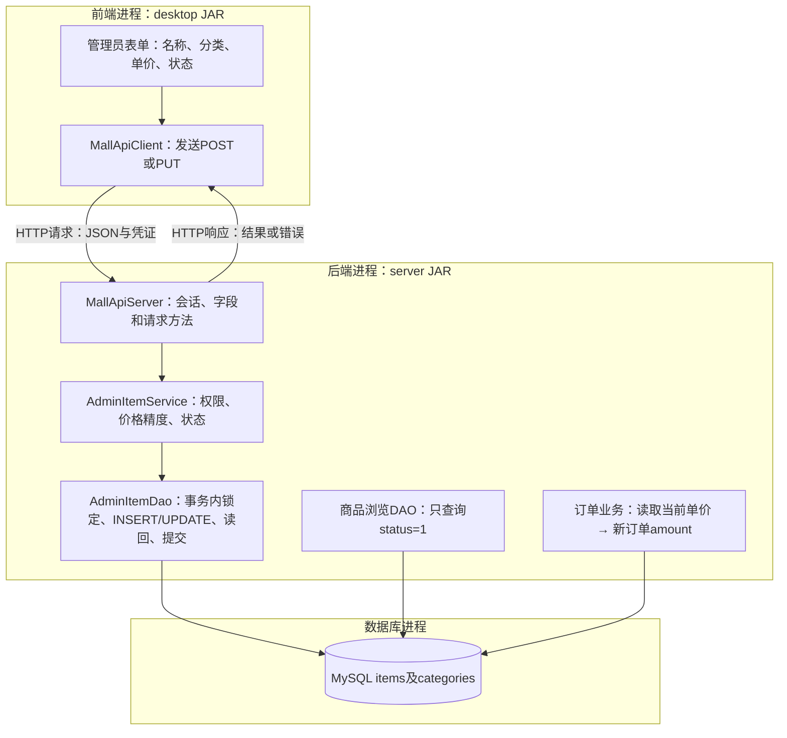

# 0.2.7：管理员商品基础信息维护

2026-11-08。对应老师要求书中的“业务管理：数据录入、分类、状态”，在同一个正式商城工程继续开发。本轮维护MySQL基础信息；MongoDB详情的说明、图片与语言字段编辑将在下一轮接入，不能把本轮记为双库录入已经全部完成。

## 承接上轮的实际进度

用户确认分类操作正常。2026-11-08提供的截图中，编号3改名为“训练用品演示”，parent_id为2，窗口位于“球类→篮球”下面；随后提供的日志显示POST、两次PUT、DELETE及各次刷新均返回200。记录为分类编辑、移动、删除已经由用户主库手操确认。截图展示的是删除前状态，不把它当作删除后SQL读回。

## 这次改什么，数据会怎样变化

管理员新增“商品管理”页面，包含上架和下架商品；可新增商品，编辑名称、分类、单价及销售状态。继续使用已有items表，不需要执行DDL或重新建库。

| 操作 | items变化 | 对普通商城的影响 |
| --- | --- | --- |
| 新增商品 | INSERT一行，生成item_id | status=1时出现在在售列表 |
| 改名 | 更新title | 列表及引用该商品的查询显示当前名称 |
| 更换分类 | 更新category_id | 按该编号关联categories，显示新的分类名称 |
| 改价 | 更新price | 之后下单使用新价格，旧报价被拒绝 |
| 下架 | status改为0，商品记录保留 | 在售列表隐藏，后端拒绝新下单 |
| 重新上架 | status改为1 | 商品重新可浏览和下单 |

本轮没有物理删除商品的接口；下架不执行DELETE，既有orders.item_id和MongoDB的商品引用继续有效。订单amount是下单时保存的金额快照，所以改价不会重写它；订单展示的商品名称仍由当前items联表查询，并未声称名称也是历史快照。

例如新增编号N后：

| 阶段 | item_id | title | category_id | price | status |
| --- | --- | --- | --- | --- | --- |
| 新增 | N | 商品维护演示球 | 1 | 89.90 | 1 |
| 编辑 | N | 训练演示球 | 2 | 99.90 | 1 |
| 下架 | N | 训练演示球 | 2 | 99.90 | 0 |

三个阶段是同一行，N由MySQL生成，不预设编号，也不会自动创建MongoDB详情文档。

## 代码改在哪一层，为什么

源码位于src/main/java/com/sportsmall下。

| 层 | 文件与方法 | 输入→输出；架构目的 |
| --- | --- | --- |
| 窗口 | desktop/MallDesktop.showAdminItems、editAdminItem | 当前选择/表单→HTTP调用；负责显示、输入和确认 |
| 客户端 | client/MallApiClient.adminItems、createItem、updateItem | 业务字段→GET/POST/PUT；负责序列化与发送登录令牌 |
| HTTP入口 | server/MallApiServer的商品管理路由 | URL、JSON、会话→业务层；限制方法和字段，身份来自后端会话 |
| 业务层 | service/AdminItemService.listFor、createFor、updateFor | 当前账号和字段→已校验输入；决定谁可操作、值是否合法 |
| DAO | dao/mysql/AdminItemDao.findAll、create、update | 已校验输入→参数化SQL和实际读回；拥有数据库操作 |
| 数据模型 | model/ItemFields、AdminItemView | 保存字段、含销售状态的返回行；不携带数据库连接 |
| 资源装配 | server/MallServices | 用现有连接池创建DAO与Service，交给路由调用 |
| 事务 | util/JdbcTransactions.execute | 同连接检查/保存/读回→提交；异常尝试回滚 |

普通用户仍使用原有ItemView和GET /api/items；管理员使用新的AdminItemView和GET /api/admin/items。两个列表的用途不同：前者只展示在售商品，后者也需要看到下架商品。管理员列表暂按编号显示前100项，完整多条件分页仍是后续要求。

## 一次保存完整走一遍

1. **窗口取输入。** 管理员点击新增或编辑时，先GET分类列表。分类下拉框显示名称和编号，内部保存categoryId。编辑时预填当前商品的四项信息；新增默认下架，可在表单选择上架。
2. **发HTTP。** 新增发POST /api/admin/items，编辑发PUT /api/admin/items/N。请求携带title、categoryId、price、status。当前JSON金额按字符串传输，例如：

   ```json
   {"title":"训练演示球","categoryId":2,"price":"99.90","status":1}
   ```

   客户端携带登录令牌，不提交root密码、操作者编号或role。
3. **解析请求。** MallApiServer只允许这四个字段，分类编号和状态必须能精确解释成整数。多余身份参数和不支持的方法被拒绝，然后将会话用户与业务字段交给AdminItemService。
4. **业务校验。** 读取账号当前角色和状态，只有启用的ADMIN可管理商品。名称去首尾空白后为1至200个字符；分类编号为正数；价格大于0、不超过99999999.99元，最多两位小数；销售状态只允许0和1。
5. **金额为何用BigDecimal。** 它按十进制保存金额；89.9归一成89.90，89.901会被拒绝，不会悄悄改成89.90。无需记忆Java语法，重点是把“输入价格是否允许”和“保存哪一个金额”明确下来。
6. **DAO事务检查。** 再次读取并锁定操作者账号，核对仍有权限；锁定所选分类，保证写入期间分类有效。编辑还会锁定商品行，确认它存在，协调同一商品的下单、改价和上下架。
7. **参数化SQL。** 新增使用INSERT INTO items(title,category_id,price,status) VALUES(?,?,?,?)并取生成主键；编辑使用：

   ```sql
   UPDATE items
   SET title = ?, category_id = ?, price = ?, status = ?
   WHERE item_id = ?;
   ```

   Java逐个绑定字段值。分类名称通过JOIN查询得到，窗口不额外复制一份分类名称到items。
8. **读回和返回。** DAO按商品编号读回，核对名称、分类、价格、状态，提交事务后返回AdminItemView。窗口再次GET管理列表。普通浏览页面再次刷新时，原有status=1筛选自然反映上下架结果。



前端createItem/updateItem负责发送请求；后端route按方法与路径分发给AdminItemService.createFor/updateFor。保存成功后，窗口重新GET管理列表。这里的箭头包括同进程方法调用和跨进程HTTP，已分别标注。

## 手操：一条演示商品的新增、修改与上下架

这轮沿正常业务走一遍。历史订单金额与异常分支由独立数据库自动检查，不需要为了验证重复创建大量主库订单。

1. **重启这两个Java进程。** 保留MySQL、MongoDB窗口，退出旧商城，在旧后端窗口按Ctrl+C。依次双击工程根目录Start-Backend.cmd、Start-Mall.vbs，以mall_admin01登录，进入“商品管理”。启动脚本已经指向0.2.7。

   **位置与原理：**客户端加载新表单，后端加载商品管理接口。数据库继续使用同一份数据。

2. **新增“商品维护演示球”。** 分类选“球类（编号1）”，单价89.90，状态选“上架”，保存，记下商品编号N。管理列表应显示它。

   **位置与原理：**窗口→POST→Service→DAO→INSERT→提交。管理员编号来自会话，新商品编号由MySQL生成。

3. **在DbGate读回，再看商品浏览。** 执行：

   ```sql
   SELECT i.item_id, i.title, i.category_id, c.name AS category_name,
          i.price, i.status
   FROM sports_mall.items AS i
   JOIN sports_mall.categories AS c ON c.category_id = i.category_id
   ORDER BY i.item_id;
   ```

   随后点商城的“商品浏览”，确认新商品出现。

   **位置与原理：**SQL从存储层查看真实行；普通浏览调用GET /api/items，只选status=1的行。新商品的MongoDB详情尚未填写，当前浏览入口会显示“商品详情尚未填写。”

4. **在商品管理选中N，点击“编辑／上下架”。** 名称改为“训练演示球”，分类改为“篮球（编号2）”，单价改为99.90，保持上架并保存。重跑第3步SQL。

   **位置与原理：**PUT→UPDATE，商品编号N保持不变，三个基础字段改变；不是删掉再新增。后端日志应出现PUT /api/admin/items/{itemId}及GET刷新，日志中的占位名称用于归类接口。

5. **同一表单把状态改为“下架”。** 刷新“商品浏览”，新商品应消失；管理列表仍可找到它，DbGate仍有编号N，status变成0。需要时再通过同一表单上架。

   **位置与原理：**只更新销售状态。普通浏览与后端下单会检查这个值，订单及详情引用仍有对应商品行。

本轮未自动修改课程主库商品。新表单和主库数据结果等待用户手操；测试、用户确认和截图证据分开记录。
