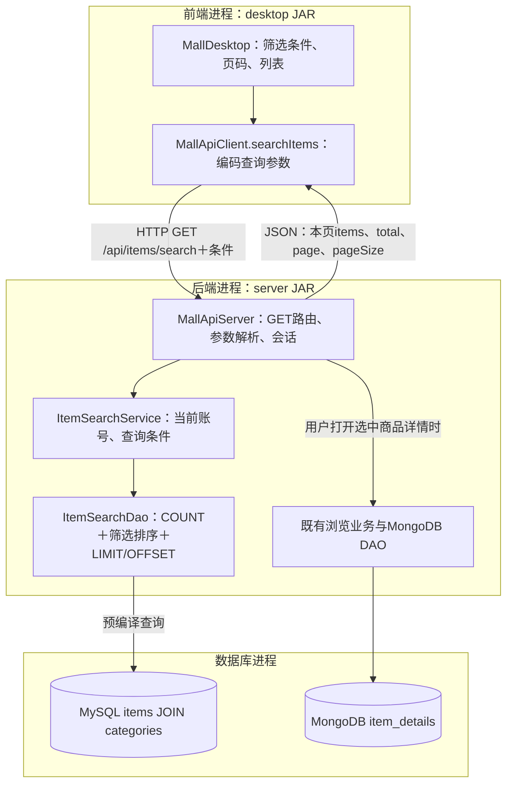

# 0.2.9：商品多条件查询与分页

2026-11-08。继续项目011要求书“业务管理→数据查询→多条件分页”。上一轮0.2.8商品详情验证已由用户确认全部完成。本轮只调整商品查询与窗口交互，沿用现有表和集合，不执行迁移或写入课程主库演示数据。

## 先看这一轮增加什么

商品浏览新增名称关键词、分类、最低价、最高价、排序、每页条数，以及首页/上一页/下一页。条件共同生效；名称只检索MySQL的title，分类只匹配直接所属分类，不自动包含下级。商品说明仍在打开详情时从MongoDB读取。

例如“名称含球、最高价100元、价格升序、每页1条”：先找所有符合条件的在售商品，再按价格和编号排序，最后每次返回一条。不是把全部商品发给窗口再隐藏其他行。

| 位置 | 改动文件与方法，路径以src/main/java/com/sportsmall为起点 | 目的 |
| --- | --- | --- |
| 前端 | desktop/MallDesktop.showProducts(ItemFilter) | 收集条件、显示本页与总数、控制翻页按钮 |
| 前端 | client/MallApiClient.searchItems、catalogCategories | 把条件编码为URL参数，调用只读HTTP接口 |
| 两端共用数据契约 | model/ItemFilter、ItemPage | 前者表示查询条件，后者表示本页列表和总数；都不是新表 |
| 后端接口 | server/MallApiServer，/api/items/search与/api/categories | 解析允许的参数，取得后端会话身份，交给业务层 |
| 后端业务 | service/ItemSearchService.searchFor、categoriesFor | 只有当前启用账号能查询；普通用户也可读取分类选项，但不能维护分类 |
| 后端数据访问 | dao/mysql/ItemSearchDao.search | 固定SQL、参数绑定、COUNT与分页SELECT |
| 既有后端链路 | BrowsingService.openFor→ItemDetailDao | 选中本页商品后按编号查询MongoDB详情，本轮继续复用 |

早期命令行入口使用的CatalogService保留。新窗口筛选使用ItemSearchService，职责分别明确。管理员维护商品、评论选品等旧接口仍继续工作，本轮新增分页的是商品浏览页面。



## 点查询以后，代码怎样走

1. **前端表单→ItemFilter。** 空价格表示不限，空名称表示不限；价格必须在0至99999999.99元、最多两位小数，最低价不超过最高价。每页1至100条，页码从1开始。点击查询、改变每页条数后点击查询，都会回到第1页。
2. **前端发送HTTP。** 示例：GET /api/items/search?keyword=球&maxPrice=100&sort=price_asc&page=1&pageSize=1。实际发送前编码中文及特殊字符，不把它们当成新的URL参数。
3. **后端解析。** 只接受keyword、categoryId、minPrice、maxPrice、sort、page、pageSize。价格、页码和编号要符合类型与范围；排序只能选id、price_asc、price_desc。身份来自登录凭证，不能自报role或指定status=0读取下架商品。
4. **Service核对当前账号。** 已停用账号不能继续查询；普通USER可使用商品筛选与分类选项，管理员分类写接口仍要求ADMIN。
5. **DAO先算总数。** COUNT(*)使用与分页查询相同的WHERE条件，始终加status=1。total是所有匹配商品数，不是当前页行数。
6. **DAO再查本页。** ORDER BY之后使用LIMIT pageSize OFFSET offset，其中offset=(page-1)×pageSize。每页1条时，第1页跳过0条，第2页跳过1条。
7. **确定同价顺序。** 价格升降序之后都用item_id升序区分相同价格。没有第二个排序依据时，同价商品顺序可能不确定，影响翻页对照。[MySQL官方说明](https://dev.mysql.com/doc/refman/8.4/en/limit-optimization.html)
8. **返回与显示。** 后端返回items、total、page、pageSize，窗口据此计算总页数和是否可翻页。筛选结果中的商品仍携带实际itemId，详情、下单使用这一编号。

价格排序由后端执行。商品表格关闭仅针对本页的表头排序，改用筛选区的排序选项，保证先对整个匹配结果排序再分页。

## SQL和数据库结构有什么变化

没有增加表、列、索引或集合。新增的是固定的查询SQL与参数绑定代码；关键词、分类、价格、排序选项、页大小和偏移都作为参数传入，不把用户输入拼成SQL文本。

| 输入含义 | 查询的作用 |
| --- | --- |
| 名称关键词 | title包含这段文字，%和_按普通文字匹配 |
| 分类 | i.category_id等于所选分类编号 |
| 最低价 | i.price大于等于输入值 |
| 最高价 | i.price小于等于输入值 |
| 每页条数 | LIMIT，本次最多返回多少行 |
| 页码 | 换算为OFFSET，本次跳过多少行 |

COUNT和本页SELECT在同一连接、可重复读事务中执行，使一次请求里的总数与本页使用同一快照。[MySQL一致性读说明](https://dev.mysql.com/doc/refman/8.4/en/innodb-consistent-read.html) 不同页是不同HTTP请求，其他人期间增删改商品后结果可能变化；这不是跨多次点击保留一个不变快照。

本轮没有声称已经完成性能优化。包含匹配、可选条件与排序仍需后续结合配额数据、EXPLAIN和耗时设计索引及优化；不能因为有LIMIT就认为查询必然很快。

## 手操与数据库对照

以下SQL用于**DbGate→商城MySQL→sports_mall查询窗口**。MongoDB详情本轮不需重新录入。

1. **退出旧商城，在旧后端按Ctrl+C。** 保持MySQL和MongoDB运行。依次双击工程根目录Start-Backend.cmd、Start-Mall.vbs，登录进入商品浏览；脚本已指向0.2.9。

   **原理与架构目的：**前端加载新筛选页面，后端加载新接口；现有数据库继续使用。

2. **先观察总数，再把每页改为1并点击查询。** 有两条以上在售商品时，下一页应可点击。只有一条时按钮禁用是正确结果；如需演示两页，可在商品管理中将上一轮已有演示商品上架，再回商品浏览重置。

   **原理与架构目的：**观察后端分页，而不是额外创建无关练习数据。更改条件后点击查询回到第1页，翻页沿用上次已经查询的条件。

3. **组合筛选：**名称输入“球”，分类选“全部分类”，最低价0，最高价100，排序“价格升序”，每页1条，点击查询。

   **原理与架构目的：**窗口只收集条件，后端取交集后排序分页。没有结果时显示空列表和无匹配提示，不代表程序错误。

4. **在DbGate查询所有符合条件的商品，作为对照。**

   ```sql
   SELECT i.item_id, i.title, c.name AS category_name, i.price
   FROM sports_mall.items i
   JOIN sports_mall.categories c ON c.category_id = i.category_id
   WHERE i.status = 1
     AND i.title LIKE '%球%'
     AND i.price >= 0.00 AND i.price <= 100.00
   ORDER BY i.price ASC, i.item_id ASC;
   ```

   **原理与架构目的：**数据库中符合条件的全量结果是窗口各页的依据。窗口第1页应对应第一行，第2页对应第二行；单价相同时按编号比较。

5. **在DbGate单独执行分页版本：**

   ```sql
   SELECT i.item_id, i.title, c.name AS category_name, i.price
   FROM sports_mall.items i
   JOIN sports_mall.categories c ON c.category_id = i.category_id
   WHERE i.status = 1
     AND i.title LIKE '%球%'
     AND i.price >= 0.00 AND i.price <= 100.00
   ORDER BY i.price ASC, i.item_id ASC
   LIMIT 1 OFFSET 0;
   ```

   改为OFFSET 1再执行，对应窗口下一页。

   **原理与架构目的：**SQL已经只返回一行；前端不需要获得所有商品再自己切片。

6. **再选某个实际分类，点击查询。**可保留其他条件。DbGate在WHERE里增加AND i.category_id = 实际编号，观察交集；这里“实际编号”需替换为窗口显示的数字再执行。选父分类不自动包含子分类商品，界面顶部已说明。

   **原理与架构目的：**分类名称只是显示，筛选按MySQL外键列的编号比较。多个条件共同限制结果，不是互相替代。

7. **选中本页商品点击查看详情。**应打开这件商品已有的说明，关闭后正常保存浏览记录。每页条数和筛选不会改变MongoDB详情与商品编号的对应关系。

   **原理与架构目的：**MySQL负责本轮列表筛选；选中行的itemId继续驱动既有双库详情读取。

## 验证范围

0.2.9通过308项JUnit和324项真实HTTP/临时MySQL8.4.13/MongoDB8.0.34检查，较0.2.8新增15项单元测试和50项商品查询检查。覆盖条件交集、价格边界、分类精确匹配、全局排序、同价稳定顺序、空/末/超出范围页、长整数偏移、URL及LIKE转义、权限、独立SQL结果对照，以及筛选商品的详情和下单链路。临时实例已退出并清理，自动检查未写课程主库。

用户已确认上一轮0.2.8全部验证完成。本轮0.2.9新窗口待用户手操；自动接口检查不等同于用户已操作窗口。

下一阶段继续课程要求中尚缺的业务闭环，优先评论修改与删除；最终数据配额、性能实测和交付PDF按总进度表继续完善。
