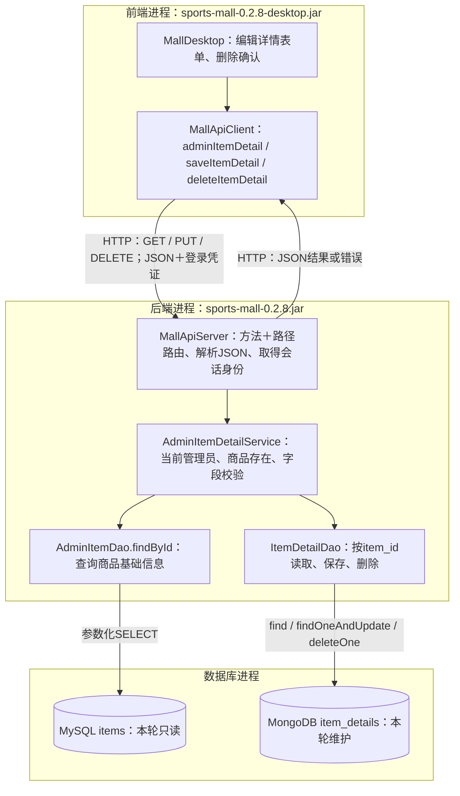

# 0.2.8：从管理员表单到MongoDB商品详情

2026-11-08。继续老师下发的项目011。承接0.2.7的商品基础信息维护，不重新创建数据库。

## 先回答前后端的两个问题

图中的MallDesktop与MallApiClient都是**前端代码**，在desktop JAR的进程中运行；MallApiServer、Service、DAO是**后端代码**，在后端JAR进程中运行。MySQL、MongoDB是另外的数据库进程。

你对接口增加方式的理解正确：前端为按钮绑定处理方法，方法经MallApiClient发送HTTP请求；后端为“HTTP方法＋路径”增加分支，从请求中取出字段，调用Service。前端的createItem/updateItem是发送请求的方法，后端处理商品基础信息的是AdminItemService.createFor/updateFor，不是跨进程直接调用Java方法。

这一轮同样接一条完整链路，只是保存位置换为MongoDB详情文档。



表单收集输入；HTTP让两个独立程序交换数据；Service决定这次操作是否允许；DAO把操作表达为数据库命令。数据库执行成功后，返回值沿原路回到窗口。

## 具体改了哪些文件，怎么接起来

以下源码路径均以src/main/java/com/sportsmall为起点。

| 所属 | 文件与方法 | 这次修改和目的 |
| --- | --- | --- |
| 前端 | desktop/MallDesktop.showAdminItems | 商品管理底部增加“编辑详情”“删除详情”，使用当前选中商品的编号 |
| 前端 | desktop/MallDesktop.editItemDetail | 先读取现有详情，再打开预填表单；说明、图片地址、语言由用户编辑 |
| 前端 | desktop/MallDesktop.deleteItemDetail | 说明删除范围，确认后发删除请求 |
| 前端 | client/MallApiClient.adminItemDetail / saveItemDetail / deleteItemDetail | GET读取、PUT保存、DELETE删除，处理HTTP结果，窗口不连接数据库 |
| 两端数据契约 | api/ApiDtos | 添加详情输入、可选详情返回、删除结果三种数据结构；只承载字段 |
| 后端 | server/MallApiServer.route | 增加/api/admin/items/{itemId}/detail分支，限制请求字段与图片数组类型；身份取后端会话 |
| 后端 | service/AdminItemDetailService.viewFor / saveFor / deleteFor | 读取当前账号权限，核对MySQL商品存在，验证说明、图片地址和语言，再调用MongoDB DAO |
| 后端 | dao/mysql/AdminItemDao.findById | 按主键查商品，包括下架商品；避免只能维护在售商品详情 |
| 后端 | dao/mongo/ItemDetailDao.findByItemId / save / deleteByItemId | 按item_id查详情；已有则更新，没有则插入；删除只作用于详情文档 |
| 后端 | server/MallServices、RequestLoggingFilter | 组装依赖、记录固定接口名称和请求结果；不输出表单正文 |

例如选中编号N，保存说明“训练演示球说明”，图片留空，语言zh-CN：

1. 前端读取N并发送GET /api/admin/items/N/detail；没有详情返回detail为null，已有则预填。GET不创建文档。
2. 用户确认表单，前端把文本转换为JSON，图片输入按行整理为数组：

   ```json
   {"description":"训练演示球说明","images":[],"language":"zh-CN"}
   ```

   路径中的N是目标商品，登录凭证代表操作者。请求不携带数据库密码，也不让前端自报管理员角色。
3. 后端根据PUT与路径选择保存分支，验证字段类型；Service核对当前启用的ADMIN账号及商品。
4. 后端允许说明1至5000个字符、图片地址最多10个、语言如zh-CN/en。图片须为HTTP/HTTPS地址；此处保存地址文字，不上传或下载图片。
5. DAO检查既有item_id唯一索引，按item_id寻找文档。使用findOneAndUpdate，upsert=true：已有时更新，没有时插入，直接取得本次写入后的文档。
6. $set更新description、images、metadata.language；$setOnInsert只在插入时设置item_id。修改已有详情保留_id与其他字段，metadata的其他字段也保留。
7. DAO把实际结果映射成ItemDetail，后端返回JSON，前端显示“已保存”。再次打开编辑窗口会重新GET读取。

MongoDB驱动对查找并更新及返回更新后文档的定义见[官方复合操作说明](https://www.mongodb.com/docs/drivers/java/sync/current/crud/compound-operations/)。本轮原子更新的范围是一份MongoDB文档。

## 数据库究竟改了什么

**没有增加表、集合或字段定义，也没有执行数据库迁移。** 使用已有items和item_details，item_id唯一索引仍使用先前建立的uq_item_details_item_id。写入前缺少该约束时会返回错误，不偷偷创建或改动索引。

| 用户操作 | MySQL items | MongoDB item_details |
| --- | --- | --- |
| 打开详情编辑窗口 | 按编号查询商品 | 查文档，不写入 |
| 首次保存 | 不修改 | 插入一份item_id=N的文档，生成_id |
| 再次保存 | 不修改 | 更新同一份文档，保留_id |
| 删除详情 | 不修改 | 删除item_id=N的详情文档 |
| 删除后再次保存 | 不修改 | 重新创建文档，生成新的_id |

保存后的文档示意，N表示实际选中商品编号：

```text
item_details
└─ 一份BSON文档
   ├─ _id：MongoDB生成的文档标识
   ├─ item_id：Long类型的N，对应MySQL商品编号
   ├─ description：训练演示球说明
   ├─ images：[]
   └─ metadata
      └─ language：zh-CN
```

商品基础信息与详情仍是两个明确的保存操作。详情保存只写MongoDB，不能撤销之前已保存的MySQL商品。两库之间没有自动外键；本轮由后端检查商品存在。主库当前也不提供物理删除商品的接口。保存请求中断时，先重新读取详情确认实际结果，再决定是否重试。

## 手操：操作、架构位置和原理

本轮用上一轮新增的演示商品，保留原有训练篮球详情。编号取你窗口里实际选中的商品，不预设为2。

1. **加载两个新版Java程序。** 退出旧商城，在旧后端窗口按Ctrl+C；MySQL和MongoDB保持运行。双击工程根目录Start-Backend.cmd，随后双击Start-Mall.vbs。脚本已指向0.2.8。以管理员账号登录，打开“商品管理”。

   **架构目的：**分别加载新的前端表单与后端接口。数据库继续使用现有数据。启动后端时提供数据库连接密码，商城登录仍使用商城账号密码。

2. **选中演示商品，点击“编辑详情”。** 没有详情时，表单提示“尚无详情”。输入说明“这是一条训练演示球的商品说明。”，图片留空，语言zh-CN，确认保存。

   **架构目的：**前端GET读已有文档，再PUT提交输入；后端校验并写入MongoDB。图片留空对应空数组，不是把其他字段留空。

3. **看后端请求日志，再直接查询MongoDB。** 日志应包括GET和PUT /api/admin/items/{itemId}/detail；成功时HTTP200。打开mongosh，在下面两行中依次执行：

   ```javascript
   use sports_mall
   db.item_details.find({}, { item_id: 1, description: 1, images: 1, "metadata.language": 1 }).sort({ item_id: 1 })
   ```

   **架构目的：**日志确认请求走到后端，文档查询确认实际保存位置。找到item_id与选中商品编号相同的文档，记下_id。MongoDB与MySQL虽然都叫sports_mall，仍是两个不同数据库进程中的数据。

4. **在DbGate的MySQL查询窗口执行：**

   ```sql
   SELECT item_id, title, category_id, price, status
   FROM sports_mall.items
   ORDER BY item_id;
   ```

   **架构目的：**观察另一边的数据；本次说明保存不会改变MySQL价格、分类和销售状态。无需重新建表或把说明加进items。

5. **再次编辑同一商品详情。** 把说明改为“这是一条训练演示球的商品说明，已更新。”，保存后重复第3步MongoDB查询。

   **架构目的：**确认这是更新同一份详情：item_id和_id不变，description变化。它不是每次保存都追加一条记录。

6. **从普通商品浏览读取。** 若该演示商品下架，先在商品管理“编辑／上下架”中上架。然后打开“商品浏览”，查看该商品详情，应看到刚保存的说明。

   **架构目的：**管理入口负责写入；商品浏览复用原有双库读取链路。普通浏览只展示上架商品，与管理员是否能编辑下架商品详情是两条规则。

7. **删除这份演示详情，再查询两边。** 在商品管理选中同一演示商品，点击“删除详情”并确认；重复第3、4步。MongoDB里该商品详情消失，MySQL商品仍在。再次打开详情编辑会提示尚无详情；可重新填写保存，以便后续演示。

   **架构目的：**DELETE只删除说明文档，不删除商品、订单、评论或浏览记录。删除后重建会产生新_id，item_id继续对应原商品。

## 这一轮的验证范围

0.2.8构建完成，293项JUnit、274项真实HTTP与临时MySQL/MongoDB检查通过，新增24项业务单元测试及47项详情集成检查。覆盖权限、下架商品、首次创建/再次更新、BSON字段、额外字段保留、输入校验、缺少唯一索引、写入失败无部分字段变化、普通浏览读回，以及删除保留商品/订单/评论/行为记录。临时实例已经退出并清理，自动检查未写课程主库。

用户已确认0.2.7商品GUI与数据库查询正常，未另提供逐项截图或演示商品编号。0.2.8新表单尚待本轮用户手操，不把接口检查写成用户窗口已验收。

之后继续商品多条件查询与稳定分页，仍按“先看具体代码改动，再操作和核对数据库”的节奏推进。
