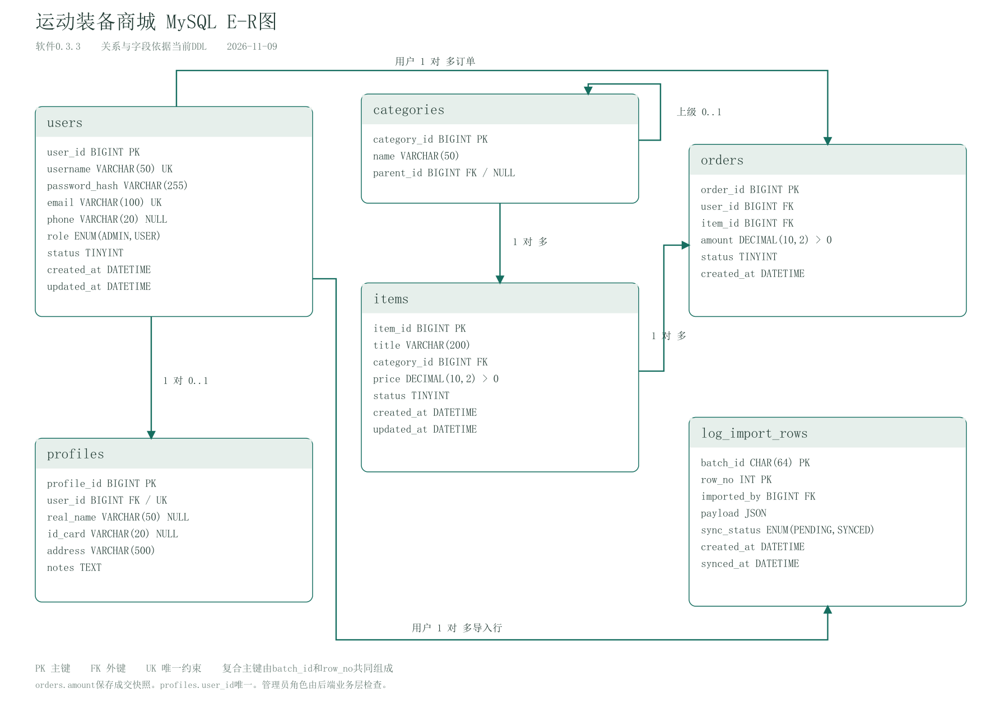

# 运动装备商城技术设计文档

文档V0.6  |  软件0.2.3  |  更新日期2026-11-07

依据老师下发的《项目011_运动装备商城.docx》维护。当前实现覆盖普通用户的主要使用链路，待完成范围在第七节列明。已确认的数据库记录由现有实例继续保存。

## 1. 运行架构

商城分为桌面客户端、HTTP后端、MySQL和MongoDB四类进程。桌面客户端调用HTTP接口，后端确认身份后执行业务校验和数据库操作。DbGate作为开发者工具直接连接数据库。

| 层 | 主要代码 | 职责 |
| --- | --- | --- |
| 桌面表现 | desktop/MallDesktop | 页面、输入、确认、结果呈现 |
| 请求客户端 | client/MallApiClient | HTTP请求、JSON、登录凭证、错误提示 |
| 接口与会话 | server/MallApiServer、SessionStore | 路由、方法与字段校验、服务端身份 |
| 业务服务 | service中的Service类 | 业务规则、本人范围、操作组织 |
| 数据访问 | dao/mysql、dao/mongo、dao/ItemDao | 参数化SQL、MongoDB文档与聚合 |
| 资源组装 | server/MallServices | 数据库连接池、MongoClient、业务对象 |

请求顺序为MallDesktop → MallApiClient → HTTP → MallApiServer → Service → DAO → 数据库，结果按相反方向返回。SwingWorker在界面线程之外执行网络操作。后端使用JDK HttpServer，客户端使用HttpClient和Gson。

同一Maven工程分别生成sports-mall-0.2.3.jar和sports-mall-0.2.3-desktop.jar。后端入口为MallServerMain，客户端入口为MallDesktop。客户端包仅保留界面、HTTP客户端、共享契约与所需依赖，数据库访问资源由后端持有。

后端默认绑定127.0.0.1:18808，MySQL配置为127.0.0.1:18306，MongoDB为127.0.0.1:27017。运行方式为个人电脑按需启动。当前使用本机HTTP与开发数据库账号。

## 2. 关系模型

| 表 | 核心关系与限制 |
| --- | --- |
| users | 用户名和邮箱各自唯一，保存密码哈希、角色、状态 |
| categories | parent_id自引用，根分类可为NULL |
| items | category_id非空外键，price为正数DECIMAL(10,2) |
| orders | 关联用户和商品，amount保存下单快照，状态0/1/2 |
| profiles | 关联用户且user_id唯一，姓名、证件、地址、备注可空 |

分类与商品、用户与订单、商品与订单均为一对多。用户与档案为一对零或一。当前每笔订单购买一个商品。主外键、唯一约束与CHECK在数据库中执行，Java侧另行检查业务可用性。

mysql_schema.sql描述目标结构。已有表的变更由独立迁移处理，商品单价对应mysql_migrate_001_item_price.sql。Java启动过程建立连接和服务对象，数据库对象通过脚本显式安装。

## 3. 数据库对象与MongoDB

| MySQL对象 | 当前职责 |
| --- | --- |
| v_user_details | users LEFT JOIN profiles，提供可选档案 |
| v_user_order_summary | 按用户汇总当前各状态数量和已完成金额 |
| sp_cancel_order | 修改指定用户的待处理订单为已取消 |
| sp_monthly_order_report | 按用户和创建月份汇总当前状态与金额 |
| trg_orders_validate_insert | 在订单插入前检查用户、商品、金额及状态 |
| trg_orders_validate_update | 保护订单归属、历史金额与状态转换 |

两个视图采用SQL SECURITY INVOKER。月报通过CallableStatement传递用户编号及月初日期，时间区间为月初包含、下月月初排除。已完成金额合计orders.amount，体现下单历史价格。

| MongoDB集合 | 内容与组织 |
| --- | --- |
| item_details | 商品说明、images数组、metadata嵌套对象，item_id唯一 |
| comments | 用户商品关联、评论文字、评分、tags数组和时间 |
| action_logs | VIEW行为、停留时长、client_info嵌套对象和时间 |
| system_logs | 登录结果、日志等级、action_detail嵌套对象和时间 |

MySQL编号通过统一整数类型参与MongoDB关联。商品详情按item_id与MySQL商品组合。已有三条聚合分别统计商品评论、近七天热门商品、本人近七天浏览活动。热门并列时比较累计停留秒数，再比较商品编号。

## 4. 接口与身份

| 方法与路径 | 用途 |
| --- | --- |
| POST /api/auth/register、/api/auth/login | 注册及登录 |
| GET /api/me、PATCH /api/me/phone | 本人账号及电话 |
| GET /api/me/overview | 本人资料与订单概览 |
| GET、PUT、DELETE /api/me/profile | 本人档案读取、保存、删除 |
| GET /api/me/orders/monthly | 本人月度订单 |
| GET、POST /api/orders | 本人订单查询与创建 |
| POST /api/orders/{orderId}/cancel | 取消本人待处理订单 |
| /api/items及评论、统计路径 | 商品和评论相关查询操作 |
| /api/browses及finish路径 | 打开商品并结束本次浏览 |

登录校验PBKDF2-SHA256密码摘要和账号状态，成功后由后端生成32字节随机凭证并保存身份，会话有效期8小时。客户端在内存中保存凭证，后端从会话取得用户编号。注销或后端重启后重新登录。

接口检查请求方法、JSON字段、编号、日期和请求体大小，JSON体上限32KiB。未经登录的本人接口返回401，参数错误返回400，资源不存在返回404，不支持方法返回405。数据访问错误由统一异常处理转换成业务提示。

## 5. 一次档案保存怎样完成

MallDesktop.editProfile读取四个表单字段，调用MallApiClient.saveProfile发送PUT /api/me/profile。请求体为realName、idCard、address、notes。MallApiServer确认会话后调用ProfileService.saveMine。

ProfileService检查账号状态和字段长度，将可选空白字段整理为NULL。姓名50、证件20、地址500字符对应表列范围，备注2000字符为工程约定。四个字段作为整份表单保存。

ProfileDao.save取得连接后由JdbcTransactions控制事务，锁定对应users行，再执行参数化INSERT ... ON DUPLICATE KEY UPDATE。user_id唯一约束使首次保存新增一份档案，后续保存更新同一份。DAO在同一事务连接上读回保存内容，再提交并向上返回UserProfile。

后端将结果转换为JSON。客户端显示保存成功并重新查询页面。“资料与订单概览”读取两个视图，姓名和地址由profiles关联取得。UserProfile定义Java中的返回数据，表定义保存在数据库中。

创建订单同样使用显式JDBC事务，校验账号与商品可用性，将确认价格写入orders.amount。数据库事务涉及本次参与的MySQL操作，跨MySQL与MongoDB的更新需要另行组织结果确认。

## 6. 日志、构建与验证

RequestLoggingFilter位于HTTP入口，记录请求编号、固定操作名称、方法、接口模板，以及响应状态和耗时。GET、PUT、DELETE档案请求统一标为维护本人档案，方法字段区分动作。请求正文、登录凭证、查询参数和动态编号从记录内容中排除。

MallServerMain记录启动、数据库准备、接口就绪和关闭。应用日志由SLF4J与Logback输出到后端终端，MongoDB system_logs保存已实现的登录业务日志。

2026-11-07当前源码package成功，213项JUnit通过，失败0、错误0，其中3项验证请求日志正常响应、拒绝响应和内容处理。0.2.3另通过89项真实HTTP/独立临时双库检查，覆盖基础38项、月报19项、档案32项。临时实例退出并清理。

前端JAR按包内容检查依赖边界，后端和客户端有各自Manifest入口。用户此前已完成主库注册登录、订单与评论操作、三项统计、视图、月报，以及档案保存和关联读回。主库二次修改与删除分支按后续实操记录，隔离测试与主库证据分别保留。

源码更改后由Maven编译和打包，启动新版进程加载新代码。SQL脚本执行后由数据库保存对象定义。Git保存源码和文档版本，两远程仓库持续同步，target产物由本机重新构建。

## 7. 后续范围

管理员权限及完整维护接口、分类树维护、商品及详情CRUD、组合分页、评论修改删除、统一业务审计与日志导入尚需实现。数据配额、性能优化、并发及故障实测、最终报告与答辩材料仍待完成。

原文要求日志保存MongoDB，同时提出日志导入使用JDBC批处理，该链路在进入功能时核对。教学将围绕同一正式工程展开，先展示需求和各层改动，再操作并核对数据库结果。
