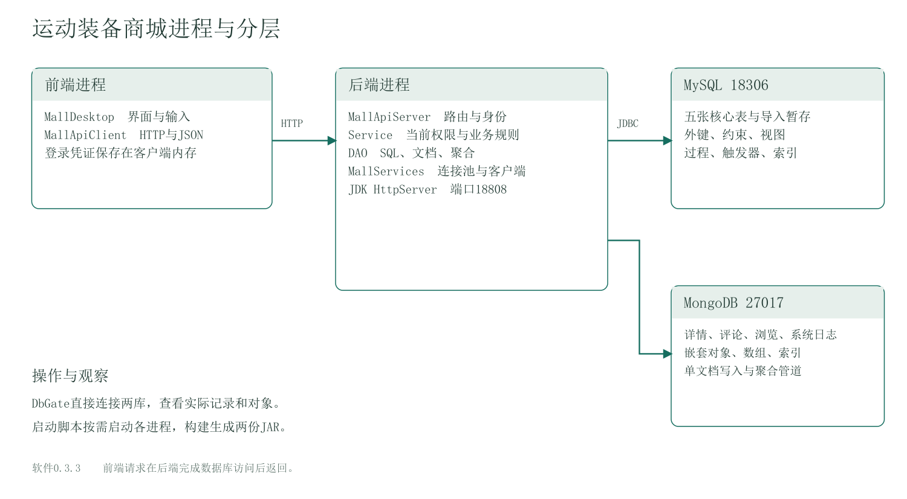
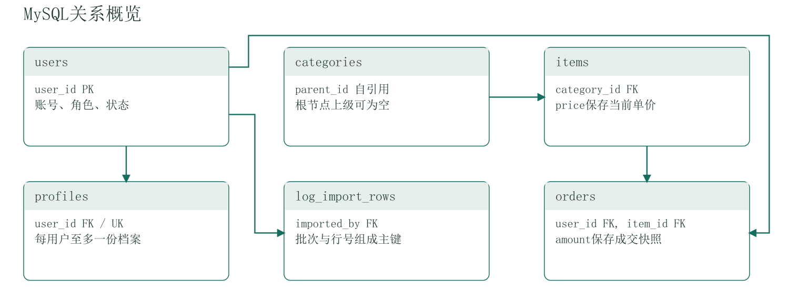
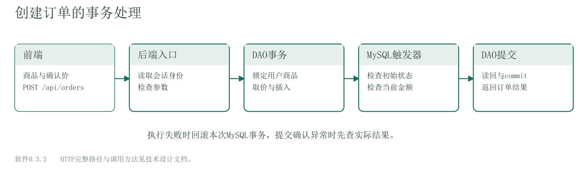
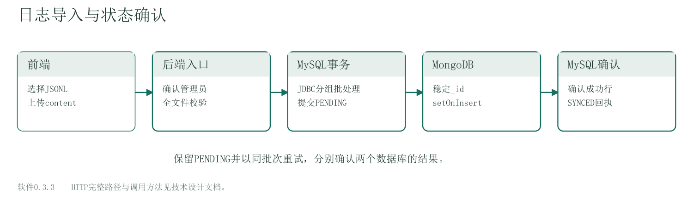

# 运动装备商城技术设计文档

软件0.3.3，文档V1.0，2026-11-09。依据项目011正式要求和当前源码。

## 1. 进程与代码分层

| 层次 | 主要代码 | 承担的工作 |
| --- | --- | --- |
| 前端界面 | desktop/MallDesktop | 表单、选择、确认、结果和错误呈现 |
| 前端请求 | client/MallApiClient | HTTP、JSON、内存中的登录凭证 |
| 后端入口 | server/MallApiServer、RequestAuthentication | 路由、方法与字段检查、会话身份 |
| 后端业务 | service目录各Service | 当前权限、本人范围、状态与价格规则 |
| 后端访问 | dao/mysql、dao/mongo、dao/ItemDao | 参数化SQL、文档写入和聚合 |
| 后端资源 | server/MallServices | HikariCP、共享MongoClient、服务组装 |
| 数据库 | MySQL与MongoDB | 保存关系、约束、文档、索引与查询对象 |

MallDesktop通过SwingWorker执行网络请求，MallApiClient用JDK HttpClient访问本机后端。MallApiServer用JDK HttpServer接收请求并将结果转为JSON。后端返回后，前端再更新表格或文本。连接池与数据库驱动由后端进程持有。

构建生成sports-mall-0.3.3.jar后端和sports-mall-0.3.3-desktop.jar客户端。默认HTTP端口18808，MySQL端口18306，MongoDB端口27017，均使用本机地址。个人电脑按需启动这些进程。DbGate直接连接数据库，承担开发查询与对象查看。

## 2. 六表关系与数据约束

各字段、主外键和完整关联见MySQL_E-R图.pdf。

users保存账号，用户名与邮箱分别唯一。profiles通过唯一user_id形成一对零或一关系。categories.parent_id自引用形成分类树，items.category_id引用分类。orders同时引用用户和商品，保存成交金额。log_import_rows通过imported_by引用导入操作者，以batch_id和row_no组成主键。

items.price和orders.amount采用DECIMAL(10,2)。订单状态的允许集合由CHECK控制，合法转换和历史字段由触发器控制。Java在取得锁和当前行后再次核对业务条件。分类删除依赖实际引用检查，移动时校验整棵树并使用锁组织并发变化。

mysql_schema.sql描述核心表，mysql_log_import.sql描述暂存表。已有商品补价格采用独立迁移文件。结构初始化与演示数据准备分别执行，演示工具读取实际自增编号后建立关联。

## 3. MySQL对象与查询

| 对象 | 数据库内执行的工作 |
| --- | --- |
| v_user_details | users左连接可选profiles |
| v_user_order_summary | 按用户汇总订单当前状态和已完成金额 |
| sp_cancel_order | 将指定用户的待处理订单转为取消 |
| sp_monthly_order_report | 按创建月份统计当前状态和历史金额 |
| trg_orders_validate_insert | 校验初始状态、有效用户、在售商品与当前单价 |
| trg_orders_validate_update | 校验终态转换并保护历史归属、金额和时间 |

月报通过CallableStatement绑定用户编号与月初日期，区间为本月月初包含、下月月初排除。存储过程由Java调用者控制事务。两个视图采用SQL SECURITY INVOKER。

商品组合筛选以固定SQL和参数值组织，CASE决定有限的排序模式。COUNT和本页查询位于同一可重复读快照。idx_items_sale_category_price用于在售、直接分类和价格区间。idx_orders_user_status_created用于本人、状态和创建时间。索引顺序与实测计划见性能报告。

## 4. MongoDB文档与跨库组合

四个集合分别保存详情、评论、浏览和系统日志。编号使用BSON Long，业务时间使用Date。详情用images数组和metadata，评论用tags数组，浏览和系统日志分别嵌套client_info与action_detail。集合字段、索引和样例见集合设计文档。

商品详情由后端先取得MySQL商品，再以item_id读取MongoDB文档并组合返回。热门排行先由Mongo聚合产生商品编号和次数，再由MySQL读取名称。两次读取各有自己的结果时点，详情缺失等情况由后端返回相应业务结果。

CommentDao的统计管道按商品匹配后分组计算条数、平均评分与评分分布。ActionLogDao的热门管道按时间窗口匹配VIEW后分组、排序和限量，本人活动管道按用户聚合浏览次数、去重商品、北京时间活跃日期和累计停留。

## 5. 一个下单请求经过哪些代码

前端选中商品并收集确认价，MallApiClient向POST /api/orders提交itemId和quotedPrice。MallApiServer读取后端会话中的用户，交给OrderService校验请求。

OrderDao在JdbcTransactions内取得连接，关闭自动提交，读取并锁定当前用户与商品，检查可用状态及确认价格，再将当前单价写入orders.amount。插入触发器执行数据库规则，DAO在同一连接读回新订单，随后提交。业务失败进入回滚，连接或提交确认异常则提示先查实际结果。

前端收到OrderView后显示订单编号、金额和状态。后端的成功写请求审计再写system_logs。审计写入故障通过后端日志提示，订单已经提交的结果保留。

## 6. 日志导入与两库状态

前端选择UTF-8 JSONL文件并上传content。POST /api/admin/log-imports确认当前管理员，LogImportParser先校验整份文件并规范化，再根据操作者和内容计算批次SHA-256。

LogImportDao在一个JDBC事务中使用addBatch，每50行executeBatch，一批最多200行。提交后读取PENDING，SystemLogDao使用稳定_id与setOnInsert批量同步MongoDB。Mongo确认后，MySQL再将已确认行标为SYNCED。

Mongo部分写入或MySQL确认标记失败时，回执保留PENDING。同一管理员重新提交原文件可继续确认并补齐。两个数据库各自提交，手动重试通过稳定编号收敛。日常日志查询只读展示，成功业务写请求生成OPERATION，导入日志为IMPORT，登录结果为LOGIN。

## 7. 身份、校验与异常

SessionStore在后端内存保存32字节随机凭证与身份，有效期8小时。前端通过Bearer发送凭证。重启后端会结束内存会话。Service重新核对当前账号和角色，关键管理员SQL写事务内再读取并锁定操作者。

普通JSON请求体上限32KiB，导入HTTP入口上限256KiB，导入文本自身上限64KiB。日期、编号、金额、评分、文本长度和允许字段均在后端检查。SQL参数使用PreparedStatement绑定，运维工具也采用固定查询和DDL模板。

业务规则异常使用MallBusinessException，数据访问异常使用MallDataAccessException，HTTP入口统一转换错误代码和提示。常见状态包括400参数错误、401会话无效、403权限拒绝、404资源缺失、405方法不支持、409状态冲突、413请求过大、503数据访问异常。

PBKDF2-SHA256采用随机盐和600000次派生，保存方案标签、参数、盐和摘要。数据库连接配置使用application.properties，密码从本地输入或进程环境取得。RequestLoggingFilter记录接口模板、方法、状态和耗时，Mongo记录业务审计。

## 8. 初始化、验证和版本交付

0.3.3的mongodb_init.js建立集合与索引。CourseDataTool在取得实际SQL编号后生成演示文档，测试运行器在独立夹具中准备训练篮球详情。新装步骤见用户手册。

342项JUnit与427项临时HTTP/双库检查已经复测，数据工具另验证空库准备、失败回滚、两库续跑和幂等重跑。性能报告记录三个查询的原始样本与计划。详细覆盖、主库截图和限制见测试报告。Git采用真实日期提交，两个远程仓库同步，交付索引列出当前版本文件。
