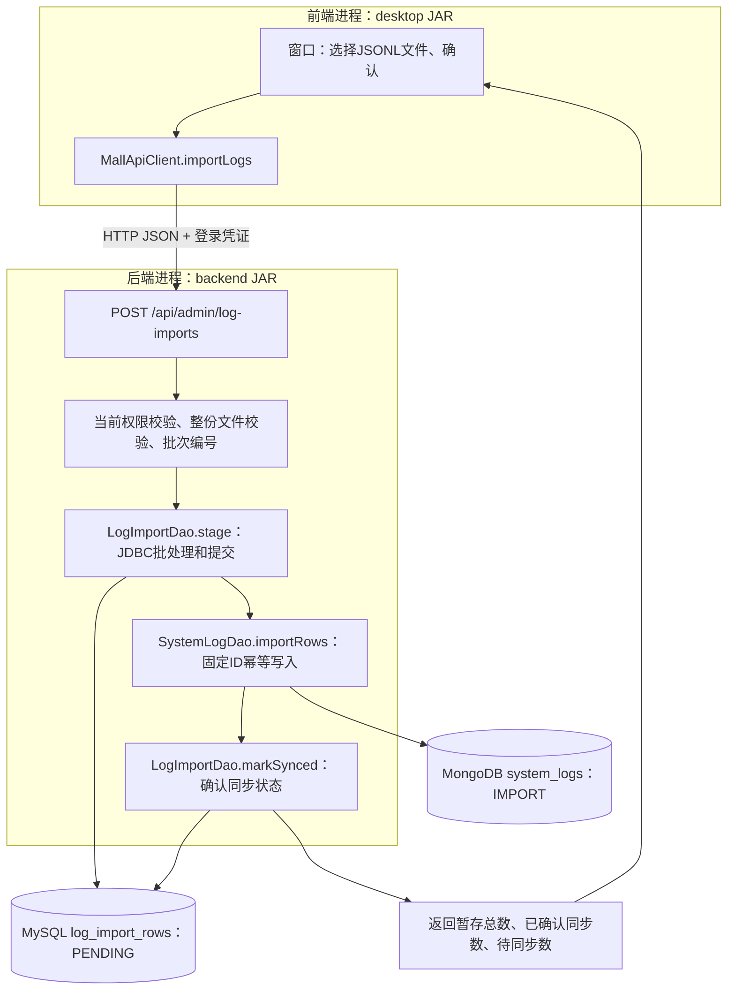

# 日志管理与JDBC批量导入：先追踪实现，再统一手操

版本0.3.1。上一批0.3.0评论维护、管理员订单处理及账号角色/启停，用户已在2026-11-08确认所有GUI测试通过。这里记录用户反馈，不补造新的数据库截图或异常分支证据。

执行分工更新：用户已将常规脚本执行和配置交给助手，以下脚本步骤保留用于理解和复现，无需用户再次机械执行。用户已提供一次导入20/20/0的成功截图；助手核对MongoDB对应批次为20条，并已成功执行日志索引脚本。目标索引原本已存在，本次重复执行没有新增第二份索引或更改日志内容。其他GUI分支不因该截图自动记为通过。

## 这批要完成什么，为什么需要这些层

要求书4.2第4项明确要求“日志数据导入使用JDBC批处理”，同时3.2把system_logs定义为MongoDB集合。本次采用一个工程方案满足两点：Java后端先用JDBC批量保存导入暂存行，再同步到MongoDB。MySQL增加第六张表log_import_rows，用于保存导入凭据和同步状态；MongoDB的system_logs仍是日志查询来源。暂存表是工程选择，不是原件逐字要求的表名。

窗口增加管理员“系统日志”：按用户编号、类型、级别、北京时间日期筛选最新200条，可查看完整说明；还可以选择本地JSONL文件导入。普通用户没有这个入口，直接访问接口同样会被后端拒绝。

系统日志分成三种类型：LOGIN沿用真实登录结果；OPERATION记录本版后端成功处理的受保护业务写请求；IMPORT专门标记文件导入的演示记录。导入文件不能指定log_type或source，不能把演示记录伪装成真实登录或操作审计。

## 修改位置与具体调用

Java文件位于src/main/java/com/sportsmall下。

| 层 | 文件和方法 | 实际职责 |
| --- | --- | --- |
| 前端窗口 | desktop/MallDesktop.java，showSystemLogs | 收集筛选条件，显示日志表格和详情 |
| 前端窗口 | desktop/MallDesktop.java，importLogs | 选取UTF-8 JSONL文件，限量读取并确认上传 |
| 前端HTTP客户端 | client/MallApiClient.java，systemLogs/importLogs | 发送GET /api/admin/logs或POST /api/admin/log-imports，带已有登录凭证 |
| 后端接口 | server/MallApiServer.java，route | 解析允许的查询参数/正文，身份从后端会话取得 |
| 后端业务层 | service/AdminLogService.java，find/importFile | 读取账号当前角色与状态，校验、协调两个DAO |
| 后端文件校验 | service/LogImportParser.java，parse/batchId | 全文件先校验；按管理员编号和规范化内容计算SHA-256批次编号 |
| 后端MySQL访问 | dao/mysql/LogImportDao.java，stage | 在事务内复核管理员权限，用PreparedStatement.addBatch/executeBatch批量插入 |
| 后端MongoDB访问 | dao/mongo/SystemLogDao.java，importRows | 使用bulkWrite和按固定_id的upsert补齐日志；已存在时不覆盖 |
| 后端MySQL访问 | LogImportDao.markSynced/summary | MongoDB确认后再把暂存行标为SYNCED，返回本批统计 |
| 数据库结构 | sql/mysql_log_import.sql | 新增导入暂存表，不改变原五张业务表 |
| 数据库索引 | sql/mongodb_log_indexes.js | 为类型、级别、时间组合查询提供索引 |



这条链里数据库修改的是两处：暂存表新增行/更新同步状态；system_logs新增IMPORT文档。窗口不执行SQL，也没有数据库密码。新增系统日志查询接口只读MongoDB。[当前六张表的关系](MySQL当前结构.md)同时标明了暂存表与账号的外键。

## JDBC批处理和事务具体在哪里

stage把同一条INSERT编译为一个PreparedStatement。每读到一条已校验的记录，就绑定这一行的参数并addBatch；每50行执行一次executeBatch，余下的最后一组也执行。所有组仍属于同一个JdbcTransactions.execute事务。任何一组失败，会尝试rollback，不能只留下前50条再宣称整批成功。

批处理表达的是“把多组参数交给数据库执行”；事务表达的是“这次MySQL写入何时一起提交或回滚”。两个概念在代码中分别体现。服务端先验证整份文件，因此末行格式错误时不会先写入前面的合法行。

## 中断与重复导入会怎样

| 中断位置 | 可能看到的数据 | 本版处理方式 |
| --- | --- | --- |
| 文件校验失败 | 两库都没有本批新增行 | 返回行号及格式提示 |
| JDBC批处理被数据库拒绝 | 整个MySQL暂存事务回滚 | 返回错误，修复后重新导入 |
| 暂存提交后、MongoDB写入失败 | MySQL为PENDING，MongoDB可能已有部分记录 | 返回待同步数量，保留原文件后重试 |
| MongoDB成功、MySQL标记失败 | MongoDB已有记录，暂存仍PENDING | 重试时复用_id，再更新标记 |
| 全部成功后重复导入 | 复用同一管理员的同一规范化内容批次 | 不增加第二份导入日志 |

SYNCED表示“MongoDB确认写入后，MySQL也确认了标记”。PENDING表示尚未完成这两次确认，其中部分文档可能已经存在于MongoDB。它不是对MongoDB实际文档缺失数的直接统计。

固定文档_id由import:批次编号:行号组成。重试使用$setOnInsert：没有该_id时新增，已有时保留。相同时间和文字本身可以合法重复，文件中不同的行仍是不同记录。更改文件内容或换一个管理员导入会形成新批次。

本版没有跨MySQL/MongoDB的全局事务，没有后台定时同步服务。恢复数据库后，由同一管理员重新选择原文件手动继续。暂存记录保留用于核对，不自动清空。用户通过DbGate手工删除已确认同步的文档，不属于本版自动修复范围。

## 成功写请求审计怎样加入

MallApiServer.handle在route成功返回后调用auditSuccessfulWrite。对需要登录的POST/PUT/PATCH/DELETE业务请求，向system_logs写入OPERATION：操作者编号、请求方法和资源路径、来源IP、时间及固定成功说明。不保存正文、密码、姓名或地址。

只读GET不产生这种审计，避免查看日志又不断制造日志。登录使用原有LOGIN记录；未完成的浏览票据不写OPERATION。没有实际修改的成功写请求也可能留下请求审计，记录名明确写“已完成商城业务写请求”，不能据此断言字段一定发生变化。

MySQL业务成功后MongoDB审计仍可能失败。此时终端明确提示审计未确认，保留已经成功的业务响应，避免让用户误以为下单回滚而再次下单。该审计是尽力记录，不能声称无丢失或覆盖全部失败尝试；失败登录沿用已有WARN日志。旧版本历史操作不会被补写成新审计。

## 一次完成手操，每步对应一个目的

### 1. 给已有MySQL库增加暂存表

在DbGate左上“商城MySQL”下面右键sports_mall，选择New query/新建查询。在这个MySQL窗口中打开并执行工程内src/main/resources/sql/mysql_log_import.sql整个文件。

目的与位置：这是数据库结构变更，新增log_import_rows。原有users/categories/items/orders/profiles和业务记录保留。CREATE TABLE IF NOT EXISTS不会重建已有表，也不能自动纠正同名旧表的不一致结构。

执行以下只读SQL观察：

```sql
SHOW CREATE TABLE sports_mall.log_import_rows;
SELECT COUNT(*) AS staged_rows FROM sports_mall.log_import_rows;
```

首次创建、尚未导入时，staged_rows应为0。表中的imported_by是执行导入的管理员账号外键；payload是已校验日志的JSON内容；sync_status记录两库同步进度。

### 2. 给MongoDB增加查询索引

在工程根目录PowerShell执行：

```powershell
& "C:\develop\MongoDB\shell\bin\mongosh.exe" "mongodb://127.0.0.1:27017" --file ".\src\main\resources\sql\mongodb_log_indexes.js"
```

目的与位置：为system_logs建立类型、级别、时间的组合索引，帮助数据库选择查询路径。只增加辅助索引，不填入演示文档，不改现有日志内容；具体性能效果留待规模测评，不宣称小数据时必然更快。

### 3. 打开0.3.1程序

退出旧商城窗口，旧后端窗口按Ctrl+C。数据库保持运行。依次双击Start-Backend.cmd和Start-Mall.vbs，使用原商城管理员登录。

目的与位置：让两个Java进程加载新版代码。启动后端的MySQL密码属于后端连接配置，商城登录使用原商城账号密码。新增加的DDL只需在第1步执行，不需要重建数据库。

本轮已生成0.3.1两个JAR；如自行修改源码，退出两个程序后再运行.\mvnw.cmd package。构建只生成程序，不执行上述DDL。

### 4. 查看真实登录与成功写请求

管理员进入左侧“系统日志”，选择LOGIN、INFO后查询，查看原有登录记录。然后在“我的账号”修改联系电话，再返回系统日志，选择OPERATION查询。

目的与位置：前端发送筛选条件，后端核对管理员身份，DAO读取MongoDB。新日志应能看到PATCH /api/me/phone及当前操作者编号；这不是新的MySQL表字段。

### 5. 导入随工程提供的20条演示日志

在“系统日志”点击“导入JSONL日志”，选择docs/演示数据/日志导入示例.jsonl并确认。成功时回执应为暂存20条、已确认同步20条、待同步0条；保存回执中的批次编号。页面自动筛选IMPORT，确认看到“课程导入演示”记录。

目的与位置：一次体验前端上传→后端校验→MySQL JDBC批处理→MongoDB同步。示例user_id为null，表示没有关联某位真实业务用户，操作者另保存在action_detail.imported_by。日期2026-11-08为演示数据时间，不代表真的在这些时刻发生了操作。

JSONL指每行一个完整JSON对象。文件为UTF-8，最多64KiB、200条；空行忽略。允许字段为user_id（正整数或null，可省略）、timestamp（含时区的ISO时间）、level（INFO/WARN/ERROR）、message（1至500字符）、operation（1至100字符）。格式有误时整份文件拒绝，不导入一半。

### 6. 直接查看两库的对应状态

DbGate上半部分“商城MySQL”下面右键sports_mall→新建查询，执行：

```sql
SELECT batch_id, imported_by, sync_status, COUNT(*) AS row_count
FROM sports_mall.log_import_rows
GROUP BY batch_id, imported_by, sync_status
ORDER BY batch_id;
```

应该能找到当前批次SYNCED、20条。payload和主键结构可以双击log_import_rows查看。若本库此前已有其他导入，按回执batch_id核对本批，不用总条数代替本批结果。

再在DbGate“商城MongoDB”下面右键sports_mall→New query/新建查询，执行以下JavaScript：

```javascript
db.system_logs.find({ log_type: "IMPORT" }).sort({ timestamp: -1, _id: -1 })
```

注意：只点左侧MongoDB库，不会把原先打开的MySQL Query标签转换成MongoDB查询。一定从MongoDB对应库新建窗口；如果错误提到MySQL server或SQL syntax，检查查询窗口所属连接。DbGate窗口里不写mongosh专用的use sports_mall。

MongoDB里应有IMPORT、BSON日期、action_detail中的批次/行号和导入人。按回执批次精确核对时：

```javascript
db.system_logs.find({ "action_detail.batch_id": "把这里替换成回执的64位批次编号" })
```

目的与位置：DbGate直接读取存储层，绕过商城前后端，帮助你确认窗口提示对应哪些实际记录。

### 7. 重复导入同一个示例文件

使用同一管理员再导入同一文件，应返回相同批次及20/20/0；对应批次的MongoDB文档仍为20条。查询总系统日志时可能多出一次OPERATION，那是本次真实导入请求的审计，不能与IMPORT记录混算。

目的与位置：验证后端批次识别与MongoDB固定_id规则，而不是验证前端禁用了按钮。MongoDB部分失败与SQL标记失败已在隔离数据库中注入故障检查，不需要为了验收在你的课程主库上破坏日志集合。

## 自动验证与后续边界

本轮自动检查使用独立临时MySQL/MongoDB目录与动态端口，结束后只清理自己创建的数据目录；未替用户执行课程主库迁移或导入。主库和窗口手操由上述步骤完成，用户反馈后再记录验收。

新增导入暂存表并不表示原五表、四集合的数据配额已经全部满足。示例是20条演示日志，日志类100+配额、正式性能测评及最终PDF/PPT仍属于后续交付。

技术核对：[JDBC PreparedStatement.addBatch](https://docs.oracle.com/javase/8/docs/api/java/sql/PreparedStatement.html#addBatch--)、[MongoDB Java bulkWrite](https://www.mongodb.com/docs/drivers/java/sync/current/crud/bulk/)。
