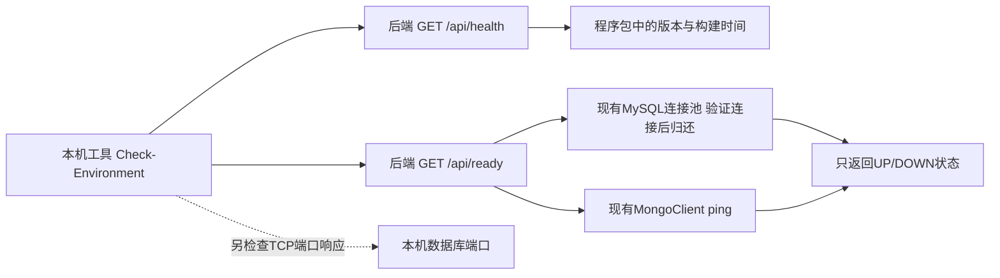

# 演示前环境检查与本轮维护

维护日期为2026年11月11日，版本沿用0.3.3。这是对已有课程工程的诊断与可维护性改进。

## 本轮解决的问题

原有`/api/health`把版本写死为0.3.1，和实际工程0.3.3不一致。仅收到HTTP响应，也不能说明后端此刻能连接数据库。现场演示时，这两点会干扰“旧进程未退出”“数据库未启动”等问题的判断。

## 前端、后端与数据库分别改了什么

| 位置 | 文件或入口 | 改动和目的 |
| --- | --- | --- |
| 构建 | pom.xml、build-info.properties | 构建时将工程版本和UTC构建时间写入程序包，只过滤这一个资源文件 |
| 后端 | BuildInfo、GET /api/health | 返回当前包的版本与构建时间，表示HTTP处理器可以响应 |
| 后端 | DatabaseReadiness、GET /api/ready | 借用现有MySQL连接验证有效性，并向现有MongoDB客户端发送ping；全部通过返回200，任一失败返回503 |
| 后端 | MallApiServer、MallServices、RequestLoggingFilter | 接入只读检查、登记固定操作名称；响应只有UP/DOWN，不返回连接地址、密码和异常堆栈 |
| 本机工具 | Check-Environment.ps1/.cmd | 检查Java、程序包、数据库端口、后端身份、运行包是否与本地包一致，以及后端实际数据库连接结果 |
| 启动工具 | Start-Backend.ps1 | 从pom.xml读取程序包版本，后续升级时不必再手改脚本中的版本号 |
| 前端 | 原有Swing窗口 | 业务界面和接口调用方式沿用当前实现 |
| 数据库 | 当前表、集合及现有记录 | 本轮检查只读，不执行结构迁移和数据准备 |

数据流如下。

这里“就绪”限定为数据库连接可用，不检查每个表、视图、过程和业务操作。端口检查只能说明有程序接受TCP连接，后端的数据库检查才确认已有连接能执行验证。数据库仍按需启动。

## 如何操作及为什么这样操作

1. 按需启动两个数据库，再启动后端。它们是三个不同进程，管理客户端不会代替数据库服务。
2. 双击工程根目录`Check-Environment.cmd`。检查失败时会显示对应项及处理入口，不需要输入数据库密码。
3. 如果“运行版本与构建”不一致，退出旧后端并重新打开`Start-Backend.cmd`。重新构建JAR不会替换已经运行中的Java进程。
4. 检查通过后打开商城窗口进行业务演示。该检查帮助定位环境问题，业务验收仍以实际操作和数据库结果为准。

在PowerShell中也可以执行`./Check-Environment.ps1`。自动检查可加`-Json`读取结构化结果，失败返回退出码1，通过返回0。三个端口参数用于显式指定本机测试实例。

构建时间统一按UTC比较。已处理PowerShell将JSON日期转换成DateTime的情况，避免同一程序包误报不一致。

版本注入使用[Maven资源过滤](https://maven.apache.org/guides/mini/guide-filtering-resources.html)，构建时间来源见[Maven变量说明](https://maven.apache.org/guides/introduction/introduction-to-the-pom.html#special-variables)。MySQL检查使用[JDBC连接有效性验证](https://docs.oracle.com/en/java/javase/17/docs/api/java.sql/java/sql/Connection.html#isValid(int))。

## 先前未提交的演示数据工具

本次同时纳入昨天留下的`Enrich-CourseData.ps1`、`scripts/java/CourseCatalogEnricher.java`和11月10日数据回执。该工具用于添加32件具体商品、9个分类、96笔分月模拟订单、128条模拟评价及238条浏览样本，标识为`COURSE_CATALOG_V2`。已有回执记录了备份位置、数量和旧记录指纹核对。

这些是课程合成样本，适合演示筛选、评论和分月统计。此次核验了工具编译与回执结构，没有再次向主库导入。启动脚本另修正了失败时向调用方抛出错误、结束后恢复调用前密码环境变量的处理。

## 本轮验证

| 验证 | 结果与范围 |
| --- | --- |
| Maven构建与JUnit | 350项，失败0、错误0、跳过0；生成独立前后端包 |
| 临时双库与HTTP | 445项通过；包含原有业务检查和新增连接状态检查 |
| 新增故障场景 | 两库可用、MySQL连接池关闭、Mongo客户端关闭、两者都关闭；只关闭测试自己创建的连接资源 |
| 环境检查脚本 | 真实临时双库正常时通过；Mongo客户端关闭但TCP端口仍响应时失败，证明未用端口响应代替后端验证 |
| 独立客户端 | 沿用已有跨进程检查，客户端不携带数据库密码和驱动 |
| 数据工具 | 现有工具与新增目录丰富工具一并编译成功；11月10日主库回执按原日期保留 |

原始构建和HTTP检查日志位于本机`target/maintenance-20261111-*.log`。日期明确的结果摘要及源码散列见`测评证据/维护验证-20261111.json`。11月9日正式PDF中的342/427是此前验证基线。

本轮修改、自动验证与提交操作由Codex协助执行。新增诊断工具已经自动验证，用户尚未单独手动验收本轮入口。

## Git日期核对

本轮提交前，HEAD为`6ff6613`，共有35次提交，分布在12个北京时间日期。今天进行真实维护提交会增加11月11日这个日期。

任务书的“全程至少11次”与“前11天每天至少一次”分别核对。以10月27日为首日，前11个自然日截至11月6日，其中10月29日与11月5日无提交。今天的维护提交不替代这两天，历史按真实日期保留，最终认定以教师验收为准。
