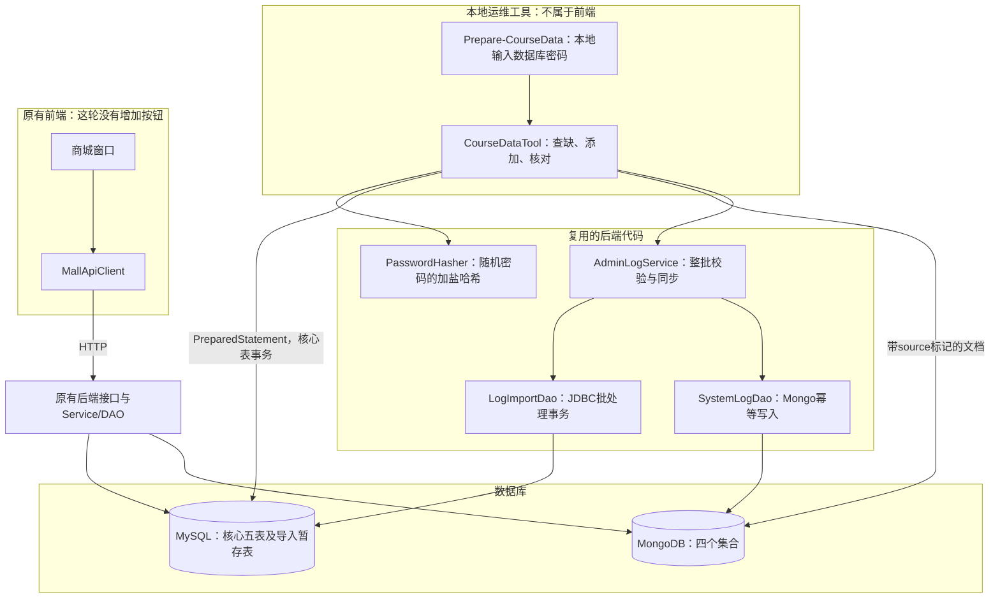

# 演示数据与索引测评：从业务功能进入课程验收

本批软件版本0.3.2。业务代码沿用0.3.1，新增数据准备工具、两个MySQL索引、独立性能测评和报告。唯一依据仍是上一级的《项目011_运动装备商城.docx》。不另起练习项目，不增加常驻服务。

## 为什么现在做这一步

之前已经完成注册、登录、档案、分类、商品、订单、评论、浏览、统计、日志与导入。课程还要求MySQL每表至少10条测试记录、MongoDB每集合至少20条、日志100+。只有一两件商品时，分页和排行虽然能运行，演示范围与性能证据都不足。

本批将两种数据分开：课程库放少量、明显标注的演示数据，便于在商城窗口展示；大量测评数据放临时实例，测完停止并移除。不能用临时库的6万条记录声称课程主库已达标。

## 本次到底改了哪一层

| 层次 | 文件与操作 | 目的 |
| --- | --- | --- |
| 前端 | MallDesktop、MallApiClient没有增加业务方法 | 原有商品分页、订单和统计窗口直接显示新增数据 |
| 后端业务 | 原有AdminLogService、LogImportDao、SystemLogDao被工具复用；业务规则未改 | 101条模拟日志仍经过JDBC批处理、PENDING暂存、Mongo同步及SYNCED确认 |
| 运维工具 | Prepare-CourseData.ps1 / .cmd；scripts/java/CourseDataTool.java | 在数据库操作者本地输入密码后添加数据、读回核对和再次运行检查；不是商城用户登录入口 |
| 数据库内容 | 六张MySQL表与四个Mongo集合 | 补明确标注的合成记录，不覆盖既有记录 |
| 数据库索引 | src/main/resources/sql/mysql_query_indexes.sql | 增加商品分类价格筛选、本人订单状态日期筛选的复合索引 |
| 测评 | scripts/Run-DataAndPerformance.py；scripts/java/PerformanceProbe.java | 创建独立实例，比较相同查询结果、执行计划和重复计时 |
| 构建入口 | pom.xml、Start-Backend.ps1、Start-Mall.vbs | 版本更新为0.3.2，原有0.3.1正在运行的窗口可以先保留 |



## 具体添加什么，为什么这样添加

1. 添加10个`course_demo_v1_u01`至`course_demo_v1_u10`普通账号。邮箱使用example.invalid，密码随机生成后只保留哈希，没有公开默认密码，也不自动创建或提升管理员。
2. 为这些账号添加10份档案，姓名、地址和notes明确标注课程演示。不会拿现有账号的个人资料充数。
3. 添加10个“【课程演示】分类”，第1个是根，其余挂在这个根下面；添加20件“【课程演示】运动装备”。每条记录使用实际分配的编号，不能假设自增编号连续。
4. 这些账号与商品之间创建20笔模拟订单。插入先为待处理，再按现有规则将部分转为已完成或已取消；金额来自当时的商品价格，遵守已有触发器。
5. 添加20份商品详情、40条明确写着模拟评价的评论、101条模拟VIEW浏览。BSON里的user_id/item_id/时长为Long，时间为Date，评论和浏览编号仍为ObjectId。
6. 通过原有日志导入Service导入101条模拟日志，类型固定IMPORT，操作标记COURSE_DEMO_V1。暂存表会真的经过批处理和同步，工具不直接伪造SYNCED。

模拟浏览会影响全站热门排行，因为原有统计包含符合条件的VIEW。商品名称带“课程演示”前缀，演示时需说明这是合成样本。现有真实账号的“我的订单/活动”按本人编号筛选，不会混入演示账号记录。模拟时间固定为2026-11-08前后，不会随每次重跑自动变成“今天”；之后七天窗口自然会让旧记录退出排行。

## 如何防止反复执行把数据库弄乱

SQL部分先根据保留名称查找，缺失才插入，不使用覆盖更新。核心表写入在一个事务里；中途失败会回滚这一部分。工具占用一个命名锁，避免两个工具同时新增相同演示记录。

Mongo部分以版本标记和序号计算稳定ObjectId，使用`$setOnInsert + upsert`。重复运行已有文档时保留原内容。日志批次也固定，复用0.3.1的幂等导入机制。工具实际执行两次，比较第二次前后数量。

SQL提交后才写Mongo，因此这不是一个跨MySQL/MongoDB的原子事务。若后半段失败，可能已经有完整SQL和部分Mongo文档，保留现场并重跑补齐；不会通过清库重做解决。已经由导入流程确认SYNCED、后来被人工删除的日志不会自动重建。

运行前后还会对当时已有的SQL记录与Mongo文档计算SHA-256指纹，只保存比较结果，不把原密码哈希、个人资料或日志正文写进报告。若同时有别的窗口改动数据，核对也可能提示变化，需要区分并发操作与工具行为。

## 两个索引是什么，改了什么

索引是数据库为查询另外维护的查找结构。就像书后的索引，它让数据库从符合某些条件的位置开始找。表里的业务字段没有因此变成另一套数据；新增、修改、删除记录时，数据库还要维护索引，所以索引也占空间并有写入成本。

新增：

```sql
idx_items_sale_category_price(status, category_id, price, item_id)
idx_orders_user_status_created(user_id, status, created_at, order_id)
```

第一条服务“在售 + 某分类 + 价格区间”的商品查询。第二条服务“某用户 + 某状态 + 创建日期区间”的订单查询。字段顺序来自实际查询条件，不是把所有字段都随意建索引。

工具先核对同名索引的列顺序与是否唯一；相同则保留，不同则报错，不擅自替换。SQL文件用于说明新定义，不应反复手工运行CREATE INDEX。InnoDB可能用新的复合索引支撑原有外键，并自动去掉冗余单列索引；外键约束仍保留。

本轮商品查询仍保留CASE排序。测评计划中还有Sort，不能声称新增索引消除了所有排序、提高了所有查询。SQL仍由原DAO参数绑定，前端不需要知道索引名称。

## 助手负责执行的事项

助手构建、运行临时实例测评、执行数据准备和索引配置、核对报告，并同步Gitee与GitHub。连接密码只能由你在本地不回显的窗口输入，不要发到聊天、写进脚本或提交仓库。主库实际是否完成，以`target/course-data/first.json`、`repeat.json`和进度表的核对记录为准。

工具入口是工程根目录的`Prepare-CourseData.cmd`。它不是每天启动项目都要运行的程序；第一次补齐后，正常启动数据库、后端和前端即可。需要复测时可重跑，但不会重置你后来编辑过的演示内容。

## 你接下来怎样观察这些变化

无需再做一轮机械命令验证。数据准备完成后，可以任选下面两条链路观察：

1. **商品浏览 → 选择课程演示分类 → 价格范围 → 翻页。** 前端把条件交给MallApiClient，后端ItemSearchService校验，再由ItemSearchDao绑定参数查询MySQL；新增索引只影响数据库如何找记录。
2. **数据统计 → 热门排行；商品评论 → 选择课程演示商品。** 后端读Mongo聚合，再结合MySQL商品名称显示。这里展示的是合成样本对统计的作用，不能解释为真实用户购买偏好。

DbGate可用下面SQL看到课程库实际总量。新建查询时确认连接是MySQL；左侧点击Mongo并不会改变已经打开的MySQL查询页。

```sql
SELECT 'users' AS table_name, COUNT(*) AS row_count FROM sports_mall.users
UNION ALL SELECT 'profiles', COUNT(*) FROM sports_mall.profiles
UNION ALL SELECT 'categories', COUNT(*) FROM sports_mall.categories
UNION ALL SELECT 'items', COUNT(*) FROM sports_mall.items
UNION ALL SELECT 'orders', COUNT(*) FROM sports_mall.orders
UNION ALL SELECT 'log_import_rows', COUNT(*) FROM sports_mall.log_import_rows;
```

MongoDB连接的sports_mall新建查询中，可分别运行：

```javascript
db.item_details.countDocuments({})
db.comments.countDocuments({})
db.action_logs.countDocuments({})
db.system_logs.countDocuments({})
```

每条单独执行即可，不需要在DbGate写mongosh的`use sports_mall`。这些手工查询是帮助你观察；自动工具已经做了数量、重跑和已有记录核对。

## 性能报告怎样读

见[性能优化报告](性能优化报告.pdf)及[文字源稿](性能优化报告.md)。先看“结果相同”再看速度：更快地给出错误结果没有意义。读计划时关注实际扫描行/文档数，再看重复测量的中位数；本机后台负载会使毫秒数波动。

这次覆盖两个MySQL查询和一个Mongo查询，不代表全系统性能。Mongo对照使用已有索引与强制扫描，不是本轮又新增一条Mongo索引。临时数据库的故障注入不会在你的课程主库执行。

复现入口为`python scripts/Run-DataAndPerformance.py`，前提是JDK、MySQL、MongoDB可执行程序位于当前本机配置路径。它会创建自己的临时目录和动态端口，拒绝使用课程主库端口，核对物理数据路径，最后停止自己的进程并移除数据目录，保留日志。一般复现由助手执行。
