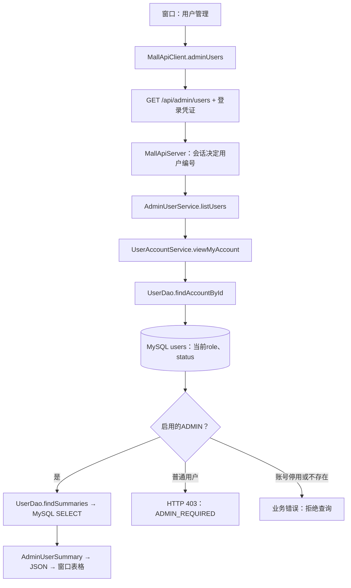

# 0.2.4：管理员权限与调用链实操

对应老师要求书的“用户与权限管理：注册、登录、角色权限”。本次增加管理员只读用户列表，接下来再做分类、商品维护。

## 本次分别改了哪些层

| 位置 | 代码改动 | 作用 |
| --- | --- | --- |
| 桌面窗口 | MallDesktop.showWorkspace、showAdminUsers | 为ADMIN显示导航，展示用户表格 |
| HTTP客户端 | MallApiClient.adminUsers | 携带已有登录凭证，发送GET /api/admin/users |
| HTTP后端 | MallApiServer增加路由，MallServices组装新Service | 从会话取得身份，调用业务方法，返回JSON |
| 后端业务 | 新增AdminUserService.listUsers | 先读取账号当前状态与角色，确认启用的ADMIN才查询列表 |
| 数据访问 | UserDao.findSummaries | 用PreparedStatement查询前100个账号，按主键排序 |
| 返回数据 | 新增AdminUserSummary | 只含编号、用户名、角色、状态 |
| MySQL结构 | 本次无需DDL迁移 | 使用已有users.role和users.status |
| MongoDB | 本次列表不查询MongoDB | 登录继续沿用原system_logs流程 |

功能本身只查询users。下面的注册会新增账号，初始化角色的UPDATE会修改这个账号的role。注册、初始化角色、查看列表是三个独立动作。



## 1. 打开本次版本

保留两个数据库的现有窗口。退出旧商城窗口，在旧后端窗口按Ctrl+C，再依次双击工程根目录Start-Backend.cmd和Start-Mall.vbs。

**原理与架构位置：**源码已构建成0.2.4的两个JAR。运行中的旧进程仍执行旧代码，重启后才加载新版本。更新的是客户端和业务后端，已有数据库继续保存原数据。MySQL连接密码由开发者在后端启动时输入；用户登录输入商城密码。

要自己重建时，在含pom.xml的工程目录执行：

```powershell
.\mvnw.cmd package
```

Maven编译源码并打包依赖，不导入SQL。以后再次构建同名JAR前应退出占用它的窗口与后端。

## 2. 在DbGate观察角色

在商城MySQL连接中新建查询并执行：

```sql
SELECT user_id, username, role, status
FROM sports_mall.users
ORDER BY user_id;
```

**原理与架构位置：**DbGate直接查询存储层。role为USER或ADMIN，status为1表示启用。商城角色是users表中的业务数据；MySQL的root是后端连接数据库使用的身份，两者分别服务用户权限和数据库连接。

保留原有mall_user01的USER角色。用这个账号登录时不会出现“用户管理”；后端也会拒绝USER直接调用管理接口，这个分支已加入隔离测试。

## 3. 通过已有注册功能建立演示账号

退出商城登录，在登录页点击“注册普通账号”：

- 用户名：mall_admin01。
- 邮箱：一个未在商城使用的邮箱，例如mall_admin01@example.test。
- 密码自己设置和保管；电话可留空。

注册后再执行第2步SELECT，应看到新账号的role为USER。如果用户名已经存在，先核对已有记录。

**原理与架构位置：**注册请求经过后端UserRegistrationService，生成密码哈希，再由UserDao插入users。公开注册固定创建USER，界面没有“自行注册成管理员”的入口。

## 4. 在DbGate初始化管理员角色

确认刚注册的账号后，执行：

```sql
UPDATE sports_mall.users
SET role = 'ADMIN'
WHERE username = 'mall_admin01'
  AND role = 'USER'
  AND status = 1;

SELECT user_id, username, role, status
FROM sports_mall.users
WHERE username = 'mall_admin01';
```

预期role变为ADMIN，status仍为1。首次满足条件时UPDATE影响1行；重复运行可能为0行，以SELECT读回为准。

**原理与架构位置：**这是课程本机环境中由开发者建立初始管理员的操作，直接修改已有字段的值。初始管理员需要由可信管理者指定；公开注册接口不接受自选角色。这个操作不改变表结构。

| username | 初始化前role | 初始化后role | status |
| --- | --- | --- | --- |
| mall_admin01 | USER | ADMIN | 1 |

## 5. 从按钮一路核对到SQL

1. 使用mall_admin01重新登录，左侧应出现“用户管理”。
2. 点击它，查看编号、用户名、角色、状态。
3. 和第2步的DbGate查询对照。
4. 查看后端窗口，应出现GET /api/admin/users、HTTP=200与处理耗时。

**原理与架构位置：**窗口发送HTTP请求，后端通过会话确定调用者，再查询users确认当前角色，最后执行列表SELECT。数据库结果经过JSON返回，表格负责显示。

接着打开src/main/java/com/sportsmall下的源码，按顺序只找一个入口：

| 顺序 | 文件 | 找什么 |
| --- | --- | --- |
| 1 | desktop/MallDesktop.java | showAdminUsers调用api.adminUsers |
| 2 | client/MallApiClient.java | adminUsers发送GET；request附加Authorization |
| 3 | server/MallApiServer.java | /api/admin/users分支，将会话中的user传给Service |
| 4 | service/AdminUserService.java | listUsers先读当前账号，判断ADMIN，再读列表 |
| 5 | service/UserAccountService.java | viewMyAccount读取本人并检查启用状态 |
| 6 | dao/mysql/UserDao.java | findAccountById、findSummaries及FIND_SUMMARIES |

列表SQL只取四个字段，按编号排序，LIMIT参数通过PreparedStatement绑定。这次没有事务写入；列表最多100条，分页在后续查询功能实现。

窗口根据登录时角色展示入口。后端每次读取数据库中的当前角色决定是否允许操作；即使管理员在登录后被降级，下一次请求也会被拒绝。重新登录则刷新窗口导航。

## 验证范围与下一步

自动验证使用独立临时双库，包含无登录拒绝、USER直接调用拒绝、自选角色拒绝、ADMIN读取、撤销角色、停用账号、恢复权限、返回字段与100条上限。没有调整课程主库中的任何角色。

2026-11-07用户提供三张主库截图：DbGate读回mall_admin01为user_id=2、ADMIN、status=1；商城用户列表显示普通用户1和管理员2；后端请求25、26均为GET /api/admin/users、HTTP200。因此管理员初始化和主库列表读取已确认。普通用户直接请求、角色撤销等异常分支仍以隔离测试证据为准。

下一步见分类树实操.md，让管理员经后端新增categories记录。
