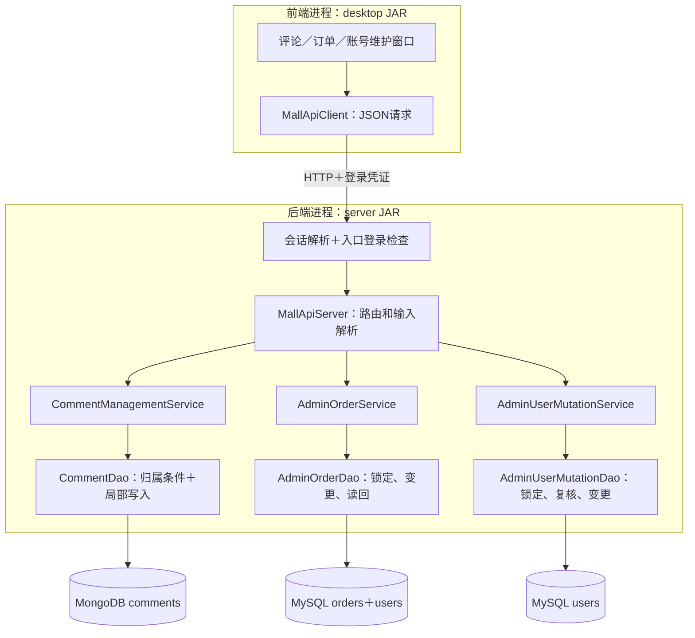

# 0.3.0：一次补齐三组维护功能

日期2026-11-08。按用户要求合并同类功能开发和验收，不再每个按钮单独交付。依据仍为老师的《项目011_运动装备商城.docx》，本轮承接MongoDB CRUD、MySQL业务维护、订单事务和权限边界。评论审核、管理员完成订单、账号启停/角色是本工程落实要求的业务选择，不声称老师逐项指定这些按钮。

上一轮0.2.9商品筛选分页已由用户确认完成。0.3.0窗口本轮待用户统一手操，自动接口检查不能代替这项反馈。

## 这次改动放在哪里

工程根目录为sports-mall，下面源码路径以src/main/java/com/sportsmall为起点。

| 分层 | 文件、方法或对象 | 本次改动与目的 |
| --- | --- | --- |
| 前端窗口 | desktop/MallDesktop.showManagedComments、editMyComment | 本人查看、修改、删除；管理员查看、删除；显示作者、商品编号、评分和标签 |
| 前端窗口 | MallDesktop.showAdminOrders、processAdminOrder | 用户编号、状态和日期联合筛选；管理员完成或取消待处理订单 |
| 前端窗口 | MallDesktop.editManagedUser | 修改目标账号的角色和启停状态 |
| 前端通信 | client/MallApiClient | 新增维护请求方法，把输入编码成HTTP请求，不连接数据库 |
| 后端入口 | server/RequestAuthentication.resolve、SessionStore.find | 解析会话身份并返回结果，不自行决定业务权限 |
| 后端入口 | MallApiServer.handle、requiresLogin、route | 统一判断路径是否必须登录，再识别请求路径/方法并解析允许字段 |
| 后端业务 | service/CommentManagementService | 本人归属、内容评分标签校验，管理员审核权限 |
| 后端业务 | service/AdminOrderService、AdminUserMutationService、AdminPermissions | 当前账号权限、目标编号和状态/角色范围校验 |
| 后端数据访问 | dao/mongo/CommentDao | 按_id和user_id共同匹配修改/删除；管理列表；局部更新 |
| 后端数据访问 | dao/mysql/AdminOrderDao | JDBC事务锁定账号、订单，改变状态并读回提交 |
| 后端数据访问 | dao/mysql/AdminUserMutationDao | JDBC事务锁定用户，复核操作者权限并更新目标账号 |
| MySQL | 既有users、orders及两个订单触发器 | 表结构、过程和触发器定义均未修改 |
| MongoDB | 既有comments | 可选新增updated_at日期字段；新增两个查询索引，不增加集合 |



图中Service读取当前账号的MySQL访问为简化未逐一连线。返回沿HTTP回到窗口，窗口刷新列表；终端日志记录请求状态和耗时，不把密码写进请求日志。

## 三组操作的代码链与规则

### 1. 评论维护

“商品评论→我的评论／修改删除”调用GET /api/me/comments。后端会话给出用户编号，CommentManagementService读取启用账号，CommentDao使用user_id查询最新100条，包含下架商品的历史评论。管理员GET /api/admin/comments读取最新100条全部作者评论。两个列表都有上限，不表示已返回所有历史记录。

点击编辑后，MallApiClient.updateComment发送PUT /api/me/comments/评论编号，正文仅含content、rating、tags。后端不接收新的作者、商品编号和创建时间。业务层校验文字最多2000字符、评分1至5、标签最多5个且每个最多20字符，去空白和重复标签。

DAO的实际写入条件为：

    {_id: ObjectId(评论编号), user_id: 后端当前用户编号}

更新内容仅为$set content、rating、tags、updated_at；不整份替换，不使用upsert。已有_id、user_id、item_id、created_at和额外字段保留。条件匹配与单文档修改在同一次操作中完成，避免先查归属再仅按_id写入。[MongoDB官方说明](https://www.mongodb.com/docs/drivers/java/sync/current/crud/compound-operations/)

本人DELETE /api/me/comments/编号也同时带归属条件。没有匹配返回deleted=false；修改不存在/不属于本人的评论会报错。删除后不会被一次迟到的修改重新新增。多个编辑先后提交时采用最后一次成功写入的内容，本轮没有增加版本冲突提示。

管理员仅开放DELETE /api/admin/comments/编号，不开放代替作者编辑。删除目标文档后，评分和数量聚合自然反映剩余评论。业务上的删除由点击确认触发，程序不会自动清理用户评论。

### 2. 管理员订单处理

列表GET /api/admin/orders接受userId、status、from、through，含首尾日期，显示符合条件的最新200条。普通“我的订单”仍严格限定本人。

点击完成/取消发送PUT /api/admin/orders/编号/status，正文仅含status。后端业务层确认ADMIN，再由DAO开始JDBC事务：锁定并复核当前管理员→锁定订单→确认状态仍为0→更新为1或2→读回→commit。失败则rollback。锁定读取用于协调同时处理同一订单的请求。[MySQL官方说明](https://dev.mysql.com/doc/refman/8.4/en/innodb-locking-reads.html)

这条链不修改订单归属、商品编号、金额或创建时间，既有数据库触发器继续保护历史字段和状态转换。两个请求同时争取同一待处理订单时，只能一个成功，另一个刷新后看到订单已结束。用户之后查看订单、账号汇总或月报即可看到完成/取消结果。

### 3. 管理员账号维护

用户管理选择账号后，PUT /api/admin/users/编号只提交role和status。USER/ADMIN两种角色，状态0停用或1启用。邮箱、密码哈希和其他资料不在这个接口里修改，也不物理删除账号。

业务层先读取当前账号；DAO又在写事务中复核角色/状态，防止排队期间权限已经撤销。为简化课程项目的并发规则，本轮按用户编号锁定用户行，串行处理管理员角色/启停修改。它适合当前小数据量演示，不能据此声称已经实现高并发账号管理。

不能停用或降级当前操作账号，至少保留一个启用管理员。停用账号的后续业务请求和新登录会被拒绝；重新启用后，尚未过期的原会话可能再次可用，本轮没有声称停用会永久撤销全部登录令牌。角色变化后，后端权限按当前数据库值执行；前端导航在重新登录后更新。

## 一次完成手操

1. 退出旧商城窗口，在旧后端窗口Ctrl+C。数据库保持运行；依次双击工程根目录Start-Backend.cmd和Start-Mall.vbs，脚本已指向0.3.0。

   目的：前端加载新按钮，后端加载新接口；使用原有课程数据，不重新建库。

2. 在工程根目录PowerShell执行一次评论索引增量脚本：

   ```powershell
   & "C:\develop\MongoDB\shell\bin\mongosh.exe" "mongodb://127.0.0.1:27017" --file ".\src\main\resources\sql\mongodb_comment_indexes.js"
   ```

   目的：为本人评论查询和管理员按时间查看添加索引。脚本只建索引，不填充或覆盖文档；不需要重跑包含演示详情的mongodb_init.js。MySQL本轮不需执行迁移。

3. 普通用户登录，“商品评论→我的评论／修改删除”：选择自己的现有演示评论，把评分改为4、文字改为“修改后的课程演示评论”，保存；查看商品评论统计，再删除这条演示评论并再次查看统计。想保留原评论时，可先通过已有入口另发一条演示评论。

   目的：一轮体验MongoDB的读取、修改、删除与聚合联动。在DbGate左上“商城MongoDB”下面右键sports_mall，选择New query/新建查询，进入这个新窗口执行以下代码。仅点击左侧数据库不会改变已有Query标签的连接；若错误出现MySQL server或SQL syntax，说明发到了MySQL窗口。把数字1替换为你的实际商城用户编号；这里不写mongosh的use命令：

   ```javascript
   db.comments.find({ user_id: 1 }).sort({ created_at: -1, _id: -1 })
   ```

   保存后观察content、rating、tags、updated_at变化，作者、商品和created_at保持；删除后选中文档消失。

4. 普通用户新建两笔演示订单；退出后用mall_admin01登录，在“订单管理”按普通用户编号和待处理状态筛选，一笔完成、一笔取消。回普通用户的“我的订单”与“我的月度订单”观察结果。

   目的：体验同一数据由不同角色通过不同接口维护，而金额来自下单时的历史快照。DbGate MySQL执行：

   ```sql
   SELECT order_id,user_id,item_id,amount,status,created_at
   FROM sports_mall.orders
   ORDER BY order_id DESC;
   ```

   检查两笔订单分别为1已完成、2已取消；金额没有被处理订单的操作改变。已结束的订单不能再次完成或取消。

5. 管理员“用户管理→修改角色／启停”：选普通用户，停用后尝试以该用户登录，应被拒绝；再由管理员启用。若要体验角色变更，可把演示账号升为ADMIN，重新登录查看导航，再由原管理员改回USER。

   目的：角色决定允许的后台业务操作，状态决定账号是否可用，两者分别保存。DbGate MySQL执行：

   ```sql
   SELECT user_id,username,role,status
   FROM sports_mall.users
   ORDER BY user_id;
   ```

   当前账号自停用/自降级会被后端拒绝。用户和关联订单、档案仍然保留。

6. 管理员“评论管理”选择另一条明确用于演示的评论并删除，用MongoDB查询和评分统计对照。界面不提供冒充原作者修改内容的按钮。

   目的：区分作者维护与管理员审核的业务权限。无需为每个按钮单独回报，完成三组后一次反馈即可。

## 验证和剩余工作

本轮324项JUnit、396项真实HTTP/临时双库检查通过。包含账号停用与角色撤销、他人评论越权、BSON字段保留、单文档更新删除并发、订单并发争抢、数据库规则拒绝后的回滚、SQL读回与月报联动。相比0.2.9新增16项JUnit和72项接口实库检查，其中5项JUnit为中断前已有身份解析改动的测试。

独立客户端子进程也通过本人评论读取，前端包中不含新增后端Service、DAO或数据库驱动。临时实例已退出并清理，自动检查没有改写课程主库。本轮新窗口与主库索引脚本仍待用户执行，不把接口检查写成GUI已经验收。

旧月报故障检查删除过程后会在finally恢复临时实例的原定义，避免影响后续完整业务链检查。

尚需继续：日志管理/导入与JDBC批处理、标注清楚的配额演示数据、执行计划与性能测试、正式故障/并发报告，以及最终PDF和答辩材料。现有PDF仍为0.2.3阶段快照，本轮不把它们标成已经更新。
